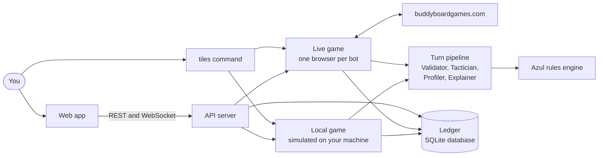
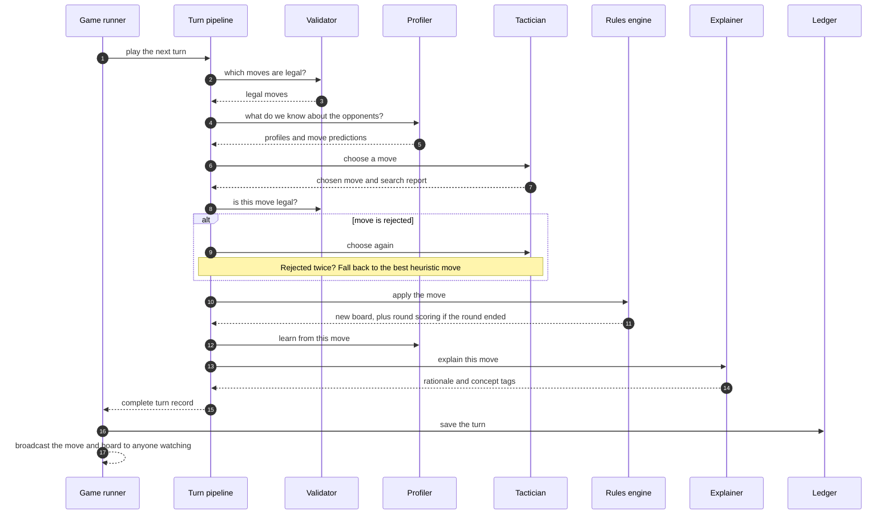
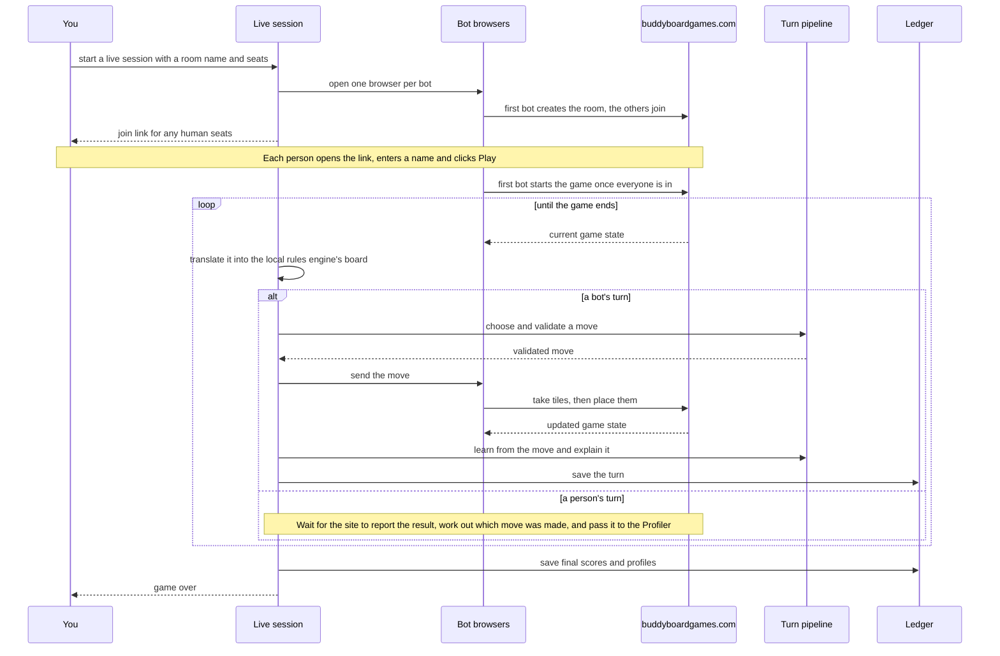

# TILES

TILES is a multi-agent system that plays the board game **Azul** and explains
every move it makes. Four specialised agents share the work on each turn: a
**Validator** that enforces the rules, a **Tactician** that picks the move, a
**Profiler** that learns how each opponent plays, and an **Explainer** that
says why the move was chosen.

It can play fast simulated games on your machine, or sit down at a real table
on [buddyboardgames.com](https://buddyboardgames.com/azul) by driving a
browser. Every game is recorded move by move, so you can watch it live, replay
it later, inspect the reasoning behind each decision, and run experiments that
compare the agents against each other.

*Built by AIS PT07 Capstone Group 1 for the Master of Technology in Artificial
Intelligent Systems, ISS, National University of Singapore.*

**Documentation:** [Architecture](docs/ARCHITECTURE.md) ·
[API reference](docs/API.md) ·
[Experiments and results](docs/EVALUATION.md) ·
[Web app guide](frontend/README.md) ·
[Backend guide](backend/README.md)

## Quick start

You need **Python 3.10 or newer** and **Node.js 18 or newer** on macOS or
Linux. On Windows, use WSL or the Docker route below.

```bash
./start.sh
```

Then open <http://localhost:5173>.

The first run takes a few minutes. The script creates a Python virtual
environment in `backend/.venv`, installs the backend, downloads the Chromium
browser used for live play, installs the frontend packages, and starts two
processes: the API on port 8000 and the web app on port 5173. Press `Ctrl+C`
to stop both. Later runs reuse what is already installed.

**Play your first game.** Go to **Sessions**, fill in the *New session* form
(leave the mode on *local* and pick a Tactician for each seat), and start it.
The app takes you to the **Monitor**, where you can watch the board, the move
log and the explanation for each move as the game is played.

### Manual setup

If you would rather run the two halves yourself, use two terminals.

Backend:

```bash
cd backend
python3 -m venv .venv
source .venv/bin/activate
pip install -e '.[dev]'
tiles serve
```

Frontend:

```bash
cd frontend
npm install
npm run dev
```

`tiles serve` starts the API at <http://127.0.0.1:8000> and keeps its database
in `db/tiles.db`, relative to the folder you run it from. `npm run dev` starts
the web app at <http://localhost:5173> and forwards its API calls to port 8000.

To run everything from a single process, build the web app once with
`npm run build`. `tiles serve` then serves it at <http://localhost:8000>
alongside the API.

For live play you also need the browser itself:

```bash
playwright install chromium
```

The backend has optional extras you can add to the `pip install` line, for
example `pip install -e '.[dev,llm]'`:

| Extra | Installs | You need it for |
|---|---|---|
| `dev` | pytest and plugins | running the tests |
| `llm` | the Anthropic SDK | LLM-written explanations and LLM rule extraction |
| `rl` | PettingZoo, Gymnasium | the reinforcement-learning environment |
| `telemetry` | MLflow | logging ablation runs to MLflow |
| `ml` | PyTorch | the sequence-model profiler in the evaluation scripts |

### Run with Docker

```bash
docker compose up tiles
```

This builds the web app, bundles it with the API, and serves both at
<http://localhost:8000>. The database lives in a Docker volume, so your games
survive a restart.

That image cannot play live games because it has no browser. For live play use
the larger image instead:

```bash
docker compose up tiles-live
```

Run one or the other, not both: they use the same port.

### Optional: LLM-written explanations

By default the Explainer writes its rationale from templates and needs no
network access. To have Claude rewrite those rationales in more natural
language, and to enable the LLM rule extractor, install the `llm` extra and set
your key before starting the server:

```bash
export ANTHROPIC_API_KEY=your-key-here
```

If the key or the package is missing, TILES quietly falls back to the template
text. The Docker images do not include the `llm` extra.

### Settings

| Variable | Read by | Default | What it does |
|---|---|---|---|
| `TILES_API_HOST` | `start.sh` | `127.0.0.1` | Address the API listens on |
| `TILES_API_PORT` | `start.sh` | `8000` | Port the API listens on |
| `TILES_UI_PORT` | `start.sh` | `5173` | Port the web app listens on |
| `TILES_API_PROXY` | the web app's dev server | `http://localhost:8000` | Where the web app sends its API calls. Set this too if you change the API port |
| `TILES_UI_DIST` | the API server | `frontend/dist` | Folder containing the built web app to serve |
| `ANTHROPIC_API_KEY` | the API server and CLI | not set | Turns on the LLM Explainer and LLM rule extractor |

## How it works

Azul is a tile-drafting game for two to four players. On your turn you take
all tiles of one colour from a factory or from the centre of the table and
place them on one of your pattern lines. Completed lines move onto your wall
and score points; tiles you cannot place fall to the floor and cost points.

TILES keeps its own complete implementation of those rules. Whether a game is
simulated locally or played on the live website, every move passes through the
same turn pipeline and ends up in the same database.



This section is the short version. For a walkthrough of every component, see
[docs/ARCHITECTURE.md](docs/ARCHITECTURE.md).

### The four agents

| Agent | Its job |
|---|---|
| **Validator** | The rules authority. It lists the legal moves and checks every proposed move against the rules engine. Nothing reaches the board without passing it. |
| **Tactician** | Chooses the move. Several are available, from a random player to tree search (see below). |
| **Profiler** | Watches every move and builds a picture of each player: which colours they favour, how often they take from the centre, how often they dump tiles on the floor, and so on. It labels each player with one of five play styles and predicts what they will do next. |
| **Explainer** | Turns the Tactician's own evidence (the options it compared, their scores, the line of play it expected) into a short rationale with tags such as `COMPLETES_LINE` or `BLOCKS_OPPONENT`. |

### What happens on each turn



The turn record that gets saved holds the board before and after the move, the
options the Tactician considered, the explanation, the opponent profiles at
that moment, the Validator's verdict and how long each step took. That record
is what powers the Monitor, Replay and Profiles views.

### Tacticians you can choose

| Name | How it plays | Main settings (default) |
|---|---|---|
| `random` | Picks any legal move at random. A baseline. | `seed` |
| `greedy` | Scores each legal move one step ahead using a weighted mix of points gained, progress on pattern lines, floor penalties, the first-player token, end-game bonus potential and denying opponents the tiles they need. | none |
| `minimax` | Alpha-beta search through the rest of the current round, assuming every opponent plays against it. | `depth` (3), `beam_width` (12) |
| `mcts` | Monte Carlo tree search guided by the same heuristic, looking across round boundaries. | `simulations` (300), `c_puct` (1.5), `time_budget_ms` |
| `mcts_profiled` | The same search, but when it imagines an opponent's turn it leans on the Profiler's prediction of what that particular opponent tends to do. | same as `mcts` |
| `human` | A seat for a real person. Live games only. | none |

The Profiler's five play styles are `aggressive_blocker`, `cautious_optimizer`,
`set_collector`, `greedy_scorer` and `risk_taker`.

## Playing live on buddyboardgames.com

In a live game the website deals the tiles and keeps the official score. TILES
opens one Chromium browser per bot, joins a room, reads the game state the site
sends over its WebSocket, and answers with moves. Each move is still checked by
the local Validator before it is sent.



Start one from the web app by choosing mode **live** in the *New session* form
and giving at least one seat the `human` Tactician if people are joining. Or
start one from the terminal:

```bash
tiles live --room tiles-demo --player Athena=mcts_profiled --player You=human --headed --db db/tiles.db
```

`--headed` shows the bot's browser window; leave it off to run invisibly. If
nobody joins a human seat within five minutes the game starts without them, and
if the room name is already taken TILES tries a new one and tells you which.

The full live-game loop, and how TILES talks to the site, is described under
[Running a game](docs/ARCHITECTURE.md#running-a-game) in the architecture
guide.

## The web app

| View | What you do there |
|---|---|
| **Dashboard** | See totals at a glance: games played, moves recorded, win rate per Tactician, how long decisions take, which play styles have been detected, and recent games. |
| **Sessions** | Set up a new game (local or live, two to four seats, a Tactician and its settings for each seat, Profiler, Explainer, random seed, pacing) and start, stop or delete existing ones. |
| **Monitor** | Watch a game as it happens: the board, scores, a move log grouped by round, round results, a system log, and a panel showing the rationale, the alternatives considered and the opponents' profiles for the selected move. |
| **Replay** | Step or auto-play through any recorded game at your own speed, with the same board and reasoning panel. |
| **Profiles** | Run the Profiler over a recorded game and read each player's play style, traits, colour and placement habits, score over time and how the detected style shifted during the game. |
| **Experiments** | Launch any built-in experiment with your own settings, watch its progress, and read the results as summaries, tables and charts. |
| **Rulebook** | Browse the Azul rulebook, search it, and see which rules TILES extracted from the text and whether each one matches the rules engine. |
| **Agents** | A diagram of the turn pipeline and a catalogue of every Tactician, Profiler and Explainer with its settings. |

Everything these views show comes from the API documented in
[docs/API.md](docs/API.md). To work on the web app's own code, see
[frontend/README.md](frontend/README.md).

## The command line

Installing the backend gives you a `tiles` command. With the quick-start setup
it lives in `backend/.venv`, so activate that environment first
(`source backend/.venv/bin/activate`).

| Command | What it does |
|---|---|
| `tiles serve` | Starts the API (and the built web app, if present). Options: `--host`, `--port`, `--db`. |
| `tiles play` | Plays one simulated game in the terminal, narrating each move. Add `--db PATH` to record it. |
| `tiles live` | Plays one game on buddyboardgames.com. Needs `--room`. |
| `tiles analyze` | Profiles the players of a recorded game (the latest one by default). |
| `tiles tournament` | Runs a round-robin between Tacticians and prints an Elo ladder. |
| `tiles ablate` | Compares `greedy`, `mcts` and `mcts_profiled` against a fixed opponent. |
| `tiles predict-eval` | Measures how well the Profiler predicts opponents' next moves. |
| `tiles verify-rules` | Extracts rules from the rulebook text and checks them against the rules engine. |
| `tiles experiment list` / `run` | Lists the built-in experiments or runs one. |

Players are described as `Name=tactician`, optionally followed by settings:

```bash
tiles play --player Athena=mcts_profiled:simulations=300 --player Bruno=greedy --seed 7
```

Run `tiles <command> --help` for the full list of options.

## Experiments

TILES ships with eight experiments. Each can be launched from the
**Experiments** view or from the terminal, and each stores its result in the
database so you can come back to it.

| Experiment | The question it answers |
|---|---|
| `profiler_ablation` | Does knowing the opponent's habits make the tree search win more often, and what does it cost in thinking time? |
| `prediction_accuracy` | How often does the Profiler correctly predict an opponent's next move, compared with simple baselines? |
| `archetype_discovery` | Can the five play styles be recovered from game data without being told the labels? |
| `tournament` | How do the Tacticians rank against each other? |
| `search_budget_sweep` | How much stronger, and slower, does the tree search get as it is given more simulations? |
| `rule_extraction` | How accurately can rules be extracted from the rulebook text? |
| `latency_profile` | How long does each step of the turn pipeline take, per Tactician? |
| `xai_coverage` | How many moves get an explanation, and does the stated main reason match the evidence? |

```bash
tiles experiment list
tiles experiment run profiler_ablation --param games=20 --param simulations=300
tiles experiment run tournament --param games_per_pair=6 --output elo.json
```

Settings for each experiment are
in [docs/EVALUATION.md](docs/EVALUATION.md).

## Repository layout

```
.
├── start.sh               one-command launcher for local development
├── Dockerfile             API and built web app in one image
├── Dockerfile.live        the same, plus Chromium for live play
├── docker-compose.yml
├── backend/
│   ├── pyproject.toml     package definition, the tiles command, optional extras
│   ├── tiles/             the Python package
│   └── tests/             pytest suite
├── frontend/              the React and TypeScript web app
└── docs/                  architecture, API reference and evaluation results
```

Inside `backend/tiles/`, these packages make up the app described above:

| Package | What it holds |
|---|---|
| `core/` | The Azul rules engine: board state, moves, legality, scoring, dealing |
| `agents/` | The Validator, Tacticians, Profiler and Explainer |
| `orchestration/` | The turn pipeline that runs the agents in order |
| `sim/` | Local games, tournaments and the ablation study |
| `engine/` | Live play: the site's message format, browser control, state translation |
| `ledger/` | The SQLite database of games, moves, rounds, profiles and experiments |
| `experiments/` | The eight experiments and the runner that tracks their progress |
| `rulebook/` | The Azul rulebook text, rule extraction, and verification against the engine |
| `server/` | The API the web app talks to |
| `telemetry/` | Optional logging of ablation runs to MLflow or a local file |
| `rl/` | An Azul environment for reinforcement-learning libraries |
| `cli.py` | The `tiles` command |

Each of these is explained in [docs/ARCHITECTURE.md](docs/ARCHITECTURE.md),
and [backend/README.md](backend/README.md) covers setting up the backend on its
own.

## Tests

```bash
cd backend
source .venv/bin/activate
pytest
```

The suite has around 500 tests across 52 files. It covers the rules of the
game, each Tactician, the Profiler, the turn pipeline, the database, the API,
every experiment, rule extraction, and the live-play loop against a simulated
site.

One test plays real games on buddyboardgames.com and is skipped unless you ask
for it with `pytest -m live`. Tests that depend on an optional extra are
skipped when that extra is not installed.

The web app has no tests of its own. `npm run build` in `frontend/` type-checks
it.

## Good to know

- **It is built for local use.** The API has no login and accepts requests
  from any origin. Do not expose it to the internet as it stands.
- **Running games live in memory.** If the server restarts mid-game, that game
  cannot be resumed. Finished games are unaffected: history, replay, profiles
  and export all read from the database.
- **Live play depends on a website the team does not control.** If
  buddyboardgames.com changes how it talks to its own pages, live play will
  need updating. Everything specific to the site is kept in
  `backend/tiles/engine/`.
- **Human moves in live games are observed, not logged.** They feed the
  Profiler, but only the bots' moves appear in the saved move log.

## Documentation

| Document | Read it when you want to |
|---|---|
| [docs/ARCHITECTURE.md](docs/ARCHITECTURE.md) | Understand how the system is put together, component by component, or add a new Tactician, Profiler, Explainer or experiment |
| [docs/API.md](docs/API.md) | Call the REST and WebSocket API yourself, or see exactly what the web app sends and receives |
| [docs/EVALUATION.md](docs/EVALUATION.md) | Look up an experiment's settings |
| [frontend/README.md](frontend/README.md) | Work on the web app's code |
| [backend/README.md](backend/README.md) | Set up and work on the backend on its own |
