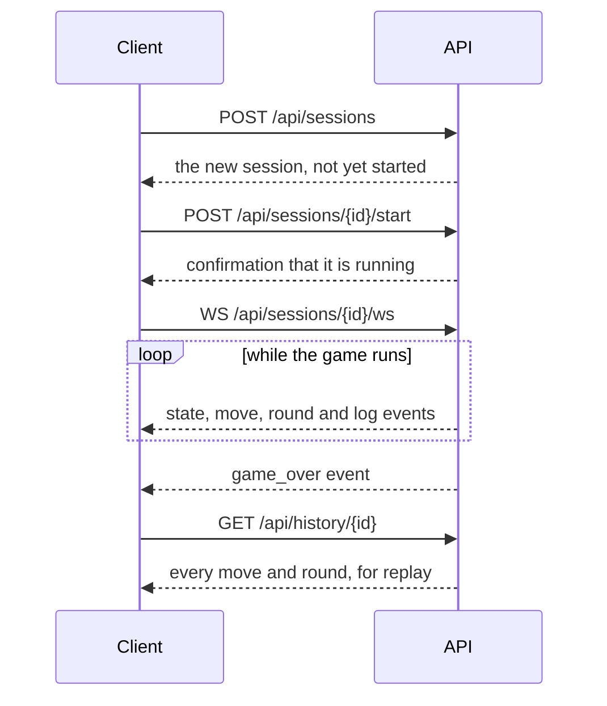

# TILES API reference

This is the API that `tiles serve` exposes and the web app uses. The code is in
`backend/tiles/server/`.

- **Base URL:** `http://localhost:8000`
- **Interactive docs:** `http://localhost:8000/docs`
- **Format:** JSON in and out
- **Authentication:** none. The API is meant for local use and accepts
  requests from any origin.

Errors come back with a `detail` message. `404` means the session or
experiment does not exist, `409` means it is in the wrong state for the
request, and `422` means the request body or parameters were not valid.

## How a game flows through the API



## Health and agent catalogue

| Method | Path | Returns |
|---|---|---|
| `GET` | `/api/health` | `status`, `version`, and two capability flags: `live_available` (the browser automation package is installed) and `llm_available` (an Anthropic API key is set). |
| `GET` | `/api/agents` | Every Tactician, Profiler and Explainer with a description and its parameters (name, type, default, range or choices), plus the Validator. The web app builds its forms from this. |
| `GET` | `/api/tacticians` | A flat list of Tactician names, with `human` added. Kept for older clients. |

## Sessions

A session is one game.

| Method | Path | What it does |
|---|---|---|
| `POST` | `/api/sessions` | Creates a session. It does not start it. |
| `GET` | `/api/sessions` | Lists sessions, newest first. |
| `GET` | `/api/sessions/{id}` | Returns one session in full, including its current board. |
| `POST` | `/api/sessions/{id}/start` | Starts a created session. |
| `POST` | `/api/sessions/{id}/stop` | Asks a running session to stop. |
| `DELETE` | `/api/sessions/{id}` | Deletes a session and its recorded moves. Stop it first if it is running. |
| `WS` | `/api/sessions/{id}/ws` | Streams the game as it is played. |

### Creating a session

```json
{
  "mode": "local",
  "players": [
    { "name": "Athena", "tactician": "mcts_profiled", "config": { "simulations": 300 } },
    { "name": "Bruno", "tactician": "greedy", "config": {} }
  ],
  "profiler": "basic",
  "explainer": "template",
  "seed": 7,
  "move_delay_ms": 0
}
```

| Field | Notes |
|---|---|
| `mode` | `local` (default) or `live`. |
| `players` | Two to four seats. Names must be unique. `tactician` is one of `random`, `greedy`, `minimax`, `mcts`, `mcts_profiled`, or `human` (live mode only). At least one seat must be a bot. `config` holds that Tactician's parameters; unknown or out-of-range values are rejected with `422`. |
| `profiler` | `basic` (default) or `null` to switch profiling off. |
| `explainer` | `template` (default), `llm`, or `null`. |
| `seed` | Optional. The same seed gives the same local game, including every Tactician's choices. |
| `move_delay_ms` | Pause between moves, to make a game watchable. Default `0`. |
| `live` | Required when `mode` is `live`: `room_name`, `platform_url` (default `https://buddyboardgames.com/azul`) and `headless` (default `true`). |

### Session fields

Every session response includes `id`, `mode`, `status`, `players`, `profiler`,
`explainer`, `seed`, `created_at`, `completed_at`, `scores` (by seat), `winner`
(seat index, or `null` for a game that was stopped or ended in a shared win:
equal score and equal completed rows), `winner_name`, `steps`, `rounds`, and for live games `room_name`
and `room_url`. The single-session response adds `state` (the current board),
`result`, `move_delay_ms`, `live` and `error`.

`status` is one of:

| Status | Meaning |
|---|---|
| `created` | Set up but not started. |
| `starting`, `running` | A local game is in progress. |
| `connecting`, `lobby`, `running` | A live game is opening browsers, waiting in the lobby, or in progress. |
| `completed` | Finished normally. |
| `aborted` | Stopped on request. |
| `failed` | Ended with an error. |
| `stalled` | A live game exceeded its move limit without finishing. |

### Session events

On connecting, the WebSocket first replays the most recent events (up to 500)
and then streams new ones. It only sends; it does not read anything from the
client. The socket is available only for sessions created since the server
last started.

| `type` | Other fields | Sent when |
|---|---|---|
| `status` | `status`; live games add `room_url`, `room_name` and, in the lobby, `waiting_for_humans` | The session changes state. |
| `state` | `step`, `state` | After the opening deal (`step` 0) and after every move. |
| `move` | `step`, `record` | A move has been made. `record` is the turn record described below. |
| `round` | `round`, `result` | A round has ended. `result` holds tilings, floor penalties, scores and any bonuses. |
| `game_over` | `winner` (`null` for a shared win), `scores`, `bonuses` | The game has finished. |
| `log` | `level`, `message`, `phase`, `player` | Something worth noting happened, mostly in live games. |

### The board (`state`)

| Field | Contents |
|---|---|
| `num_players`, `round`, `phase`, `current_player` | Where the game stands. |
| `factories` | A list of factories, each a list of tile colours. |
| `center_pool` | Tile colours in the centre, plus `firstPlayer` while the token is there. |
| `bag`, `lid` | Remaining tile counts per colour. |
| `players` | For each player: `name`, `score`, `wall` (5×5 booleans), `pattern_lines`, `floor_line`, `has_first_player_token`. |

Colours are `blue`, `yellow`, `red`, `black` and `white`.

### The turn record (`record`)

| Field | Contents |
|---|---|
| `step`, `round`, `player_index`, `player_name`, `tactician` | Who moved and when. |
| `action` | `source_type` (`factory` or `center`), `source_index`, `color`, `destination` (`pattern_line` or `floor`), `destination_row`. |
| `state_before`, `state_after` | The board on either side of the move. |
| `explanation` | `text`, `concepts` (tags), `evidence`. `null` if no Explainer is attached. |
| `report` | The Tactician's search report: `candidates` (best first, with scores), `simulations`, `elapsed_ms`, `used_opponent_model`, `notes`. |
| `profiles` | The other players' profiles as the Tactician saw them. |
| `validation` | `ok`, `violation` (which rule check failed, if any), `attempts`, and for live games `site_fallback`. |
| `timing` | `decide_ms`, `validate_ms`, `explain_ms`, `total_ms`, and for live games `execute_ms`. |

## History and export

| Method | Path | Returns |
|---|---|---|
| `GET` | `/api/history/{id}` | `session`, `moves` (every turn record) and `rounds`. This is what Replay uses. |
| `GET` | `/api/history/{id}/export` | The whole game as a downloadable JSON file. |

The export contains `export_version` (`"2.0"`), `session` (ID, mode,
configuration, status, timestamps, result), `summary` (the session fields
above), `rounds`, `moves` (turn records) and `profiles` (each player's final
profile).

## Profiles

| Method | Path | Returns |
|---|---|---|
| `GET` | `/api/profiles/archetypes` | The five play styles, each with a description and its trait signature. |
| `GET` | `/api/profiles/{id}` | The profiles saved when that game ended. |
| `POST` | `/api/profiles/{id}/analyze?profiler=basic` | Replays the game through a Profiler and returns, for each player, their profile, statistics and a timeline of how the profile developed. |

## Rulebook

| Method | Path | Returns |
|---|---|---|
| `GET` | `/api/rulebook` | The rulebook, split into sections. |
| `GET` | `/api/rulebook/search?q=...&k=5` | The `k` passages (1 to 20) most relevant to the query, with scores. |
| `GET` | `/api/rulebook/rules?extractor=deterministic` | The extracted rules, each marked `verified`, `mismatch` or `skipped` against the rules engine, with an overall accuracy. |

`extractor=llm` uses Claude when an API key is set. Otherwise the deterministic
extractor is used; the response's `extractor` field says which one actually
ran, and `requested` says which one you asked for.

## Statistics

| Method | Path | Returns |
|---|---|---|
| `GET` | `/api/stats` | Totals for the Dashboard: session counts by status and mode, total moves, experiment counts, games, wins, win rate and average score per Tactician, play-style counts, latency percentiles for each pipeline step, and the eight most recent sessions. |

## Experiments

| Method | Path | What it does |
|---|---|---|
| `GET` | `/api/experiments/types` | Lists the available experiments with their descriptions and parameter schemas. |
| `POST` | `/api/experiments` | Starts a run. Body: `{ "kind": "...", "params": { ... } }`. Unknown parameters are rejected. |
| `GET` | `/api/experiments` | Lists runs, newest first, without their results. |
| `GET` | `/api/experiments/{id}` | Returns one run with its `status`, `progress` and `result`. |
| `POST` | `/api/experiments/{id}/stop` | Asks a run to stop. |
| `DELETE` | `/api/experiments/{id}` | Deletes a finished run. |
| `WS` | `/api/experiments/{id}/ws` | Streams the run's progress. |

A run's `status` is `created`, `running`, `completed`, `failed` or `aborted`.
Its `result` has a `summary`, `metrics`, `tables` and chart `series`.

The experiment WebSocket sends four event types: `status`, `progress` (`done`,
`total`, `message`), `log` (`level`, `message`) and `result`. It replays the
run's history on connect, and it works for finished runs after a restart too.
