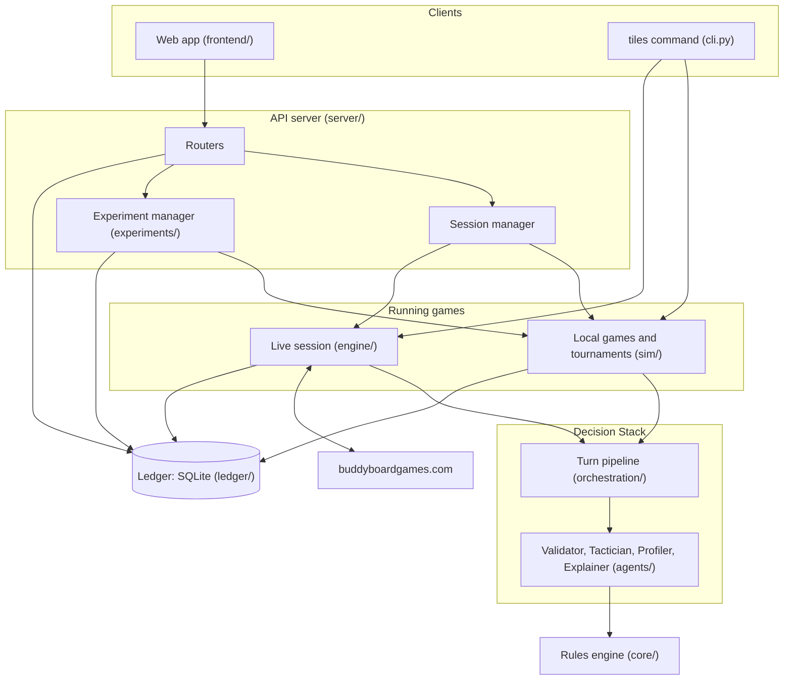
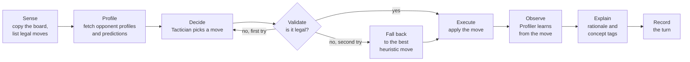
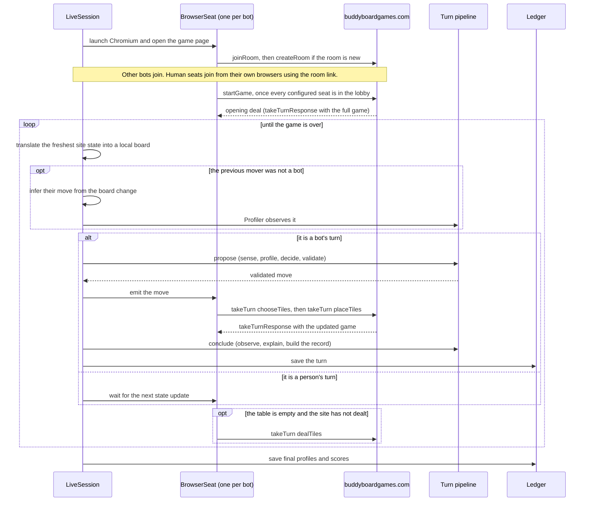
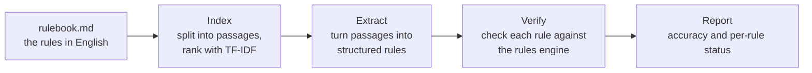

# TILES architecture

This document explains how TILES is put together. It follows the path a game
takes through the system, and names the part of the code responsible for each
step. All paths are relative to `backend/tiles/` unless they say otherwise.

If you only want to run TILES, the [README](../README.md) is enough.

## The big picture

A game is started either from the web app, through the API server, or directly
from the `tiles` command. Either way it is run by one of two game runners: a
local one that simulates the whole game, or a live one that plays on the
website. Both hand each turn to the same turn pipeline, which runs the four
agents, and both write the result to the same database.

## Design principles

1. **The local rules engine is the source of truth.** TILES never asks the
   website whether a move is legal. A deterministic engine (`core/`) owns
   legality, scoring and state transitions. In live play the website deals
   the tiles and keeps the official score, but every move is validated
   locally before it is sent.
2. **Agents are interfaces.** Each role sits behind a small contract
   (`agents/base.py`) and a registry, so a new Tactician or Profiler can be
   added without touching the pipeline, the server or the web app.
3. **Explanations come from evidence.** A Tactician must return a search
   report alongside its move: the candidates it compared, their scores, and
   the line of play it expected. The Explainer builds its text from that
   report. It does not invent a justification afterwards.
4. **Everything can be replayed.** Each turn produces a record with the board
   before and after, the validation result, the explanation and timings.
   Moves and rounds are only ever inserted into the database, never edited.

## The rules engine (`core/`)

| File | What it does |
|---|---|
| `state.py` | The board. Built to be copied cheaply during search: each wall is a 25-bit integer and tile pools are five-number colour counts. `to_dict()` gives the readable JSON form used by the database, the Explainer and the web app. |
| `actions.py` | A move, with a stable numeric ID in a fixed space of 300 (10 sources × 5 colours × 6 destinations). |
| `rules.py` | Legality as named checks (`wall_slot_open`, `line_color_matches`, `line_has_space`, and so on), scoring, end-of-round wall tiling, floor penalties, end-game bonuses, and `step()`, the single function that advances the game. |
| `simulator.py` | The random part: drawing from the bag, refilling it, dealing factories. Kept separate so search can re-deal on its own and live play can skip it. |
| `encode.py` | Flattens the board into a numeric vector for the reinforcement-learning environment. |

When a move is illegal, the engine says which named check failed. That is what
the Validator reports.

## The Decision Stack (`agents/` and `orchestration/`)

The turn pipeline (`orchestration/turn_graph.py`) runs the agents in a fixed
order. It is plain Python with no agent framework and no language model in the
decision path.

The pipeline exposes this in two halves so live play can put the website in the
middle: `propose()` covers sense to validate, and `conclude()` covers observe
to record. `run_turn()` does both, with the move applied in between, for local
games.

### Validator (`agents/validator.py`)

A thin layer over the rules engine. It lists the legal moves for the current
board, checks each proposed move, and keeps an audit trail of every check. If
the Tactician proposes an illegal move, the pipeline asks it once more; if the
second proposal is also illegal, the pipeline takes the top-ranked heuristic
move instead. An illegal move cannot reach the board.

### Tacticians (`agents/tacticians/`)

| Name | Approach |
|---|---|
| `random` | Uniform choice among the legal moves. |
| `greedy` | Scores each move one step ahead with a weighted heuristic (`heuristics.py`). The components are immediate points, line progress, near-completion, floor penalty, first-player token, end-game bonus potential, and denial (taking tiles an opponent visibly needs). The per-component breakdown is reused as evidence by the Explainer. |
| `minimax` | Depth-limited alpha-beta search within the current round, treating all opponents as playing against it. Only the most promising moves are explored below the root. |
| `mcts` | Monte Carlo tree search in the PUCT style. Move priors come from the heuristic, the tiles are re-dealt on each visit when a search path crosses into a new round, and positions are valued by short randomised playouts followed by the heuristic evaluation. |
| `mcts_profiled` | The same search with one change: at an opponent's turn, the prior is a 70/30 blend of the Profiler's predicted move distribution for that opponent and the heuristic. Search effort goes to the futures this particular opponent is likely to create. Without a Profiler attached it behaves like `mcts`. |

### Profiler (`agents/profiler/`)

| File | What it does |
|---|---|
| `features.py` | Turns each observed move into features and accumulates per-player traits: colour bias, how often they take from the centre, how often tiles land on the floor, how often they complete lines, denial, risk, bonus focus, and tempo. |
| `archetypes.py` | Five named play styles (`aggressive_blocker`, `cautious_optimizer`, `set_collector`, `greedy_scorer`, `risk_taker`). A player is assigned the style whose signature their traits are closest to, with a confidence. Also contains a small k-means implementation used by the archetype-discovery experiment. |
| `predictor.py` | Predicts an opponent's next move. Each opponent is modelled as weighing the same heuristic components differently, and those weights are adjusted whenever a prediction misses. Early in a game the prediction is blended with a neutral one and that blend fades as moves accumulate. |
| `basic.py` | The Profiler the app uses, combining the three above. |
| `analysis.py` | Replays a recorded game through a Profiler after the fact. This powers the Profiles view and `tiles analyze`. |

### Explainer (`agents/explainer/`)

| Name | Approach |
|---|---|
| `template` | Deterministic. Names the main driver of the decision (the largest weighted heuristic component), the margin over the runner-up, the search evidence and the opponent's profile, and attaches concept tags: `COMPLETES_LINE`, `BLOCKS_OPPONENT`, `BONUS_SETUP`, `FLOOR_SACRIFICE`, `TAKES_FIRST_PLAYER`, `FORCED`, `ENDGAME`. |
| `llm` | Produces the template explanation first, then asks Claude to rewrite it in two sentences. If the API key, the package or the call is unavailable, the template text is used unchanged. |

The Explainer runs after the move has been chosen and applied. It never
influences the decision.

## Running a game

### Local games (`sim/match.py`)

`MatchRunner` deals a new game, then loops: run one turn through the pipeline,
save the turn record, announce the move and the new board, and, when a round
ends, save the round result and deal the next round. At the end it saves each
player's final profile and the result. `sim/` also contains the round-robin
tournament with Elo ratings, the ablation study and the Profiler's
prediction-accuracy evaluation, all built on the same runner.

### Live games (`engine/`)

| File | What it does |
|---|---|
| `protocol.py` | Everything known about the site's message format: frame parsing, message types, payload builders, and how a room join link is built. |
| `browser_seat.py` | One Chromium browser for one bot. It joins the room, listens to the page's WebSocket, and sends moves through it. |
| `state_translator.py` | Converts the site's game object into the local engine's board and back, and infers which move another player made by comparing two successive boards. |
| `dom_snapshot.py` | Reads the board from the page itself. Used only as a fallback when the WebSocket state is not available. |
| `live_session.py` | The game loop that ties these together. |

A few behaviours worth knowing:

- The first bot in the seat list is the host. It creates the room and starts
  the game.
- A human seat has no browser on the TILES side. The person opens the room
  link, types a name and clicks Play. The host waits up to five minutes for
  the lobby to fill, then starts regardless.
- If the room name is already in use, the session retries with a new name and
  reports it.
- If the site rejects where a bot wanted to place its tiles, the bot places
  them on the floor instead, and the turn record notes that this happened.
- A person's moves are inferred and fed to the Profiler, but only bots' turns
  are written to the move log.

## Persistence (`ledger/`)

One SQLite database, opened in write-ahead mode. By default it is `db/tiles.db`
relative to wherever the server or command was started; `--db` overrides it.

| Table | Contents |
|---|---|
| `sessions` | One row per game: mode (local or live), configuration, status, timestamps, final result. |
| `moves` | One row per turn, holding the complete turn record as JSON. |
| `rounds` | One row per completed round: wall tilings, floor penalties, scores, bonuses. |
| `profiles` | Each player's final profile, saved when the game ends. |
| `experiments` | One row per experiment run: kind, settings, status, progress, result. |

Moves and rounds are insert-only. Session and experiment rows are updated as
their status changes, and a session or experiment can be deleted as a whole.

`telemetry/` is separate from the ledger. It gives the ablation study somewhere
to log runs: MLflow if it is installed, otherwise a local `experiments.jsonl`
file, or nowhere.

## Experiments (`experiments/`)

`registry.py` lists the eight experiment kinds, each defined in its own file
under `kinds/` with a parameter schema. `runner.py` validates the parameters,
runs the experiment on a background thread (or directly, from the command
line), saves progress and the final result to the ledger, and streams updates
to the web app. Every experiment returns the same shape of result: a summary,
metrics, tables and chart series. The web app generates each experiment's form
from its parameter schema, so a new experiment needs no frontend work.

What each experiment measures is described in
[EVALUATION.md](EVALUATION.md).

## Rule extraction (`rulebook/`)

This shows that the rules can be read out of the English rulebook, without
putting a language model anywhere near real-time play.

`ingest.py` builds the searchable index, `extract.py` produces structured rules
(with a deterministic extractor and an optional Claude-based one), and
`verify.py` checks every extracted rule against `core/`, either by comparing
constants or by probing the engine's behaviour. The extracted rules are checked
against the engine; they are never fed back into it. This is what the Rulebook
view, `tiles verify-rules` and the `rule_extraction` experiment show.

## The API server and web app

`server/app.py` builds the FastAPI application. `server/sessions.py` holds the
session manager, which keeps running games in memory, starts each one on its
own worker thread, and fans events out to WebSocket subscribers. The routers in
`server/routers/` are thin: they validate input and call the session manager,
the experiment manager or the ledger. If a built web app is present, the server
also serves it.

Because running games are held in memory, a server restart loses them. Recorded
history is unaffected.

The web app (`frontend/`) is a React and TypeScript single-page app with no
other runtime dependencies. It reads state over REST and follows live games and
experiments over WebSockets, with polling every few seconds as a backstop. Endpoint details are in [API.md](API.md).

## Reinforcement-learning environment (`rl/`)

`rl/azul_env.py` wraps the rules engine as a PettingZoo environment with a
300-entry action mask, so standard multi-agent RL libraries can train on it.
Rewards are the score change when a round is resolved, plus a win or loss bonus
at the end. Nothing in the app uses it; it is there for future training work.

## Extending TILES

| To add | Write | Register it in |
|---|---|---|
| A Tactician | A class with `decide()` that returns a move and a search report | `agents/tacticians/__init__.py`, and describe it in `agents/catalog.py` so the web app can show it |
| A Profiler | A class with `observe()`, `profile()` and `predict()` | `agents/profiler/__init__.py` and `agents/catalog.py` |
| An Explainer | A class with `explain()` | `agents/explainer/__init__.py` and `agents/catalog.py` |
| An experiment | A file in `experiments/kinds/` with a parameter schema and a `run()` | `experiments/registry.py` |
