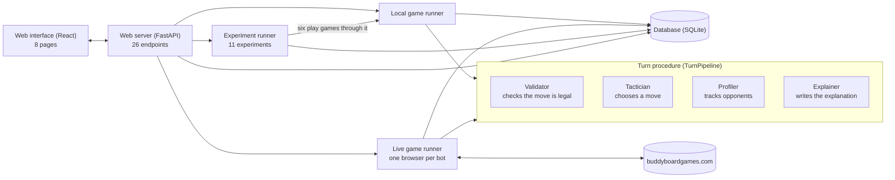
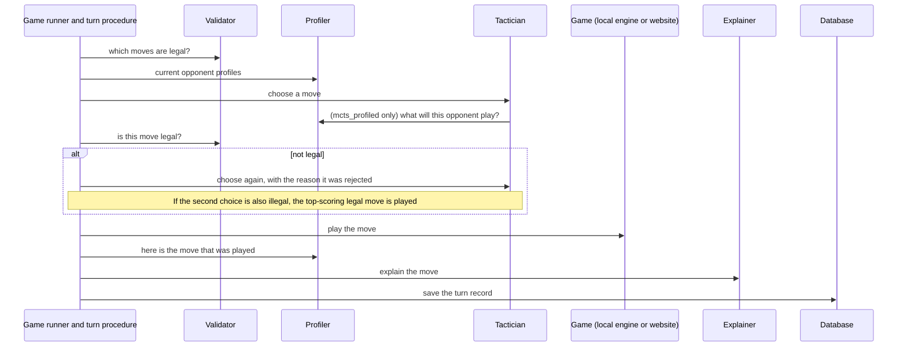
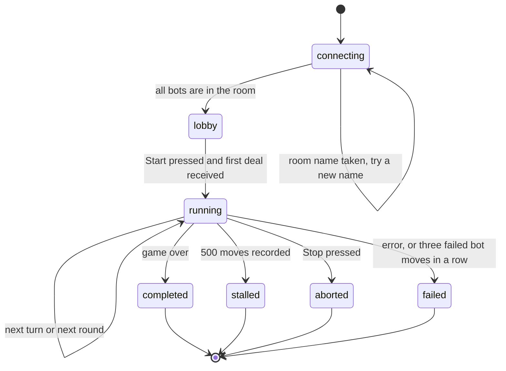

# TILES: Architecting an Explainable Multi-Agent System for Competitive Board Games

## A Case Study on Azul — Final Technical Report

**Master of Technology in Artificial Intelligent Systems**

**ISS Supervisor:** Zhengqing Hu

**Team members:** Chan Jing Rong (A0185806W) · Velu (A0314464H) · Johann Oh Hock Seng (A0314457A) · Brian Zheng (A0132097H) · Weiqiao Li (A0314458B)

---

## Abstract

TILES (Transparent Intelligence for Learning, Exploration and Simulation) is a system that plays Azul and tries to take the opponent's habits into account. Azul is a board game in which nothing is hidden: every tile and every player's board is visible to everyone. What a player cannot see is how the opponent likes to play, for example whether they block, take risks or build quietly. TILES is built from four parts, called agents. The **Validator** checks that a move is legal. The **Tactician** chooses a move, and comes in five versions that range from random play to one that tries out many possible continuations before choosing (a tree search). The **Profiler** watches each opponent, keeps statistics on how they play, labels them with one of five playing styles and guesses their next move. The **Explainer** writes a short explanation for each bot move. The same four parts are used for fast games on the team's own rules engine and for real games on buddyboardgames.com, where the bots play through automated web browsers. In a recorded game, every bot move is saved to a database with the board before and after, the explanation and the time taken, so that the game can be replayed and analysed.

The main results are as follows. Against bot opponents, the Profiler's first guess at the opponent's next move was right 87.8 % of the time, and the move was among its top three guesses 95.0 % of the time. A fixed guesser that never adapts scored 83.5 % and 93.5 %, and random guessing 17.2 % and 33.9 %. Five playing styles are defined. On new games played by five kinds of bot, the Profiler picked the intended style 46 % of the time. When styles that it tends to confuse are merged, leaving three broader groups, it picked the right group 71 % of the time. A rulebook reader looks up a fixed list of 19 rules in the team's own rulebook text file, and all 19 agree with the rules engine. This serves as a cross-check on the engine, where the rules the system plays by are written by hand. All 1,007 bot moves that were reviewed have an explanation. The system has played full games on the live website, including one that a person joined through an invite link. The main negative result is that giving the search the Profiler's guesses did not make it play better against bots. It won 98 % of its games against a blocking bot where plain search won 100 %, and in 230 games between the two, plain search won 119, the Profiler version won 96 and 15 were level, so it did not do better. It also gave no gain against four opponents with habits outside its model, where its guesses were a little less often right than a fixed guesser (70 to 89 % against 78 to 91 %). A second predictor that also learns colour, centre and row habits predicted one of them better than the fixed guesser, but did not improve play. Testing it against people is left for future work. A separate study varied the weights of the move score and the number of players. Ignoring the floor penalty costs about 8 points a game at every table size, and the first-player token is worth about 3 points at four players and nothing at two. Setting its value by table size lifts the win rate of the greedy Tactician at four players from 23 % to 31 %.

---


## 1. Introduction


### 1.1 Azul in brief

This section gives the minimum needed to read the rest of the report. Azul (Plan B Games, 2017) won the Spiel des Jahres in 2018 (Spiel des Jahres, 2018). Two to four players compete to build a mosaic of coloured tiles.

**Components.** There are 100 tiles, 20 in each of five colours, kept in a bag. Each player has a *wall* (a 5×5 grid, empty at the start), five *pattern lines* of lengths 1 to 5 to the left of the wall, and a *floor line* of seven slots. Each round, *factory displays* (5, 7 or 9 for 2, 3 or 4 players) are filled with four random tiles each from the bag. A shared *centre* area starts empty.

**A round has three phases.**

1. *Drafting.* Players take turns. On a turn, a player picks one factory (or the centre) and one colour, and takes every tile of that colour there. If a factory was chosen, its remaining tiles move to the centre. The player places the taken tiles on one pattern line, or on the floor. A line holds a single colour, and it cannot take a colour already on the matching row of the wall. Tiles that do not fit go to the floor. The first player to take from the centre in a round also takes the *first-player token*, which fills a floor slot but gives first pick next round. Drafting ends when all factories and the centre are empty.
2. *Wall tiling.* Each full pattern line moves one tile onto the wall row of the same number. The other tiles of that line are discarded.
3. *Scoring.* A tile placed on the wall scores 1 point if it touches no other tile. Otherwise it scores 1 point for each tile in its connected horizontal run plus 1 for each tile in its connected vertical run (counting itself in each run that has at least two tiles). Floor tiles then cost 1, 1, 2, 2, 2, 3 and 3 points in order. The score cannot go below zero.

**End of game.** The game ends after the round in which some player completes a horizontal wall row. Bonuses follow: 2 points per complete row, 7 per complete column, 10 per colour with all five tiles on the wall. The highest score wins.

**Why it is hard.** A turn is a choice of where to take tiles from, which colour, and where to put them. At the start of a round there can be as many as 120, 168 or 216 options for 2, 3 and 4 players (5, 7 or 9 factories, up to 4 colours on each, and 5 pattern lines or the floor as the destination). The number shrinks quickly as factories empty and lines fill. In a one-off measurement over 30 random games per player count, the rules engine counted an average of 23.5, 32.4 and 42.6 legal moves per turn, and the most it saw on any turn was 186 (in a four-player game). Those averages are in the same range as the 35–38 moves per position quoted for chess (Chessprogramming Wiki, n.d.), lower with two players and higher with four. So the number of choices is not what makes Azul hard. Three other things do. A move has consequences later in the game, through how tiles sit next to each other on the wall and through the end-game bonuses. Each round starts with a random deal, so a program cannot plan across rounds with certainty. And the best move depends on what the opponents are collecting and blocking.

### 1.2 Why Azul was chosen

1. **Nothing is hidden, so the open question is the opponent.** Because the whole board is visible, the project can study how to read an opponent without also having to guess at hidden cards, as a poker program must.
2. **The rules are small enough to code exactly, and the game is rich enough to need look-ahead.** The rules engine is under 1,000 lines. A bot that simply takes the best-looking move beats random play, and a bot that searches ahead beats that one (Section 10.4), so there is a measurable range of skill.
3. **The rules are written in plain language.** The rulebook is short and well structured, which makes it a workable source for the rule-reading part of the project, and whatever is read can be checked against the engine.
4. **Players visibly interfere with each other.** Blocking, taking a penalty on purpose and setting up bonuses are all choices that show up in the moves, which gives a profiler something to measure.
5. **There is a public online version.** buddyboardgames.com let the team test the bots on a site it did not write, and against a person.
6. **A gap in earlier work.** An open-source Azul bot that uses tree search exists (Yau, 2020). It does not model its opponents or explain its moves, which is what this project adds.


### 1.3 The imperfect-profile framing

Chess programs are now stronger than the best human players (Zhang et al., 2025), and AlphaGo defeated a world champion at Go (Silver et al., 2016). Both work by searching for the best move against a strong opponent. In Azul the best reply also depends on the habits of the particular opponent. The team calls this an *imperfect-profile* setting: the state of the game is fully visible, but the opponent's profile (their strategy, appetite for risk and favourite tactics) is not, and it changes what the best move is. A program in this setting has to work out the profile from the moves it sees, and adapt.

### 1.4 Problem statement

The project asks whether a program made of separate, cooperating parts can play a scored, turn-based game well, adapt to the opponent in front of it, and say why it made each move. The brief set four tasks: read rules from text, predict and profile opponents, search for good moves within a time limit, and give a reason for each decision that can be checked afterwards. The parts should also be replaceable, so that a better version of one can be added without rewriting the others.

### 1.5 Scope and deliverables

The proposal committed the project to the following areas. The table uses the proposal's own wording.


| Area                | Commitment in the proposal                                                                                  |
| ------------------- | ----------------------------------------------------------------------------------------------------------- |
| AI / ML / DL        | Rule extraction, opponent modelling, profiling; exploration of transformer, RL and probabilistic approaches |
| NLP                 | Automated rulebook understanding via Retrieval-Augmented Generation; unstructured text to structured rules  |
| Explainable AI      | Transparent profiling, interpretable decision pathways, human-centred evaluation                            |
| Data science        | Feature engineering from gameplay data; clustering and classification into archetypes                       |
| Systems engineering | Modular agent-of-agents architecture with specialised agents                                                |


The deliverables were a working prototype; a rule extraction module with an accuracy benchmark; an opponent modelling module with prediction accuracy compared against baselines; an opponent profiling module that identifies 3–5 player types; an explainability dashboard; and a documented repository, a technical report and a demo.

The final system approaches these areas with methods chosen to be simple, repeatable and easy to inspect: rules written by hand in an engine and cross-checked against the team's rulebook text, a tree search for choosing moves, a small opponent model that adapts during a game, and explanations built from templates. Sections 3 to 9 describe each one, and Section 11 sets out what is left for future work.

### 1.6 Contributions

1. **A rules engine of the team's own.** An early prototype relied on the live website to run the game. TILES has its own rules engine, so games can be simulated, searched and tested without the website. In a live game the website still runs the game and has the last word; the engine is used to check each bot move before it is sent and to look ahead.
2. **One turn procedure for both kinds of game.** The same code chooses, checks and explains a bot's move, and builds the record of it, whether the game is local or on the website. Only the step that actually plays the move differs.
3. **An opponent model whose accuracy and limits are measured**, with a set of experiments that can be re-run from the command line.
4. **A written explanation for each bot move**, built from the scores recorded when the move was chosen and saved with the move in recorded games.
5. **Live play on a website that changed during the project.** The site changed its message format during the project. The code that talks to it was updated and games were played on it, including one against a person.
6. **A negative result.** Search that uses the opponent model did not beat plain search against bots. The report gives possible explanations, which have not been tested, and a plan for testing on people.

---


## 2. System architecture


### 2.1 Overview




TILES has six main pieces.

- A **web interface** (React) with eight pages for setting up games, watching them live, replaying them, looking at opponent profiles, running experiments and browsing the rulebook.
- A **web server** (FastAPI; Ramírez, n.d.) that starts and stops games and experiments and pushes live updates to the browser.
- Two **game runners**. The local runner plays a game entirely on the team's rules engine. The live runner plays on buddyboardgames.com and controls one web browser per bot.
- The **turn procedure**, a single piece of code (`TurnPipeline`) that both runners call for every bot move. It calls the four agents in a fixed order.
- An **experiment runner** that runs any of eleven predefined experiments in the background.
- A **database**, a single SQLite file that the code calls the ledger, where games, moves and experiment results are stored.


### 2.2 Design principles

1. **The project has its own rules engine.** The code in `tiles/core/` decides what is legal, how a move changes the board and how a round is scored. Local games and all experiments run on it alone. In a live game the website deals the tiles, keeps the score and has the last word on every move; the engine is used to check a bot's move before it is sent, to look ahead, and to work out what a human player did.
2. **The agents can be swapped.** The Tactician, Profiler and Explainer are each defined by a small common interface (`tiles/agents/base.py`) and looked up by name. A new version can be added by registering it under a name, without changing the game runners, the server or the web pages. For the web pages to show a description and a settings form for it, it also needs an entry in `tiles/agents/catalog.py`. In the application there are five Tacticians, one Profiler and two Explainers. A second predictor, used only in one experiment, is described in Section 6.5. The Validator is a single fixed class.
3. **Explanations are built from recorded numbers.** When a Tactician picks a move it also returns a short list of the moves it considered and their scores. The Explainer writes its text from that list, and the list is saved with the move so that the two can be compared later (Section 7.4).
4. **Recorded games keep every turn.** Each bot turn produces one record holding the board before and after, the move, the result of the legality check, the explanation, the opponent profiles and the timings. Games started from the web interface are always saved. Games started from the command line are saved when a database is named. The games played inside experiments are not saved move by move; only the experiment's summary result is stored, in the same database.


### 2.3 What happens on each turn




The agents are not wired to each other. The turn procedure calls each one and passes the results along. There is one exception: for the `mcts_profiled` Tactician, the turn procedure hands over the Profiler's guessing function, and the search calls it directly for each opponent position it looks at.

The procedure has two halves. The first (`propose()`) lists the legal moves, fetches the opponent profiles, asks the Tactician for a move and checks it. The second (`conclude()`) runs after the move has been played: it shows the move to the Profiler, asks the Explainer for an explanation and assembles the turn record. In a local game the two halves run in one call, with the move applied on the rules engine in between. In a live game the live runner calls the first half, sends the move to the website, waits for the site's updated board and then calls the second half. In both cases it is the game runner that saves the finished record to the database.

If the Tactician proposes an illegal move, it is asked once more and told which rule it broke. If the second attempt is also illegal, the procedure plays the top-scoring legal move instead. The Tacticians in the repository always choose from the list of legal moves, so this path is only exercised by tests.

A human's move in a live game does not go through this procedure. It is worked out afterwards by comparing the board before and after (Section 8.3).

### 2.4 What is per player and what is shared

Each bot seat has its own Tactician. A human seat has none. Each game has one Validator and, unless they are switched off, one Profiler and one Explainer, shared by all players. The Profiler watches every player in the game and keeps separate statistics for each. The database is shared by all games on the server.

### 2.5 User interface


| Page        | What it is for                                                                                                                                                                                   |
| ----------- | ------------------------------------------------------------------------------------------------------------------------------------------------------------------------------------------------ |
| Dashboard   | Totals across the database: games, moves, experiments, win rate per Tactician, how long decisions take, counts of playing styles, recent games                                                   |
| Sessions    | Set up a game with 2–4 seats (any Tactician and its settings, or a human seat in a live game), and choose the Profiler, Explainer, random seed and pacing; list, start, stop and delete games    |
| Monitor     | The live board, the list of moves grouped by round with timings, round summaries, a system log, the room name and invite link (live games), and the explanation panel                            |
| Replay      | Step through or auto-play any recorded game with the same board and explanation panel; export it as JSON                                                                                         |
| Profiles    | Run the Profiler over a recorded game: playing style and confidence, nine traits, which colours, sources and rows the player used, score over time, and how the style label changed move by move |
| Experiments | Start any of the eleven experiments with chosen settings, watch progress, read the summary, numbers, tables and charts, export as JSON                                                           |
| Rulebook    | Browse the rulebook, search it, and see the extracted rules and whether each agrees with the engine                                                                                              |
| Agents      | A diagram of the steps of a turn showing which agent handles each, and a list of the Validator and the available Tacticians, Profilers and Explainers with their settings                        |


The charts are drawn directly as SVG without a charting library. The server's interface is documented in `docs/API.md`.

---


## 3. Game engine and Validator


### 3.1 How the game is stored

The engine keeps its own copy of the Azul table: what is on each factory, in the centre, in the bag and in the discard pile, and what is on each player's board (`tiles/core/state.py`). Internally this is stored compactly. Each wall is 25 yes/no flags packed into one number, and each pile of tiles is five counts, one per colour. This matters because the search copies the board hundreds to thousands of times per move. A converter turns the compact form into readable JSON and back, which is what the database and the web pages use. The constants follow the rulebook: 20 tiles of each colour (100 in all), floor penalties of 1, 1, 2, 2, 2, 3 and 3 points, and 5, 7 or 9 factories for 2, 3 or 4 players.

### 3.2 Numbering the moves

A move is "take all tiles of one colour from one place and put them on one pattern line or the floor". There are at most 10 places to take from (nine factories and the centre), 5 colours and 6 destinations, so every possible move can be given a fixed number from 0 to 299. The Profiler uses these numbers to label its guesses. The engine can also produce a list of 300 yes/no flags marking which moves are currently legal. That list is there for a future learning agent, and the practice environment built for one (`tiles/rl/`, Section 11) already uses it.

### 3.3 Rule checks

Whether a move is legal is decided by one function, `check_action`. It has eight checks, applied in a fixed order, and stops at the first one that fails. Each check has a name, and a failed check returns that name with a sentence saying what was wrong. Not every check applies to every move: the factory check is skipped when tiles come from the centre, and the four pattern-line checks are skipped when the tiles go straight to the floor.


| Check                | The question it asks                                     |
| -------------------- | -------------------------------------------------------- |
| `phase_is_drafting`  | Is the game still in the tile-taking phase?              |
| `color_exists`       | Is this a real colour?                                   |
| `source_exists`      | Does this factory exist?                                 |
| `source_has_color`   | Does the chosen place hold any tiles of that colour?     |
| `dest_exists`        | Does this pattern line exist?                            |
| `wall_slot_open`     | Is that colour still missing from the matching wall row? |
| `line_color_matches` | Is the line empty, or already holding this colour?       |
| `line_has_space`     | Does the line have room for at least one more tile?      |


The same eight names are used as labels by the rulebook reader (Section 4). The rest of the engine applies a move to the board, scores the end of a round (moving tiles to the wall, scoring them against their neighbours, charging floor penalties without letting a score fall below zero, and passing on the first-player token) and adds the end-game bonuses of 2 per row, 7 per column and 10 per colour. Dealing the next round is kept separate, because in a live game the website does the dealing. (In the code these are `apply_action`, `resolve_round`, `end_game_bonuses` and `step()`, which applies a move and scores the round if the move ended it.)

### 3.4 Validator

The Validator (`tiles/agents/validator.py`) is a thin layer over those checks. It answers two questions: which moves are legal, and is this particular move legal. It keeps no history of its own. The turn record notes that the move passed and how many attempts it took.

In a live game there is a second, separate safeguard. The website can itself refuse a move. If three bot moves in a row fail, the live runner stops the game with an error instead of retrying for ever, and a game started from the web interface is then shown as failed. The stopping is tested against a stand-in for the website (Section 8.4).

### 3.5 Testing

The engine tests play full random games with 2, 3 and 4 players and check after every move and every deal that all 100 tiles are still accounted for. Separate tests cover scoring, wall tiling, floor penalties, bonuses and the end of the game. There are 16 engine tests in `tests/test_rules.py`. Across the whole project there are 176 backend test cases and 137 frontend test cases (the frontend tests cover the web pages and components); some tests run several times with different inputs, and each run counts as one case.

---


## 4. Rule extraction from the rulebook

The rules that TILES plays by are written by hand in the engine (Section 3). This part of the project cross-checks that engine against the written rules. It looks up a fixed list of 19 rules in a rulebook text file and confirms that each one agrees with the engine. It runs separately from play and has no part in choosing or checking moves during a game. The code is in `tiles/rulebook/` and works in three steps.

1. **Split and search** (`ingest.py`). The rulebook (`rulebook.md`) is the team's own write-up of the Azul rules in English, in 14 numbered sections. The program cuts it into its sections (plus the short introduction under the title) and, for sections longer than three sentences, also into overlapping groups of three sentences. To search, it scores each piece by the words it shares with the query, counting rarer words for more. This is a standard keyword-matching method (TF-IDF with cosine similarity; Salton & Buckley, 1988). It returns passages that are already in the file. This is the retrieval half of a technique called retrieval-augmented generation (Lewis et al., 2020), in which a program finds relevant passages and a language model then writes an answer from them. In TILES the passages go to the pattern step below. The search is available on the Rulebook page and as `GET /api/rulebook/search`.
2. **Extract** (`extract.py`). The team listed 19 rules in advance. For each one it wrote a search phrase and a text pattern, which is a fixed piece of wording the passage must contain, with gaps where numbers go. The program runs the search and takes the first of the top six passages that fits the pattern. For seven rules it copies numbers out of the passage: the floor penalties, the bonus values, the number of factories, the tile supply, the tiles per factory, the score for a lone tile and the minimum score. For the other twelve it only confirms that one or more key phrases are present. Each result is stored as a structured rule with an id, the rulebook section and text it came from, a type, any numbers found and, for constraints, the name of the matching engine check from Section 3.3. The three types are scoring (how points are counted), flow (how the game is set up and proceeds) and constraint (what a player may not do). The id, type and check name come from the team's list; they are not read from the text.
3. **Check** (`verify.py`). Each rule is compared with the engine, which is treated as correct. For the seven rules with numbers, the numbers must equal the engine's. For the eight constraint rules, the program sets up a small illegal position and confirms that the engine rejects it for the reason given on the team's list. For the remaining four (first-player token, end of game, refilling the bag, tie-break) it confirms that the engine behaves as the rule says. In these twelve checks the text supplies the key phrase and the check is a hand-written test of the engine.

The 19 rules are four scoring rules (floor penalties, end-game bonuses, scoring a placed tile, score never below zero), seven flow rules (number of factories, tile supply, filling the factories, first-player token, end of game, refilling the bag, tie-break) and eight constraints, one for each engine check. All 19 pass (Section 10.5).

The check is a consistency test between three things the team wrote: the rulebook file, the text patterns and the engine. Its job is to catch a later change that makes them disagree, such as an edit to one of the seven sets of numbers or a change in how the engine behaves on any of the 19 points. One of the tests changes an extracted column bonus from 7 to 8 and confirms that the check fails. The check covers the 19 listed rules; a rule that is not on the list is outside it. If a pattern stops matching the text, that rule drops out of the count instead of being reported as a mismatch, and a separate test that requires all 19 to be found would fail.

There is also an optional extractor that uses a language model. When it is selected and an access key for Claude, Anthropic's language model, is configured, the whole rulebook and the list of 19 rule ids are sent to Claude in one request, the reply is read into the same structure, and it goes through the same checks. If the request fails for any reason, the pattern-based result is used instead. No results from this path are reported here.

---


## 5. Tacticians: choosing a move

A Tactician is the part that chooses a move. All five versions have the same interface. They are given the board, the list of legal moves and a random seed (a number that fixes the sequence of "random" choices, so that the same game can be replayed exactly). They return a move together with a report of what they considered. One of them is also given the Profiler's guess about what each opponent will do (Section 5.4).

### 5.1 The move score (`heuristics.py`)

Much of the system leans on one simple way of scoring a single move. It looks only at the board as it is now, with no look-ahead, and adds up seven parts, each multiplied by a fixed weight.


| Part             | What it measures                                                                                                                                                   | Weight |
| ---------------- | ------------------------------------------------------------------------------------------------------------------------------------------------------------------ | ------ |
| Immediate points | If the move completes a pattern line, the points the tile would score on the wall as it stands now                                                                 | 3.0    |
| Line progress    | The share of the pattern line that this move fills                                                                                                                 | 1.0    |
| Near completion  | Extra credit when the line ends at least half full but not complete                                                                                                | 0.8    |
| Floor penalty    | Penalty points for everything the move puts on the floor: tiles that do not fit, tiles sent there on purpose, and the first-player token (counts against the move) | 1.2    |
| First player     | Taking the first-player token                                                                                                                                      | 0.7    |
| Bonus potential  | If the move completes a line, how close the tile's row, column and colour will then be to an end-game bonus                                                        | 0.6    |
| Denial           | Taking tiles that an opponent's part-filled line needs: the number of tiles taken, multiplied by how full that line already is                                     | 0.4    |


This score is used in several places. The greedy Tactician plays the move with the highest score. Minimax uses it to decide which moves to look at. The tree search uses it as a first hint about which moves are promising, and to play out imagined games quickly. The Profiler's next-move guesser is the same score with the weights adjusted for each opponent (Section 6.3). The Explainer has one stock phrase for each part (Section 7.1). Changing the weights also gives bots with different habits, which is how the test opponents in Section 10 are made.

A second, separate function (`evaluate_state`) estimates how well a player is doing in a whole position. It takes the player's current score, adds credit for full and part-full pattern lines and for a share of the end-game bonuses already earned, subtracts floor penalties, and compares the total with the best opponent's. The look-ahead Tacticians use it to judge the positions they reach.

### 5.2 Random, greedy and minimax

`random` plays any legal move and `greedy` plays the move with the highest score. They are the baselines.

`minimax` looks three moves ahead within the current round: its own move, the reply and the move after that. It considers all of its own first moves, but at the later steps only the 12 highest-scoring moves for whoever is to play. It assumes every opponent will choose whatever is worst for the bot, and it skips branches that cannot change the result (a standard shortcut called alpha–beta pruning). The positions it reaches are judged with the position estimate from Section 5.1. It never looks past the end of the round, because the next deal is random.

Within a round nothing is random, so the imagined moves play out exactly as they would in the real game. Assuming the worst of the opponent is the standard approach for a two-player game; with three or four players it is a deliberately pessimistic simplification.

### 5.3 Tree search (`mcts.py`)

The strongest Tactician uses Monte Carlo Tree Search (Browne et al., 2012; Fu et al., 2024). In plain terms, before each move it plays out 300 quick imaginary continuations of the game and keeps a tally of how each possible first move fared. Each playout has three stages.

1. It walks down a tree of moves it has already tried. At each step it balances two things: moves that have done well so far, and moves that the move score rates highly but that have had few tries. The balancing rule is called PUCT (Rosin, 2011).
2. It adds one new position to the tree.
3. It finishes with a rough playout. Four times in five it plays the best-scoring of six randomly chosen legal moves, and otherwise a random move. The playout runs until two rounds have been scored, normally the rest of the current round and all of the next, or until the game ends. The result is +1 if the bot finishes ahead on points, −1 if behind, 0 if level or, if the game is not over, a value in between worked out from the position estimate.

When the 300 playouts are done, the move that was tried most often is played.

The random deal between rounds needs special handling. The tree only covers the rest of the current round. When an imagined move ends the round, the search stops branching there. Each time it comes back to that point it draws a fresh random deal from the tiles that are really left in the bag and plays on, so the estimate is an average over many possible deals.

Inside the tree, the search assumes that opponents choose whatever is worst for the bot. In the rough playouts every player, the bot included, simply follows the move score. Along with its move the search reports its top eight candidates, each with the average result of its playouts, the number of times it was tried, its initial hint, the line of play the search expects, and the seven-part score breakdown.

A few settings control the search. It runs 300 playouts per move by default. A setting of 1.5 fixes how readily it tries little-explored moves over ones that have already done well. In a playout, one move in five is random. The starting hints come from converting the move scores into probabilities with a standard formula (a softmax with temperature 2), set so that weaker moves keep some chance. A playout that stops before the game ends is given a value between −1 and +1 by squashing the position estimate (`tanh` of the estimate divided by 20), so a 20-point lead counts as about +0.76.

### 5.4 Search that uses the opponent model (`mcts_profiled`)

This Tactician is the same tree search with one change. At points in the tree where an opponent is to move, the hint about which replies are promising is a blend: 70 % the Profiler's guess for that opponent (Section 6.3) and 30 % the standard move score. Everything else is unchanged. The search still assumes the opponent picks what is worst for the bot, and the playouts still use the standard weights for every player. In other words, the Profiler only steers which opponent replies get tried first and most often. The search still judges each reply by how much it hurts the bot. Whether this helps is tested in Section 10.1.

### 5.5 Optional parts of the move score and two weight switches

The greedy Tactician rates every legal move with the seven-part score in Section 5.1 (the *move score*) and plays the best-rated one. Six additions to that rating came out of the study in Section 10.8. They are off by default, which means a greedy player in a normal game does not use them. The two settings at the end of the table are tick boxes on the Sessions page, under the greedy player's settings. The four components above them have no tick box yet. They are switched on by giving the player a weight for them in the session's player settings (`weights`, in the API or the command line), and they are what the experiments in Section 10.8 do for each version. Because they are off by default, the seven-part score in Section 5.1, the Profiler's guesses and every earlier result are unchanged.


| Name                                         | What it does                                                                                                                                                                                                                                                                                          |
| -------------------------------------------- | ----------------------------------------------------------------------------------------------------------------------------------------------------------------------------------------------------------------------------------------------------------------------------------------------------- |
| `round_end_feasibility`                      | Penalises starting a pattern line whose missing tiles are no longer on the table, so the line cannot be finished this round. The penalty runs from 0 (the line can still be finished) to −1 (the tiles it needs are gone). A line left open costs no points, but it blocks its row for other colours. |
| `floor_outlook`                              | Estimates the extra floor penalty from tiles the player will probably have to take later in the round but will have no room for after this move. The player is assumed to take about one in *n* of the tiles still on the table, where *n* is the number of players.                                  |
| `spoil`                                      | The share of the tiles left on the table that the next player has no pattern line for (0 to 1). A higher weight prefers moves that leave the next player only tiles that must go to the floor.                                                                                                        |
| `bonus_reach`                                | When a move completes a line, how far it brings the tile's column and colour toward their end-game bonuses, counted only for lines that are at least three-fifths done and scaled by whether the missing tiles are still in the bag or on the table.                                                  |
| `table_aware` (a setting of the Tactician)   | Sets the value of the first-player token from the number of players: 0.7 with two players, as in Section 5.1, and 2.0 with three or four.                                                                                                                                                             |
| `endgame_aware` (a setting of the Tactician) | Once any wall has a row one tile from complete, so the game is close to ending, switches to weights that cash in points and bonuses: immediate points 4.5, bonus potential 1.5, line progress and near completion 0.3, first player and denial 0.2.                                                   |


The first four are components with their own weights, calculated only when a weight is given. The two settings are available when a session is created. Results are in Section 10.8.

### 5.6 Opponents with habits outside the model (`styles.py`)

The Profiler describes a player by seven weights on the parts of the move score. All the opponents in Sections 10.1 to 10.4 are built from those same parts, so the model can in principle describe them exactly. To test the opponent model against players it cannot describe exactly, four extra opponents are used. Each plays like `greedy` but adds one habit that is not one of the seven parts: `colour_loyal` favours blue and then red, `centre_averse` avoids taking from the centre, `low_rows` likes the two shortest pattern lines and avoids the two longest, and `noisy` plays a random move one time in four. They are used only in the experiment `opponent_styles` (Section 10.1) and are not offered as Tacticians in the web interface.

---


## 6. Opponent modelling and profiling

The Profiler does three things for every player it watches. It keeps running statistics on how they play, it labels them with a playing style, and it guesses their next move. All three start from scratch at the beginning of each game; nothing is carried over from earlier games.

### 6.1 Measurements and traits (`profiler/features.py`)

After each move the Profiler notes a few facts about it: the colour taken, whether it came from the centre, whether any tiles went to the floor, whether it completed a line, whether it took the first-player token, and four parts of the move score (immediate points, denial, floor penalty and bonus potential). For each player these are averaged into nine traits, each scaled, and capped where needed, to lie between 0 and 1.


| Trait             | Meaning                                                                                     |
| ----------------- | ------------------------------------------------------------------------------------------- |
| `color_bias`      | How strongly the player favours one colour (0 = an even spread, 1 = always the same colour) |
| `center_rate`     | Share of moves that take from the centre                                                    |
| `floor_rate`      | Share of moves that put at least one tile on the floor                                      |
| `completion_rate` | Share of moves that complete a pattern line                                                 |
| `denial_avg`      | Average denial value, which is high for a player who often takes tiles an opponent needs    |
| `risk_avg`        | Average floor penalty accepted per move                                                     |
| `bonus_focus`     | Average progress towards end-game bonuses per move                                          |
| `fpt_rate`        | Share of moves that take the first-player token                                             |
| `immediate_avg`   | Average immediate points per move                                                           |


The Profiler also notes how long each decision took. The average (`tempo_ms`) is shown as a tenth figure but is not used for the style label.

These are plain running averages. Nothing is trained at this step.

### 6.2 Playing styles (`profiler/archetypes.py`)

Five styles, called archetypes in the code, are defined: **aggressive_blocker**, **cautious_optimizer**, **set_collector**, **greedy_scorer** and **risk_taker**. Each has a description and a *signature*, which is a typical value for each of the nine traits. To label a player, the Profiler measures how far the player's traits are from each signature and picks the nearest. It also reports a confidence figure, which is higher when the nearest signature is much closer than the rest. A label is available from the first move, although early labels rest on very little.

The signatures are fixed numbers in the code. The program does not learn them while it runs. They were worked out once: for each style the team built a greedy bot with weights chosen to play that way, ran 20 games (random seed 11) and took the average trait values. Those games can be replayed with the `archetype_discovery` experiment (`games_per_preset=20`, `seed=11`), which lists each game's trait values; the signatures stored in the code are their averages for each bot. The team's first attempt used signatures written by hand, and some of them described players that could not occur. For example, a greedy bot cannot take the first-player token in more than about one move in six, so a signature that expected 30 % was never the nearest.

Before distances are measured, the traits are put on a common scale. Some traits vary more than others: across the reference games the typical spread (the standard deviation) ranged from about 0.03 for `color_bias` to 0.11 for `denial_avg`. Left alone, the traits that vary most would drown out the rest, so each difference is divided by that trait's spread.

Separately, an offline experiment asks whether the styles show up in the data without being told what to look for. It puts the trait values of many games on a common scale and groups them with k-means, a standard clustering method. The implementation is plain Python, uses the k-means++ way of choosing starting points (Arthur & Vassilvitskii, 2007) and keeps the best of ten runs. Clustering is used only in that experiment (Section 10.3), never during a game.

### 6.3 Guessing the next move (`profiler/predictor.py`)

For each opponent the predictor keeps seven numbers, one weight for each part of the move score in Section 5.1. They start at the default weights, which amounts to assuming a sensible, ordinary player. Before the opponent moves, the predictor scores every legal move with that opponent's weights and ranks them. After the opponent moves, it checks whether its top-ranked move was the one played. If it was, nothing changes. If it was not, the weights are nudged: up for the parts where the move actually played scored better than the predictor's pick, and down for the parts where it scored worse. The bigger the difference, the bigger the nudge. The weights are then rescaled so that their total stays the same.

This is online learning in the plain sense of the term: the model is updated one observation at a time while the game is being played. It is a small model: seven numbers per opponent, learned afresh in each game.

For readers who know the field, the adjustment is a variant of the perceptron rule (Collins, 2002) in which weights are multiplied up or down instead of being added to (Arora et al., 2012), with a step size of 0.8. Because the weights change by multiplication, a weight can shrink towards zero but never turns negative.

The predictor's output is a probability for every legal move, not a single move. The scores are turned into probabilities (a softmax with temperature 2) and then blended with "every move equally likely". At the start of a game the predictor's own view counts for one third and "equally likely" for two thirds. After 9 of that opponent's moves its own view counts for two thirds, and after 21 for four fifths. The top-ranked moves are what Section 10.2 measures. The full set of probabilities is what the search in Section 5.4 uses.

### 6.4 Profile Analyzer (`profiler/analysis.py`)

Any recorded game can be run through the Profiler again afterwards (`POST /api/profiles/{id}/analyze`). The result is each player's final profile, some descriptive statistics (which colours, sources and rows they used, and their score over time) and the style label after each move, which the Profiles page draws as a timeline. The same code handles human moves recorded in live games (Section 8.3).

### 6.5 An extended predictor that learns habits (`profiler/habits.py`)

The predictor in Section 6.3 describes a player only by the seven weights on the move score. A second version, used only in the experiment `opponent_styles` (Section 10.1) and not offered in the application, adds twelve habit features: one for each colour, one for taking from the centre, one for each pattern line and one for the floor. The habit weights start at zero. After each wrong guess they move by a fixed step of 0.25: up for the habits of the move that was played and down for those of the move that was guessed. The original seven weights are updated as before but with a smaller step (0.1 instead of 0.8), so that the habit weights explain departures from the default score. The step sizes were chosen from a small set of values on 30 separate games per opponent, not the games reported in Section 10.1. Larger habit steps, and an update after every move instead of after wrong guesses, did worse.

---


## 7. Explanations


### 7.1 How an explanation is built (`explainer/templates.py`)

The default Explainer fills in sentence templates from the report that the Tactician returned. No language model is involved. An explanation has up to four pieces.

- **The main reason.** The Explainer takes the seven-part score of the chosen move, multiplies each part by its default weight and picks the largest. Each part has a stock phrase, such as "completes a pattern line for 4 immediate points" or "denies tiles an opponent visibly needs". If no part is positive, the reason given is the floor penalty ("accepts a floor penalty as the least bad option") when the move takes one, and otherwise no main reason is stated.
- **How clear the choice was.** One of a few fixed phrases, such as "it was clearly the best option" or "narrowly preferred over the alternative to …". For the tree searches the phrase depends on how many more tries the chosen move received than the next one, and for greedy and minimax on the gap in score. Minimax does not work out the runner-up's score exactly, so its gap is approximate. For the look-ahead Tacticians (minimax and the two tree searches) the phrase is followed by the line of play the Tactician expected, which is the chosen move and up to two moves after it. The tree searches also give the number of playouts. When a Tactician lists no alternative, the phrase is "it was the standout option".
- **A note on the opponent model**, added when the search used it and at least one opponent move has been observed. It names one opponent (the first in seating order) with their style label and the number of moves observed. The wording is fixed and does not depend on what the Profiler predicted.
- **Labels** set by simple rules: `COMPLETES_LINE` (the move fills a pattern line), `BLOCKS_OPPONENT` (it takes several tiles that an opponent's part-filled line needs), `BONUS_SETUP`, `FLOOR_SACRIFICE`, `TAKES_FIRST_PLAYER` (it takes the first-player token), `FORCED` (there was only one legal move) and `ENDGAME` (some player has four tiles in a wall row). Two are broader than their names suggest: `FLOOR_SACRIFICE` is set whenever any tile reaches the floor, and `BONUS_SETUP` whenever a scored move completes a line.

When there is only one legal move, the explanation says so. The numbers behind the text (the score parts, the playout count, the gap to the runner-up and the expected line of play) are saved with the explanation.

For every Tactician that reports a score breakdown (all except `random`), the main reason is worked out the same way: it describes the chosen move in terms of the move score from Section 5.1, which keeps it short and checkable. For the look-ahead Tacticians, what the search itself expected is given alongside it: the line of play and, for the tree searches, the playout count. So when a search prefers a move for where it leads a few turns later, the main reason still names the largest part of that move's own score, and the expected line of play shows where the search thought the game was heading.

### 7.2 Rewording with a language model (`explainer/llm.py`)

If the `llm` Explainer is selected and an access key for Claude is configured, the finished template text, the scores and the top candidates are sent to Claude with a request to rephrase them as short commentary without changing the facts. The original template text and all the saved numbers are kept alongside the rewrite, so that the two can be compared; that comparison is not automated. If the request fails, the template text is used. All of this happens after the move has been played, so the language model has no part in choosing moves.

### 7.3 What the interface shows

For each move, the Monitor and Replay pages show the explanation, the labels, the table of candidates (score, number of tries, initial hint), the expected line of play, the time taken to decide, check and explain, and a card for each opponent with their style, confidence, traits and number of moves observed. The Profiles page shows how a profile came about: the traits, the breakdowns and the timeline.

### 7.4 Automatic check (`xai_coverage` experiment)

This experiment reads every move in the database and reports three things. *Coverage* is the share of recorded moves that have any explanation text. A bare "X chose to …" sentence counts, and inferred human moves, which carry none, count as moves. The second is how often each label appears. *Faithfulness* is whether the main reason saved with the explanation is the same one obtained by redoing the calculation from the saved score parts.

The faithfulness comparison is a guard against a later change that would make the saved reason and the saved numbers disagree. It repeats the calculation the Explainer made, so for moves recorded with the current code it passes by design. It works on the saved reason, not on the wording of the sentence, so it applies in the same way whether or not the text was reworded by a language model. How clear and useful people find the explanations is a separate question, left for future work (Section 11). Results are in Section 10.6.

---


## 8. Live platform play


### 8.1 How the bots play on the website

For each bot seat the program opens its own Chromium browser through Playwright (Microsoft, n.d.), a tool for controlling browsers from code, and loads the Azul page as a person would. It types a room name and clicks Play. The first bot, the host, creates the room and the others join it.

The page keeps a live connection (a WebSocket) to the game server. Playwright lets the program read every message the server sends over that connection. To send messages of its own, the program adds a small script to the page before it loads; the script keeps hold of the connection so that the program can send through it. After every accepted action the server sends a full description of the board, and the program works from the most recent one.

To make a move, a bot chooses it with the usual turn procedure, which checks it against the team's own rules engine. It then sends two messages, "take these tiles" and "place them on this line", and after each one waits up to five seconds for the server's reply. If the server refuses the placement, or does not answer in time, the bot tries to put the tiles on its floor line instead so that the game does not get stuck. In that case the saved record is flagged, but the move it shows, its explanation and what the Profiler learns from it are still the move the bot meant to make, not the floor move that was played.

The website runs the game. It deals the tiles, keeps the scores, decides whose turn it is and when the game is over, and can refuse a move. The team's rules engine does the supporting work: it checks each bot move before it is sent, powers the look-ahead, works out what human players did, and replays each bot move so that the Profiler and Explainer can describe it.

During the project the website changed the format of its messages. It used to wrap each message in the format of a messaging library called Socket.IO; it now sends plain JSON text over a WebSocket, and the board data is arranged differently. All the code that knows how the website works (its messages, its page elements and its link format) is in one package, `tiles/engine/`, and the update was made there. The code that reads incoming messages understands both formats; the code that sends moves uses the current one.

Separately, the site's invite links carry the room name in an encoded form (base64). An early version of the team's link wrote the name as plain text, which the site does not accept, and this was corrected.

### 8.2 Stages of a live game




| Stage      | What happens                                                                                                                                                                                                                                                                                                                                                                               | Moves on when                     |
| ---------- | ------------------------------------------------------------------------------------------------------------------------------------------------------------------------------------------------------------------------------------------------------------------------------------------------------------------------------------------------------------------------------------------ | --------------------------------- |
| connecting | A browser is started for each bot. The host creates the room and the other bots join. If the room name is already taken, a new name is tried, up to two more times.                                                                                                                                                                                                                        | All bots are in the room          |
| lobby      | If there are human seats, the program waits until the number of players in the room matches the number of seats, for up to five minutes. The host then presses Start. The opening tiles normally appear by themselves. If they have not appeared after about eight seconds, the host asks the site to deal. If that also fails, the program reads the board from what the page is showing. | The first board has been received |
| running    | Bot turns go through the turn procedure. On a human's turn the bots wait for the site's next board and work out the move from it. Between rounds, if the site has not dealt within a few seconds and a bot is to move, that bot asks for the deal.                                                                                                                                         | The game ends                     |


A game ends in one of four ways.

- It is **completed** when the program sees that the game on the site has ended: the site's messages say so, the page shows its end-of-game screen, or the board shows a finished wall row with no round in progress.
- It is **aborted** when someone presses Stop in the web interface.
- It is **failed** after an error, which includes three failed bot moves in a row. The live-game code itself only stops with the error. It is the web server that records the game as failed; a game started from the command line simply stops with the error message.
- It is **stalled**, the code's label for hitting a safety limit, if it reaches 500 recorded moves.

Stop and errors can end a game at any stage; the diagram shows them only from `running` to keep it readable. A game that is waiting for a person is never marked stalled. There is no time limit on a human's turn: the program keeps waiting, and logs a warning from time to time, until the person moves or someone presses Stop.

### 8.3 Human players

Every live game has an invite link with the room name filled in. A person opens it in their own browser, types a name, clicks Play and plays with the mouse as usual. TILES never controls their browser. When all the seats are filled, the host bot presses Start.

TILES does not see a human's move directly. It sees the board before and the board after. To recover the move, it tries every move that was legal for that player and keeps the one that produces the new board. The recovered move is passed to the Profiler in the same way as a bot's move, so a human opponent is profiled and predicted with the same code. It is also saved to the database, marked as inferred, though with less detail than a bot move: there is no explanation and no candidate list, because TILES did not choose it. If no single move accounts for the change, that move is skipped and not recorded.

### 8.4 What goes wrong, and what the code does


| Problem                                                                        | Response                                                                                        |
| ------------------------------------------------------------------------------ | ----------------------------------------------------------------------------------------------- |
| The room name is still in use (the site keeps a room for a while after a game) | Try a new name, at most twice, and update the invite link                                       |
| A human never arrives                                                          | After five minutes, try to start anyway; if the site will not start the game, the session fails |
| The first deal does not arrive                                                 | Wait, then ask for a deal, then read the board off the page, then give up                       |
| The next round is not dealt on a bot's turn                                    | Wait a few seconds, then that bot asks for the deal                                             |
| One bot's browser has not yet received the latest board                        | Use the most up-to-date board that any of the bots has                                          |
| The site refuses a move or does not reply                                      | Note it and try again on the next board; three in a row stop the game with an error             |
| A human walks away mid-game                                                    | Keep waiting, with periodic warnings, until someone presses Stop                                |


The game loop is tested without the website, against a stand-in built from the team's own rules engine (`tests/test_live_session.py`). The tests cover a full game with the host dealing, the site dealing, a human seat, the Stop button, repeated refusals and a room name that is taken. The browser-driving code is exercised in real games instead of automated tests. The code that reads the board off the page (`dom_snapshot.py`) is a last resort that runs only if the first deal never arrives.

### 8.5 Results on the real site


| Game                                                          | Players                                             | Outcome                              | Notes                                                                                              |
| ------------------------------------------------------------- | --------------------------------------------------- | ------------------------------------ | -------------------------------------------------------------------------------------------------- |
| Command line, bot vs bot                                      | Athena = greedy, Bob = greedy                       | 49 moves, 5 rounds, 59–74            | Median time to carry out a move on the site 650 ms; time to decide 0.1 ms                          |
| Web interface, bot vs bot                                     | Athena = mcts_profiled (300 playouts), Bob = greedy | 52 moves, 5 rounds, Athena won 55–44 | Athena's median times: 141 ms to decide, 431 ms to carry out the move on the site, 577 ms in total |
| Web interface, bot host and a human who joined by invite link | Athena = mcts_profiled, human                       | 26 moves recorded                    | The Profiler observed all 26 human moves and labelled the player set_collector (confidence 0.37)   |


Three things had to be handled before these games ran: the changed message format and the encoding of room names in invite links (Section 8.1), and room names that were still in use (Section 8.4). Each is now covered by a test.

---


## 9. Database, timings and experiments


### 9.1 The database (`ledger/store.py`)

Everything is stored in one SQLite file with five tables: `sessions` (a game's settings, status and result), `moves` (one record per move, as described in Section 2.2), `rounds`, `profiles` and `experiments` (settings, progress and result). Each move is saved as soon as it is played, so the web pages can show a game that is still in progress.

The database refuses a second record with the same step number in the same game. Records are only ever added: the application never changes a move record, and deleting a game removes its moves with it. A whole game can be exported as JSON (`GET /api/history/{id}/export`).

### 9.2 Timings and live updates

Every bot move records how long it took to decide, to check and to explain, and the total. Bot moves in live games also record how long the move took to carry out on the site, from sending it to receiving the site's updated board. While a game runs, the server pushes updates to the browser over an open connection (a WebSocket): status changes, the board, each move, round results, the end of the game and log lines. Experiments push their progress in the same way. The Dashboard figures are computed from the database (`GET /api/stats`).

### 9.3 Experiments (`experiments/`)

Eleven experiments are defined.


| Name in the code       | The question it answers                                                                           | Results      |
| ---------------------- | ------------------------------------------------------------------------------------------------- | ------------ |
| `profiler_ablation`    | Does the opponent model improve play? (An *ablation* is a comparison with one part switched off.) | Section 10.1 |
| `prediction_accuracy`  | How often is the next-move guess right?                                                           | Section 10.2 |
| `archetype_discovery`  | Can playing styles be recognised?                                                                 | Section 10.3 |
| `tournament`           | Which Tactician is strongest?                                                                     | Section 10.4 |
| `search_budget_sweep`  | How does strength change with the amount of search?                                               | Section 10.4 |
| `rule_extraction`      | Do the extracted rules agree with the engine?                                                     | Section 10.5 |
| `xai_coverage`         | Do moves have explanations, and do these match the saved numbers?                                 | Section 10.6 |
| `latency_profile`      | How long do moves take?                                                                           | Section 10.7 |
| `heuristic_comparison` | Which parts of the move score matter, and does it depend on the number of players?                | Section 10.8 |
| `player_count_scaling` | How does play change with two, three and four players?                                            | Section 10.9 |
| `opponent_styles`      | Does the opponent model help against opponents it cannot describe exactly?                        | Section 10.1 |


Each has a form for its settings and returns its result in the same layout (a summary sentence, headline numbers, tables and chart data), so the Experiments page can display any of them. They run in the background and show progress, and they can be started from the web page or from the command line (`tiles experiment run <kind> --param k=v --output file.json`). Results can be saved in the database and exported as JSON.

The first five play new games from a fixed random seed, so running them again with the same settings gives the same game outcomes (timings will differ), and they can be stopped early. The three added later, `heuristic_comparison`, `player_count_scaling` and `opponent_styles`, work the same way, and every game they play saves the same figures for every player (Section 10.8). The three older experiments that play full games (`profiler_ablation`, `tournament` and `search_budget_sweep`) save the same per-game figures in their result file as well. Three of the first five (`profiler_ablation`, `tournament` and `search_budget_sweep`) play through the local game runner and the turn procedure, and so do the three added later. The other two (`prediction_accuracy` and `archetype_discovery`) use a shorter loop of their own that calls the Tactician, the rules engine and the Profiler directly, with no Validator step, no explanation and no turn record. `rule_extraction` runs the check in Section 4. `xai_coverage` and `latency_profile` summarise whatever games are already in the database, so their numbers depend on which games have been played.

Results of the opponent-model comparison can also be sent to MLflow (MLflow, n.d.), a tool that keeps a log of experiment runs, or to a text file. This logging is off by default when the comparison is run as an experiment. The older direct command `tiles ablate` has it on by default: it uses MLflow if that is installed and otherwise appends to a file called `experiments.jsonl`.

---


## 10. Evaluation

The figures below come from the experiments in Section 9.3, run with the commands in Appendix A, except where the text says otherwise. The labels A1 to A9 are the ones the experiments carry in the code. Random seeds are fixed. Where bots are compared for playing strength (A1 and A3) they take turns going first, so that the advantage of moving first cancels out. The games played for A1 to A4 are all two-player games between bots; A8 and A9 play two-, three- and four-player games. Timings depend on the computer used.

### 10.1 A1 — Does the opponent model improve play?

Three bots each play the same fixed opponent, a greedy bot whose weights are set to block heavily. The three are `greedy` (no look-ahead), `mcts` (tree search) and `mcts_profiled` (tree search that uses the Profiler's guesses, Section 5.4). A win is decided by Azul's rules: the higher score or, if the scores are level, more completed wall rows. A game level on both is a win for neither. The average margin is the bot's final score minus the opponent's.


| Bot                          | Games | Wins | Win rate  | Avg margin (pts) | Avg decision (ms) |
| ---------------------------- | ----- | ---- | --------- | ---------------- | ----------------- |
| greedy                       | 50    | 25   | 50 %      | −2.1             | 0.2               |
| mcts (400 playouts)          | 50    | 50   | **100 %** | +17.7            | 784.5             |
| mcts_profiled (400 playouts) | 50    | 49   | 98 %      | +18.2            | 686.1             |


In this run the average decision was not longer when the search consulted the opponent model (686 ms against 785 ms), so the timing difference is within the variation caused by the computer's load (Section 10.7). With a smaller search (50 playouts per move, 200 games per bot over two sets of deals) the picture is the same: greedy 53.5 %, mcts 81.5 % (average margin +9.3), mcts_profiled 83.0 % (+9.3). When the two search bots played each other at 300 playouts per move, `mcts` won 119 games, `mcts_profiled` won 96 and 15 were level. These are 230 games: the 30 played between them in the tournament of Section 10.4 and 200 more, with the seat that moves first alternating.

**What this shows.** At 400 playouts tree search already beats this opponent in nearly every game, so that test has no room to show an improvement. At 50 playouts there is room (about 82 % against 100 %), and the two search bots still did equally well. In the 230 games between them, `mcts_profiled` won 45 % of the games that had a winner (interval 38–51 %), and its average score margin was −0.8 ± 1.8 points. That is no gain, and at most a small disadvantage that cannot be told from chance. The idea that modelling the opponent improves play is therefore **not supported against bot opponents**. It is **untested against people**, and testing it on them is the first item of future work (Section 11).

**Possible reasons, not yet tested.** Against the blocker, the opponent is a bot built from the same seven-part move score with different weights. The standard score on its own already predicts bots of this kind most of the time (83.5 % in Section 10.2, where the players were a blocking bot and a collecting bot with their own weight settings, not this exact opponent), so the Profiler's guess has little to add. That would explain the absence of a gain. In the direct games the opponent is itself a search bot, which the standard score describes less well, and there too the opponent model gave no clear gain. One difference in the code may matter there: the Profiler's guess is partly "every move equally likely" (Section 6.3), so the blended hint for opponent replies is less sharp than the plain one, and the search may spend more of its playouts on weak replies. Varying the 70/30 blend is the direct test of this second explanation (Section 11, item 1).

**Opponents the model cannot describe exactly.** The first reason suggests testing opponents that are not built from the same move score. The experiment `opponent_styles` (Section 5.6) does this with four opponents, each with a habit outside the model. Plain `mcts` and `mcts_profiled` each played 150 games against each opponent, at 25 playouts per move so that the search does not win every game, and both bots were dealt the same games. The table shows how often each bot won, the difference between the two bots (`mcts_profiled` minus `mcts`) with its margin of error, and how often the Profiler's first guess at the opponent's next move was right, next to a fixed guesser that does not adapt (the default move score).


| Opponent        | `mcts` wins | `mcts_profiled` wins | Difference in wins per 100 games | Difference in average margin (points) | Profiler's first guess right | Fixed guesser's first guess right |
| --------------- | ----------- | -------------------- | -------------------------------- | ------------------------------------- | ---------------------------- | --------------------------------- |
| `colour_loyal`  | 90.7 %      | 89.0 %               | −1.7 ± 5.7                       | −2.3 ± 3.0                            | 75.9 %                       | 78.4 %                            |
| `centre_averse` | 87.0 %      | 83.7 %               | −3.3 ± 6.8                       | −2.4 ± 3.1                            | 86.8 %                       | 89.3 %                            |
| `low_rows`      | 81.0 %      | 80.3 %               | −0.7 ± 7.4                       | −1.1 ± 2.8                            | 88.5 %                       | 90.6 %                            |
| `noisy`         | 96.7 %      | 97.3 %               | +0.7 ± 3.9                       | +2.0 ± 3.2                            | 70.0 %                       | 78.1 %                            |
| All four        |             |                      | −1.2 ± 3.0                       | −0.9 ± 1.5                            |                              |                                   |


The opponent model gave no gain against any of the four, and every difference is within its margin of error. The Profiler's first guess was also right less often than the fixed guesser for all four opponents, by 2 to 3 points for three of them and by 8 points for `noisy`. With about 1,300 guesses per opponent the 8-point gap is clearly larger than chance, and the smaller gaps are small. Against the greedy bots of Section 10.2, which are made of the seven parts, the Profiler was 4 points better than the fixed guesser, so the model helps when the opponent fits it and can slightly hurt when it does not. A likely reason, not tested, is that a model with only seven weights adjusts to the wrong features when the real habit lies elsewhere. Taken with the 230 direct games, these tests give no evidence that the opponent model improves play against bots, including bots it cannot describe exactly. The opponents here are artificial and simple, and the games are two-player games with a small search, so this does not settle the question for people.

**A model that can learn the habits.** The explanation above suggests giving the model a way to describe such habits. The extended predictor of Section 6.5 was run on the same opponents, the same games and the same deals. Plain `mcts` is unaffected by the Profiler, so its results are unchanged.


| Opponent        | Default Profiler's first guess right | Extended Profiler's first guess right | Fixed guesser's first guess right | Difference in wins per 100 games, extended | Difference in average margin (points), extended |
| --------------- | ------------------------------------ | ------------------------------------- | --------------------------------- | ------------------------------------------ | ----------------------------------------------- |
| `colour_loyal`  | 75.9 %                               | 80.8 %                                | 78.4 %                            | −3.0 ± 6.7                                 | −2.4 ± 3.2                                      |
| `centre_averse` | 86.8 %                               | 86.8 %                                | 89.3 %                            | −7.0 ± 6.7                                 | −3.0 ± 2.9                                      |
| `low_rows`      | 88.5 %                               | 88.5 %                                | 90.6 %                            | −5.7 ± 7.9                                 | −2.3 ± 2.9                                      |
| `noisy`         | 70.0 %                               | 70.8 %                                | 78.1 %                            | +1.3 ± 3.7                                 | +3.4 ± 3.4                                      |
| All four        |                                      |                                       |                                   | −3.6 ± 3.2                                 | −1.1 ± 1.6                                      |


The extended predictor learned the favourite colour: its first guess was right 80.8 % of the time, against 75.9 % for the default predictor and 78.4 % for the fixed guesser. For the other three opponents it was no better than the default predictor and still below the fixed guesser. Better prediction against `colour_loyal` did not give better play: `mcts_profiled` won 132 of 150 games there against 136 for plain `mcts`. Over the four opponents the win rate with the opponent model was 3.6 ± 3.2 points per 100 games lower than without it, which is just beyond the margin of error, and the average margin was 1.1 ± 1.6 points lower, which is within it. So the richer model improved prediction for one habit and did not improve play against any of the four opponents, and there is a hint that the opponent model lowers the win rate slightly. A possible reason, not tested, is that these opponents are built from the same move score as the fixed guesser, which therefore repeats their tie-breaking exactly and is hard to beat.

### 10.2 A2 — How well does the Profiler guess the next move?

The experiment plays 50 two-player games. The player being predicted is a greedy bot with one of two weight settings, a blocker or a collector, alternating from game to game. Its opponent is a greedy bot with the default weights. The predicted bot always has the first move of the game. Before each of its moves the Profiler makes its guess, and only then is it shown the move. A new Profiler is used for every game, so everything it knows about the player was learned during that game. This gives 1,360 predictions. "Top-1" means the Profiler's first choice was the move played. "Top-3" means the move was among its first three choices.


| Guesser                                                         | Top-1      | Top-3      |
| --------------------------------------------------------------- | ---------- | ---------- |
| **Profiler** (adjusts its weights during the game)              | **87.8 %** | **95.0 %** |
| Fixed guesser (the top move by the default score; never adapts) | 83.5 %     | 93.5 %     |
| Random guess among the legal moves (calculated exactly)         | 17.2 %     | 33.9 %     |


| Part of the game       | Predictions | Profiler top-1 | Fixed guesser top-1 |
| ---------------------- | ----------- | -------------- | ------------------- |
| Early (rounds 1–2)     | 551         | 87.8 %         | 85.7 %              |
| Middle (rounds 3–4)    | 544         | 86.2 %         | 81.3 %              |
| Late (round 5 onwards) | 265         | **90.9 %**     | 83.4 %              |


The Profiler beats the fixed guesser by 4.3 percentage points overall. Its lead widens from 2.1 points in rounds 1–2 to 4.9 in rounds 3–4 and 7.5 from round five. Its own accuracy does not climb steadily (87.8, 86.2 and 90.9 %); part of the widening is the fixed guesser doing worse later in the game. A widening lead is what one would expect if the Profiler is picking up the player's habits.

The scope of this test is bot opponents built from the same seven-part score whose weights the Profiler adjusts, which is the kind of player the predictor can represent exactly. Against these the fixed guesser is already right 83.5 % of the time, so the gain available was a few points. Measuring accuracy against people is future work (Section 11). The comparison guessers here are the fixed guesser and random guessing; minimax is a playing-strength baseline (Section 10.4).

### 10.3 A4 — Can playing styles be recognised?

Five greedy bots with different weight settings (blocker, collector, risk_taker, cautious and vanilla, the last being the default weights) each play 20 games against a default greedy bot. A new Profiler watches each game and labels the bot at the end. Each setting was designed to produce one of the five styles, so the test is whether the Profiler's label matches the intended one.

The style signatures were worked out from the seed-11 games (Section 6.2), so the seed-11 column below shows how well the signatures fit the games they came from. The seed-12 column uses new games, with the same five bots, against the same opponent, that the signatures were averaged from. It tests whether the Profiler recognises a bot it has been tuned on in a game it has not seen. Players of a new kind are outside this test.


|                                                | Seed 11 (used to set the signatures) | **Seed 12 (new games)** | By chance       |
| ---------------------------------------------- | ------------------------------------ | ----------------------- | --------------- |
| Label matches the intended style (five styles) | 52 %                                 | **46 %**                | 20 %            |
| k-means with five clusters: purity             | 50 %                                 | 41 %                    | —               |
| Label falls in the right one of three groups   | —                                    | **71 %**                | roughly a third |


Purity is worked out as follows. For each cluster, find the bot type that appears in it most often and count those games. Purity is that count, added up over the five clusters, as a share of all 100 games.

The three groups are {blocker, risk_taker}, {cautious} and {collector, vanilla}. They are not defined in the code, and the three-group row is worked out by hand from the table below. The groups merge the styles that this table shows being confused with each other, so 71 % is a description of these 100 games.

Seed-12 results (rows are the bot's weight setting, columns are the Profiler's label):


| bot setting → | aggressive_blocker | cautious_optimizer | set_collector | greedy_scorer | risk_taker |
| ------------- | ------------------ | ------------------ | ------------- | ------------- | ---------- |
| blocker       | **14**             | 0                  | 1             | 0             | 5          |
| collector     | 2                  | 7                  | **6**         | 4             | 1          |
| risk_taker    | 9                  | 0                  | 0             | 1             | **10**     |
| cautious      | 1                  | **13**             | 3             | 3             | 0          |
| vanilla       | 2                  | 7                  | 7             | **3**         | 1          |


The blocker is usually recognised (14 of 20), and so is the cautious bot (13 of 20). The risk-taker is split almost evenly between risk_taker and aggressive_blocker (10 and 9), so those two are better treated as one group, and as a group they are recognised in 38 of 40 games. The collector and vanilla bots are not told apart from each other, each is labelled cautious_optimizer 7 times in 20, and together they land in their own group in only 20 of 40 games. Clustering without labels did no better (41 % purity).

The signatures show why. The aggressive_blocker signature has the highest values for denial, floor use and risk. The cautious_optimizer signature has the lowest, and takes the first-player token least often. The set_collector and greedy_scorer signatures are nearly identical on most traits. These bots all play competent greedy Azul and differ on only a few traits, by small amounts.

In summary, five styles are defined, and on bot play they fall into one clear group (blocker and risk-taker), a second that is recognised about two times in three (cautious) and a third that is recognised half the time (collector and vanilla). People may differ from one another more than these bots do; profiling human games is future work (Section 11).

### 10.4 A3 — How strong are the Tacticians?

Every Tactician played every other one 30 times, 300 games in all, with 300 playouts per move for the search bots. Ratings use the Elo system from chess (Elo, 1978), in which beating a higher-rated player raises a rating more than beating a lower-rated one. Every bot starts at 1200 and a rating moves by at most 32 points per game. With 120 games each the ratings are fairly steady, but small differences between neighbours should not be over-read. W–L–T is wins, losses and ties.


| Tactician               | Elo      | W–L–T    | Win rate | Avg score |
| ----------------------- | -------- | -------- | -------- | --------- |
| mcts                    | **1654** | 106–11–3 | 88.3 %   | 55.9      |
| mcts_profiled           | 1502     | 96–20–4  | 80 %     | 53.4      |
| minimax (3 moves ahead) | 1130     | 51–69–0  | 42.5 %   | 39.9      |
| greedy                  | 982      | 43–76–1  | 35.8 %   | 47.9      |
| random                  | 733      | 0–120–0  | 0 %      | 0.7       |


Both search bots beat random 30–0. `mcts` beat greedy 30–0 and `mcts_profiled` beat it 28–1 with one tie. `mcts` beat minimax 28–2 and `mcts_profiled` beat it 29–1. In this set `mcts` beat `mcts_profiled` 18–9 with 3 ties (Section 10.1 pools these games with 200 more). Minimax beat greedy 18–12, a modest lead. Minimax looks only three moves ahead, considers a limited set of replies and cannot see past the end of the round, which may be why its lead over greedy is modest. The tree search, which plays imagined games through the next deal, is the clear step up. Greedy beat random 30–0.

Search budget (`mcts` against greedy, 30 games per budget):


| Playouts per move | 10   | 25    | 50    | 100   | 200   | 400   | 800    |
| ----------------- | ---- | ----- | ----- | ----- | ----- | ----- | ------ |
| Win rate          | 50 % | 83 %  | 93 %  | 97 %  | 93 %  | 93 %  | 97 %   |
| Avg margin        | +0.6 | +10.0 | +14.9 | +13.3 | +13.2 | +19.1 | +16.5  |
| Avg decision (ms) | 20.7 | 55.2  | 111.3 | 229.7 | 456.8 | 825.6 | 1357.3 |


With 10 playouts the search wins half its games, and with 25 playouts 25 of 30. From 50 playouts upward it wins 28 or 29 of 30. The differences between those budgets are within what chance produces with 30 games, so more than about 50 to 100 playouts gave no measurable gain against greedy. The average margins are noisy, and each budget played its own thirty deals, so the columns are not like-for-like. The default for live play is 300 playouts, which this result suggests is more than greedy requires; stronger opponents may need more. In the recorded games of Section 10.7 that took a median of about 790–890 ms. That rerun was done on a computer that was also running other programs, and another run of the same code on a quieter computer gave about 135–155 ms, well under the 430–650 ms the website takes to respond (Section 8.5). Timings should be read with that in mind.

### 10.5 A5 — Rulebook check

All 19 rules on the team's list were found in the rulebook file and all 19 agree with the engine, with none skipped: 4 scoring rules, 7 flow rules and 8 constraints. Section 4 describes what the check covers. These figures are for the pattern-based reader.

### 10.6 A6 — Explanation check

Over 1,007 recorded moves in 16 games (five Tacticians, 2–4 players; the games are listed in Appendix A):


| Measure                                             | Value                                                                                                                              |
| --------------------------------------------------- | ---------------------------------------------------------------------------------------------------------------------------------- |
| Moves with an explanation                           | **100 %** (1,007 of 1,007)                                                                                                         |
| Saved main reason matches the saved score breakdown | **100 %** of the 839 explanations that state a main reason                                                                         |
| Explanations with no main reason                    | 168: 134 moves by the random Tactician, which has no score breakdown, and 34 moves by other Tacticians, all of them forced moves   |
| Labels                                              | COMPLETES_LINE 645 · BONUS_SETUP 609 · FLOOR_SACRIFICE 241 · ENDGAME 197 · BLOCKS_OPPONENT 125 · TAKES_FIRST_PLAYER 80 · FORCED 36 |
| Main reasons                                        | Immediate points 595 · Line progress 143 · Near completion 35 · Denial 29 · Floor penalty 21 · Bonus potential 14 · First player 2 |


The second row is the consistency guard described in Section 7.4.

### 10.7 A7 — How long moves take

Time per move from the database (1,007 moves), in milliseconds. "p50" is the median, and "p90" is the value that 90 % of moves stay under.


| Tactician           | Moves | decide p50 | decide p90 | decide max | check p50 | explain p50 | total p50 |
| ------------------- | ----- | ---------- | ---------- | ---------- | --------- | ----------- | --------- |
| random              | 134   | 0.03       | 0.03       | 0.07       | 0.01      | 0.05        | 0.96      |
| greedy              | 373   | 0.29       | 0.98       | 3.68       | 0.01      | 0.08        | 1.14      |
| minimax             | 182   | 45.7       | 177.4      | 561.4      | 0.01      | 0.10        | 46.5      |
| mcts (300)          | 159   | 787.5      | 1494.9     | 2124.5     | 0.01      | 0.10        | 787.9     |
| mcts_profiled (300) | 159   | 892.2      | 1801.3     | 2782.1     | 0.01      | 0.11        | 894.0     |


Checking and explaining a move take a negligible time (a median of about 0.1 ms or less). Deciding is where the time goes, and only for the Tacticians that look ahead. The rows come from different games, so the gap between the two search rows is not a measure of what the opponent model costs; Section 10.1 gives that. These figures come from a rerun on a computer that was also running other programs, so they are about five times higher than another run of the same code on a quieter computer, where the medians for the two search rows were 135 ms and 155 ms. Timings depend on the computer and on what else it is doing, and the figures from the quieter computer are the better guide to the speed of the code. In the live games of Section 8.5, where the search took a median of 141 ms, the largest cost was waiting for the website (about 430–650 ms per move) and the search accounted for about a quarter of a live turn. The number of playouts is a setting and can be changed.

### 10.8 A8 — Which parts of the move score matter, and does the number of players change that?

The greedy Tactician plays the move with the highest score (Section 5.1). Changing the weights gives players that differ in one habit at a time, and this section tests which habits matter. Each **version** below changes one or two weights. A version plays at a table where every other seat is the unchanged greedy player, called the **baseline**. Which seat the version sits in changes from game to game, and the baseline and the version are dealt the same tiles, so the two can be compared game by game. A player who is no better than the others wins one game in two with two players, one in three with three players and one in four with four. That share is called a **fair share** below.


| Version                                         | What it changes (weights from Section 5.1)                                                                                        |
| ----------------------------------------------- | --------------------------------------------------------------------------------------------------------------------------------- |
| `myopic`                                        | Looks only at points now and the floor: line progress, near completion, first player, bonus potential and denial are all set to 0 |
| `floor_blind`, `floor_averse`, `floor_tolerant` | Floor penalty 0, 2.5 and 0.4 (baseline 1.2)                                                                                       |
| `denial_heavy`, `denial_extreme`, `no_denial`   | Denial 1.5, 4.0 and 0                                                                                                             |
| `tempo_fpt`, `tempo_extreme`                    | First player 2.0 and 4.0                                                                                                          |
| `bonus_hunter`, `bonus_extreme`                 | Bonus potential 2.0 and 5.0                                                                                                       |
| `builder`, `line_focus_extreme`                 | Line progress and near completion both 2.0, and both 4.0                                                                          |
| `points_first`                                  | Immediate points 5.0, bonus potential 0.3                                                                                         |


Every game saves the same figures for every player: final score and rank, win, points from tiling, floor penalty, bonuses, number of moves, how often tiles went to the floor or came from the centre, how often the first-player token was taken, and decision time. These rows are part of each experiment's saved result (the `--output` file), one row per player per game.

Each version played 300 games at each table size. The table shows the **points per game gained or lost compared with the baseline**. The figure after "±" is the margin of error: a difference smaller than it could be chance, so it should not be trusted. Bold marks the differences that are clearly larger than the margin of error at all three table sizes.


| Version              | 2 players      | 3 players      | 4 players      |
| -------------------- | -------------- | -------------- | -------------- |
| `myopic`             | **−4.0 ± 1.6** | **−2.3 ± 1.6** | **−3.9 ± 1.5** |
| `floor_blind`        | **−8.0 ± 2.1** | **−7.5 ± 2.0** | **−8.7 ± 2.0** |
| `floor_averse`       | −0.2 ± 0.9     | −0.6 ± 1.0     | −1.6 ± 1.2     |
| `floor_tolerant`     | −0.2 ± 2.0     | +2.0 ± 2.0     | +1.6 ± 1.8     |
| `denial_heavy`       | −1.9 ± 1.3     | −0.6 ± 1.2     | −1.1 ± 1.2     |
| `denial_extreme`     | **−5.9 ± 1.6** | **−4.0 ± 1.7** | **−5.7 ± 1.8** |
| `no_denial`          | +1.1 ± 1.0     | +0.3 ± 1.2     | +0.3 ± 1.0     |
| `tempo_fpt`          | +0.4 ± 1.9     | +3.4 ± 1.9     | +3.0 ± 1.8     |
| `tempo_extreme`      | −1.4 ± 1.9     | +2.6 ± 2.0     | +2.3 ± 1.9     |
| `bonus_hunter`       | +0.8 ± 1.0     | +0.6 ± 1.5     | −0.3 ± 1.3     |
| `bonus_extreme`      | −1.2 ± 1.5     | −0.9 ± 1.7     | −0.3 ± 1.7     |
| `builder`            | −0.2 ± 0.7     | +0.5 ± 0.8     | +0.3 ± 0.6     |
| `line_focus_extreme` | −0.9 ± 1.0     | −0.4 ± 1.1     | −0.8 ± 1.0     |
| `points_first`       | +0.2 ± 1.0     | −0.3 ± 0.9     | −0.8 ± 1.0     |


What the table shows:

1. **The floor penalty matters.** A player that ignores it loses about 8 points a game at every table size, and 10 to 23 points of win rate. Its floor penalty grows from about −13 to −22 at two players.
2. **Looking only at points now is worse.** `myopic` loses 2 to 4 points at every size. Line progress, bonus potential, the first-player token and denial together are worth having.
3. **Blocking opponents too hard costs points.** At a denial weight of 4.0 the player loses 4 to 6 points at every size. A moderate weight, or none at all, is within about 2 points of the baseline.
4. **The first-player token is worth more as the table grows.** With two players, valuing it more makes no difference. With three and four players the players that value it score 2.3 to 3.4 points more. This was checked again with 1,000 new games per version. With four players it held: +3.3 points and 4 to 5 more wins in every 100 games. With three players the gain was smaller, +1.2 to +1.7 points. A further 2,000 games per version at three players gave +1.6 ± 0.7 points, but only +2.7 ± 2.9 wins in every 100 games, so there the gain is real but small.
5. **Most other changes make no difference.** Moving line progress, near completion, bonus potential or points now up or down by a factor of 2 to 4 changes the result by less than the margin of error. A hint in the first 300 games that a high floor weight hurts with four players (−1.6 points) disappeared in the second check (−0.7 ± 0.6). So with two players none of these changes beat the weights in Section 5.1, and with three or four players only the first-player weight did (item 4). The other changes tried here gave no gain, which does not show that no better weights exist: only these 14 versions were tried.

**New parts of the move score (Section 5.5).** Six ideas built from these results were tested in the same way, with 1,000 games per version per table size on new deals, in two runs of games. Each run has its own baseline. The table shows the points gained or lost compared with the baseline of the same run, and, in brackets, the share of games won. Bold marks differences larger than the margin of error. "All four" combines `table_aware`, `endgame_aware`, `round_end_feasibility` and `bonus_reach`.


| Version                                   | 2 players               | 3 players             | 4 players             |
| ----------------------------------------- | ----------------------- | --------------------- | --------------------- |
| Baseline, first run (share of games won)  | (49 %)                  | (33 %)                | (23 %)                |
| `table_aware`                             | +0.0 (same as baseline) | **+2.2 ± 1.0** (36 %) | **+3.3 ± 1.0** (31 %) |
| `round_end_feasibility`                   | **+1.2 ± 0.5** (53 %)   | +0.8 ± 0.4 (34 %)     | +0.4 ± 0.3 (25 %)     |
| `floor_outlook`                           | −0.0 ± 0.3              | −0.1 ± 0.2            | −0.1 ± 0.1            |
| Baseline, second run (share of games won) | (49 %)                  | (34 %)                | (24 %)                |
| `spoil`                                   | −0.1 ± 0.3              | −0.1 ± 0.3            | +0.1 ± 0.2            |
| `bonus_reach`                             | +0.0 ± 0.5              | −0.5 ± 0.6            | +0.7 ± 0.6            |
| `endgame_aware`                           | +0.1 ± 0.1              | −0.1 ± 0.1            | −0.0 ± 0.1            |
| All four                                  | **+1.4 ± 0.7** (53 %)   | **+2.9 ± 1.0** (41 %) | **+4.3 ± 1.0** (34 %) |


Two of the six help. Setting the value of the first-player token by table size (`table_aware`) is the clear gain with three and four players: with four players it raises the share of games won from 23 % to 31 %. The round-end check helps a little at every size, most with two players. The other four add nothing. `floor_outlook` and `spoil` did nothing at weight 1 and were slightly worse at higher weights, and `bonus_reach` and `endgame_aware` were within the margin of error. The four-player share of 34 % for "all four" compares with 25 % for a fair share and 24 % for the unchanged baseline. As a check, `table_aware` gives the same games as the baseline with two players, as it should.

**Stronger opponents.** The tests above all play against baseline greedy players. The baseline and "all four" were also run as one seat against minimax and mcts (50 playouts per move) opponents. With one minimax opponent, "all four" won 47.5 % of 300 games against 40.8 % for the baseline. That is 6.7 ± 5.5 more wins in every 100 games and 2.0 ± 1.3 more points a game, just larger than the margin of error. With one mcts opponent it won 25 % of 100 games against 18.5 %: 6.5 ± 8.4 more wins in every 100 games, within the margin, and 2.6 ± 2.0 more points a game, just beyond it. With two or three minimax opponents there was no gain (64 % against 67 %, and 66 % against 72 %, both within the margin). So the gains found against greedy opponents may carry over to a single stronger opponent, but the samples are too small to be sure, and several thousand games against mcts would be needed, which takes hours. One side result is that the baseline wins 67 % and 72 % of games against two or three minimax players, much more than a fair share. Minimax assumes that every opponent plays the move that is worst for it (Section 5.2), which may be why it does worse with three or four players. Checking this is left for future work.

**What these tests do not show.** Every version is a weight change to one Tactician, so the tests show which parts of the move score matter, not what the best strategy is. The best combination of parts was picked after the first round of tests, but it was then tested on deals that had not been used before.

### 10.9 A9 — How does play change with the number of players?

The experiment `player_count_scaling` plays one Tactician at tables of two, three and four players. In **self-play** every seat plays the same Tactician, which shows how the game itself changes. In the second kind of table, one seat plays the Tactician under test and the other seats play a fixed Tactician. This shows how large its advantage is. Every game saves the same figures as in Section 10.8.

**Greedy playing itself** (300 games per table size):


| Players | Average score | Average floor penalty | Moves per game | Winner's lead over last place | First seat wins          | Last seat wins |
| ------- | ------------- | --------------------- | -------------- | ----------------------------- | ------------------------ | -------------- |
| 2       | 52.8          | −12.9                 | 52             | 12.7                          | 54.7 % (fair share 50 %) | 44.0 %         |
| 3       | 58.6          | −8.2                  | 67             | 19.3                          | 40.7 % (fair share 33 %) | 27.7 %         |
| 4       | 57.4          | −7.4                  | 81             | 22.2                          | 31.3 % (fair share 25 %) | 14.3 %         |


Scores rise from two to three players and then stay level. Players lose about five points less to the floor with three or four players than with two. This is probably because 5, 7 and 9 factories give more to choose from, but the tests did not check that reason. Turn order matters more as the table grows. The gap in wins between the first and the last seat widens from 11 points with two players to 17 with four, where the last seat wins little more than half of its fair share. Games are longer (52 to 81 moves) and the scores are further apart.

**mcts against greedy players** (50 playouts per move; 144 games with two and three players and 444 with four, on different deals):


| Players | Games won by mcts | Margin of error | Fair share | Times a fair share | Average score (mcts vs greedy) | Time per decision |
| ------- | ----------------- | --------------- | ---------- | ------------------ | ------------------------------ | ----------------- |
| 2       | 83 %              | 76–89 %         | 50 %       | 1.7                | 56.9 vs 47.8                   | 98 ms             |
| 3       | 54 %              | 46–62 %         | 33 %       | 1.6                | 60.6 vs 57.1                   | 157 ms            |
| 4       | 41 %              | 36–45 %         | 25 %       | 1.6                | 59.7 vs 57.2                   | 260–300 ms        |


The search wins about 1.6 to 1.7 times its fair share at every table size. Its win rate falls with more players only because a fair share falls. A decision takes about three times as long with four players as with two. The times were measured while several runs shared the computer, so they are on the high side. A first, smaller run of 24 games with four players showed 25 %, which looked as if the advantage had disappeared. The larger run shows it had not, and 25 % was chance (the margin of error for 24 games was 12–45 %). The 83 % with two players agrees with Section 10.4, where `mcts` won 28 of its 30 games against greedy at 50 playouts (93 %, interval 79–98 %). Greedy beat random in all 300 games at every table size, so those games carry no information.

### 10.10 Summary of evidence


| Claim                                                | Evidence                                                                                                                                                                                                                                                                                                 |
| ---------------------------------------------------- | -------------------------------------------------------------------------------------------------------------------------------------------------------------------------------------------------------------------------------------------------------------------------------------------------------- |
| The engine follows the rules                         | Random full games never lose or gain a tile; separate tests for scoring and the end of the game; the engine agrees with the team's rulebook write-up on 19 listed rules (a consistency check, Section 4)                                                                                                 |
| Bot moves are legal                                  | Every bot move is checked by the Validator before it is played                                                                                                                                                                                                                                           |
| Opponents' moves can be predicted                    | 87.8 % top-1 against 83.5 % for a fixed guesser and 17.2 % for random guessing, on bot opponents; the lead grows late in the game                                                                                                                                                                        |
| Opponents can be given a playing style               | Five styles defined; on new bot games 46 % for the exact style and 71 % for one of three merged groups; one human game profiled live                                                                                                                                                                     |
| The search plays well                                | Compared with the project's own baselines: mcts 1654 > mcts_profiled 1502 > minimax 1130 > greedy 982 > random 733                                                                                                                                                                                       |
| Moves are explained and can be reviewed              | Every reviewed bot move has an explanation, saved with the numbers behind it; any recorded game can be replayed                                                                                                                                                                                          |
| The system plays on the live website                 | Three games on the live site, one with a human who joined by invite link                                                                                                                                                                                                                                 |
| The move score's weights matter, and by table size   | Ignoring the floor costs about 8 points and a points-only player 2–4, at every size; the first-player token is worth +3.3 points at four players and nothing at two (Section 10.8)                                                                                                                       |
| The greedy player can be improved from these results | Against greedy opponents, setting the first-player weight by table size raises the four-player win rate from 23 % to 31 %, and the best combination of the new parts to 34 %. Three further ideas gave nothing, and against minimax and MCTS opponents the samples were too small to tell (Section 10.8) |
| Search keeps its edge at larger tables               | `mcts` wins 83 %, 54 % and 41 % of two-, three- and four-player games against greedy, 1.6–1.7 times a fair share each time (Section 10.9)                                                                                                                                                                |
| Modelling the opponent improves play                 | **Not shown** against bots (98 % vs 100 %; 96 wins to 119 head-to-head over 230 games, 15 level; no gain against four opponents with habits outside its model, including with a predictor that learns such habits). Testing against people is future work                                                |


---


## 11. Limitations and future work

1. **Opponent-aware play against people.** Human players can already join live games and have their moves recorded. Against bots with habits outside the model the opponent model also gave no gain (Section 10.1), so people are the remaining test. The next step is to run the comparison in Section 10.1 against people, which needs a set of recorded human games (30–50 would be a reasonable target), willing participants, and a way to compare the two search bots against the same people. If there is still no gain, the first things to adjust are the 70/30 blend and the predictor's settings, and after that a richer opponent model trained on recorded games.
2. **An opponent model that carries over between games.** The model keeps seven weights per opponent, describes a player in terms of the project's own move score, and starts fresh each game. Carrying what is learned about a returning player from one game to the next is a natural extension, as is a model with more ways to describe a player. A first model of that kind (Section 6.5) predicted one of four test opponents better but did not improve play.
3. **Playing styles.** Five styles are defined, and bot play separates one group clearly and the others partly (Section 10.3). A model that looks at the order of moves and not only at averages, together with human games, could separate them further.
4. **Explanations.** The main reason is taken from the move score for every Tactician that reports one (Section 7.1). Drawing more of the explanation from what the search found is one extension. Another is human evaluation: ratings of clarity and usefulness from 5–10 participants, using the Replay page.
5. **Dependence on a website the team does not control.** The site changed its message format once during the project. The code that talks to it is in one package and the game loop is tested offline, so another change would mean updating that package and checking it again in real games.
6. **Further move-score work.** The three ideas left open after the first heuristic study (leaving the next player floor-heavy choices, planning bonus lines, a closing-round mode) were tested in Section 10.8 and none gave a measurable gain on its own. What remains open is stronger versions of them, a different trigger for the closing-round mode, and using these parts as the starting hints of the tree search. The gains in Section 10.8 were measured against greedy opponents. Against minimax and MCTS opponents the samples (100 to 300 games per variant) were too small to confirm or rule them out, so a larger run is needed.
7. **A Tactician that learns.** The repository includes a wrapper that presents the game in the form reinforcement-learning libraries expect (a PettingZoo environment; Terry et al., 2021), with its own tests. No learning agent or training code exists yet. One could be added as a new Tactician. Tuning the move-score weights automatically, for example by trying many weight settings and keeping the best, is another possible extension.

---


## 12. Conclusion

TILES plays complete games of Azul, on its own rules engine and on a public website, with the same four agents in both settings. Having its own engine is what made fast simulation, search and repeatable experiments possible. Three of the four agents can be swapped for new versions, bot moves in recorded games are saved with a written explanation, and the main experiments can be re-run from the command line.

The Profiler correctly guesses a bot opponent's next move 87.8 % of the time, a few points better than a guesser that does not adapt. It labels each opponent with one of five playing styles, of which the blocking and risk-taking styles, taken together as one group, are the most clearly recognised on bot play. The tree search clearly beats the simpler Tacticians. The system has played full games on the live site, one of them with a person.

One idea was not confirmed: using the Profiler's guesses inside the search did not beat plain search against bot opponents. Testing it against people, and the other extensions, are described in Section 11.

---


## 13. Individual accomplishments

The work was split by component so that each member owned at least one concept-heavy part of the system (search, learning, language processing, agents and integration, or systems and evaluation). Everyone also took part in the shared tasks listed after the table.

The table below states each member's area, the concepts applied and where the work can be found.


| Member                  | Component owned                                                                                                                                                                                                                                          | Concepts applied                                                                                                                                         | Main evidence                                                                                                                                 |
| ----------------------- | -------------------------------------------------------------------------------------------------------------------------------------------------------------------------------------------------------------------------------------------------------- | -------------------------------------------------------------------------------------------------------------------------------------------------------- | --------------------------------------------------------------------------------------------------------------------------------------------- |
| **Chan Jing Rong**      | Tactician search: the move score, minimax (alpha–beta), tree search (MCTS) and the variant that uses the opponent model; tournament and Elo; search-budget sweep; opponent-model comparison (A1, A3)                                                     | Adversarial search, Monte Carlo methods with random events, balancing exploration against exploitation, experiment design                                | `agents/tacticians/`, `sim/`, experiments `tournament`, `search_budget_sweep`, `profiler_ablation`; Section 5, Section 10.1, Section 10.4     |
| **Velu**                | Opponent modelling and profiling: per-move measurements and traits, style signatures, k-means experiment, next-move predictor, Profile Analyzer and Profiles page (A2, A4)                                                                               | Feature engineering, nearest-signature classification, k-means clustering, a small online learner for next-move prediction, evaluation against baselines | `agents/profiler/`, `sim/prediction_eval.py`, experiments `prediction_accuracy`, `archetype_discovery`; Section 6, Section 10.2, Section 10.3 |
| **Johann Oh Hock Seng** | Language and explanation: rulebook splitting and search (TF-IDF), pattern-based rule extraction, optional LLM extractor, checking rules against the engine, template and LLM Explainers, explanation check, Rulebook page and explanation panel (A5, A6) | Information retrieval, turning text into structured rules, template-based explanation, checking explanations against recorded data                       | `rulebook/`, `agents/explainer/`, experiments `rule_extraction`, `xai_coverage`; Section 4, Section 7, Section 10.5, Section 10.6             |
| **Brian Zheng**         | Live play: browser-driven bot seats, the update to the site's new message format, working out human moves, room handling and failure handling, Sessions and Monitor pages; initial prototype and first architecture diagram                              | Software acting in an environment it does not control, reverse-engineering a message protocol, inferring moves from observed boards, fault handling      | `engine/`, `tests/test_live_session.py`, `tests/test_state_translator.py`; Section 8                                                          |
| **Weiqiao Li**          | Systems core: rules engine and Validator, `TurnPipeline`, SQLite database, FastAPI server, experiment runner, optional MLflow / text-file logging, Docker packaging, integration of the components                                                       | Rule-based systems, deterministic state machines, coordinating components, reproducibility                                                               | `core/`, `agents/validator.py`, `orchestration/`, `ledger/`, `server/`, `experiments/`, `telemetry/`; Section 2, Section 3, Section 9         |


**Shared by all five.** Writing and running tests for one's own component and reviewing another's; requirements analysis against the capstone brief; the reports; and the demo and presentation.

**Balance.** Each member owns one backend area and the matching report sections, and most also own at least one experiment. The systems core is the widest in code volume; the search, profiling and language components are narrower and carry more of the evaluation work.

---


## 14. Alignment with the capstone requirements

The ISS capstone brief asks for an intelligent system that applies at least one problem-solving technique from the programme, with good documentation, presentations and, in Phase 2, a technical paper, an individual report and a demo. Its guide for application projects lists complexity, innovation, verification and validation, customer feedback and overall functionality.


| Requirement                                                   | How TILES meets it                                                                                                                                                                                                                                                                         |
| ------------------------------------------------------------- | ------------------------------------------------------------------------------------------------------------------------------------------------------------------------------------------------------------------------------------------------------------------------------------------ |
| Design and develop an intelligent system                      | Four cooperating agents: a rule checker, move choosers that search ahead, an opponent model that adapts during a game, and an explainer (Section 2, Sections 5 to 7)                                                                                                                       |
| Use at least one problem-solving technique from the programme | Reasoning systems: rules engine, validator and search. Pattern recognition: clustering, nearest-signature classification and next-move prediction. Software agents: coordinated agents acting on a live website. Language processing: text retrieval, rule extraction and explanation text |
| Complexity of problem                                         | A multi-player game with random deals, a live online platform, and an opponent model inside the search                                                                                                                                                                                     |
| Innovation                                                    | Search that uses an opponent model, explanations built from recorded move scores, rulebook text checked against the engine                                                                                                                                                                 |
| Verification and validation                                   | 176 backend and 137 frontend automated tests, random full-game tests of the engine, the rulebook check, the explanation check and repeatable experiments (Section 10)                                                                                                                      |
| Overall functionality                                         | Local and live play, replay, dashboard, rulebook browser and eleven experiments (Section 2.5, Section 9)                                                                                                                                                                                   |
| Documentation                                                 | README, architecture and API documents, evaluation summary and this report                                                                                                                                                                                                                 |


---


## 15. Learning reflections

**Lessons about the problem.**

1. *Seeing everything does not make an opponent easy to exploit.* Guessing a bot's next move was easy (88 % top-1). Using that guess to play better was not. The standard move score already predicted these bots well, which may be why the search that used the opponent model showed no gain in A1. The team learned to treat the choice of test opponents as part of the method.
2. *A negative result is still a result.* The team expected the search that used the opponent model to win. It did not: plain search was already winning every game against the test opponent, and in direct games the opponent-model version did no better (96 wins to 119, with 15 level). Reporting this was more useful than tuning until a number looked good.
3. *The number of choices is a poor measure of difficulty.* The proposal estimated 100–180 move combinations per turn (factories × colours × pattern lines, leaving out the floor). Counting legal moves gave 23–43 on average. The framing was corrected: random deals, long-term scoring and unknown intentions are the real difficulty.

**Lessons about building the system.**

1. *Have a rules engine of your own.* Relying on the website to run the game made the first prototype fragile and slow to test. An engine of the team's own made search, testing and experiments possible, and gave live play something to check moves against.
2. *Treat the outside world as unreliable.* The website changed its message format during the project. Keeping the code that knows how the website works in one package kept the changes in one place, and a stand-in for the site kept the game loop testable.
3. *Explanations need a record to check against.* Because explanations are built from saved numbers, they can be compared with those numbers automatically. That comparison shows consistency, not usefulness, which only people can judge.
4. *Make experiments repeatable.* Fixed seeds and one command per experiment meant the game-playing experiments could be re-run and compared with earlier results.

**What the team would change.** Set up automated checks on every commit and a plan for human evaluation in the first week, and start collecting human games earlier, since the opponent-aware search is best tested against people.

---


## Statement of compliance with the policy for use of AI in teaching and learning

In preparing this project and report the team used AI tools (including Claude Code, Claude, Gemini and ChatGPT) for brainstorming architectural options, clarifying technical concepts, accelerating implementation and refactoring of code under the team's direction, drafting text and tables for documentation, and proofreading. Generated code was reviewed and tested (176 backend and 137 frontend automated tests) against the deterministic rules engine and, for live play, against the platform. Reported numbers come from the team's own experiment runs. Cited sources were checked against the original publications or pages. The design decisions, interpretation of results and conclusions are the team's own.

---


## References

1. Zhang, Y., Jacob, A. P., Lai, V., Fried, D., & Ippolito, D. (2025). Human-aligned chess with a bit of search. *International Conference on Learning Representations (ICLR 2025)*. arXiv:2410.03893.
2. Silver, D., Huang, A., Maddison, C. J., et al. (2016). Mastering the game of Go with deep neural networks and tree search. *Nature*, 529, 484–489.
3. Browne, C. B., Powley, E., Whitehouse, D., et al. (2012). A survey of Monte Carlo tree search methods. *IEEE Transactions on Computational Intelligence and AI in Games*, 4(1), 1–43.
4. Rosin, C. D. (2011). Multi-armed bandits with episode context. *Annals of Mathematics and Artificial Intelligence*, 61(3), 203–230.
5. Fu, M. C., Qiu, D., & Xu, J. (2024). A tutorial for Monte Carlo tree search in AI. In *Proceedings of the 2024 Winter Simulation Conference* (pp. 16–30). IEEE.
6. Lewis, P., Perez, E., Piktus, A., et al. (2020). Retrieval-augmented generation for knowledge-intensive NLP tasks. *Advances in Neural Information Processing Systems 33*.
7. Salton, G., & Buckley, C. (1988). Term-weighting approaches in automatic text retrieval. *Information Processing & Management*, 24(5), 513–523.
8. Collins, M. (2002). Discriminative training methods for hidden Markov models: theory and experiments with perceptron algorithms. In *Proceedings of EMNLP 2002*.
9. Arora, S., Hazan, E., & Kale, S. (2012). The multiplicative weights update method: a meta-algorithm and applications. *Theory of Computing*, 8, 121–164.
10. Arthur, D., & Vassilvitskii, S. (2007). k-means++: the advantages of careful seeding. In *Proceedings of SODA 2007*.
11. Elo, A. E. (1978). *The Rating of Chessplayers, Past and Present*. Arco.
12. Terry, J. K., Black, B., Grammel, N., et al. (2021). PettingZoo: Gym for multi-agent reinforcement learning. *Advances in Neural Information Processing Systems 34*.
13. Plan B Games. (2017). *Azul rulebook*. (Game by Michael Kiesling.)
14. Spiel des Jahres. (2018). Azul, Spiel des Jahres 2018. [https://www.spiel-des-jahres.de/en/games/azul/](https://www.spiel-des-jahres.de/en/games/azul/)
15. Chessprogramming Wiki. (n.d.). Branching factor. [https://www.chessprogramming.org/Branching_Factor](https://www.chessprogramming.org/Branching_Factor)
16. Yau, A. (2020). *Azul-MCTS-AI* [Source code]. GitHub. [https://github.com/mgsweet/Azul-MCTS-AI](https://github.com/mgsweet/Azul-MCTS-AI)
17. Microsoft. (n.d.). Playwright documentation. [https://playwright.dev](https://playwright.dev)
18. Ramírez, S. (n.d.). FastAPI documentation. [https://fastapi.tiangolo.com](https://fastapi.tiangolo.com)
19. MLflow. (n.d.). MLflow documentation. [https://mlflow.org](https://mlflow.org)


## Appendix A — Re-running the experiments

```bash
cd backend && source .venv/bin/activate          # ./start.sh creates the venv
tiles experiment run rule_extraction
tiles experiment run prediction_accuracy  --param games=50 --param seed=11
tiles experiment run archetype_discovery  --param games_per_preset=20 --param seed=11   # the games the signatures came from
tiles experiment run archetype_discovery  --param games_per_preset=20 --param seed=12   # new games
tiles experiment run profiler_ablation    --param games=50 --param simulations=400 --param seed=11
tiles experiment run profiler_ablation    --param games=100 --param simulations=50 --param seed=41000   # and again with seed=41100
tiles experiment run tournament           --param games_per_pair=30 --param simulations=300 --param seed=51000
tiles experiment run tournament           --param entrants=mcts,mcts_profiled --param games_per_pair=50 --param simulations=300 --param seed=31000   # also seeds 31100, 31200, 31300
tiles experiment run search_budget_sweep  --param budgets=10,25,50,100,200,400,800 --param games_per_budget=30 --param seed=61000
tiles experiment run opponent_styles      --param styles=colour_loyal --param games_per_cell=150 --param simulations=25 --param prediction_games=50 --param seed=71000   # also centre_averse (72000), low_rows (73000), noisy (74000)
tiles experiment run opponent_styles      --param styles=colour_loyal --param profiler=extended --param games_per_cell=150 --param simulations=25 --param prediction_games=50 --param seed=71000   # same seeds, extended Profiler
# these two summarise games already in the database. The figures in Sections 10.6 and 10.7 use 16 games played with
#   tiles play --player P1=<tactician> --player P2=<tactician> [--player P3=...] --seed <n> --db db/tiles.db
# (default Profiler and Explainer; mcts and mcts_profiled use 300 playouts) with these players in seat order:
#   seed 1 random greedy | 2 greedy minimax | 3 minimax mcts | 4 mcts mcts_profiled | 5 greedy mcts_profiled |
#   6 random minimax | 7 greedy greedy | 8 mcts greedy | 9 greedy minimax random | 10 mcts greedy minimax |
#   11 mcts_profiled greedy random | 12 mcts_profiled mcts greedy | 13 greedy minimax random mcts |
#   14 mcts_profiled greedy minimax random | 15 mcts mcts_profiled greedy greedy | 16 greedy greedy minimax mcts_profiled
tiles experiment run latency_profile --db db/tiles.db
tiles experiment run xai_coverage    --db db/tiles.db
# heuristics and table size (A8, A9)
tiles experiment run heuristic_comparison --param num_players=4 --param games_per_variant=1000 --param seed=8000 --param variants=baseline,round_end,table_aware,combined
tiles experiment run heuristic_comparison --param num_players=4 --param games_per_variant=1000 --param seed=9000 --param variants=baseline,spoil,bonus_reach,endgame,best_of_all
tiles experiment run heuristic_comparison --param num_players=2 --param games_per_variant=300 --param seed=13000 --param opponent=minimax --param variants=baseline,best_of_all
tiles experiment run player_count_scaling --param tactician=greedy --param games_per_setting=300 --param seed=2000
tiles experiment run player_count_scaling --param tactician=mcts --param opponent=greedy --param simulations=50 --param modes=field --param games_per_setting=24 --param seed=6000
# live play
tiles live --room tiles-demo --player Athena=mcts_profiled --player You=human --headed --db db/tiles.db
```

The same experiments can be started from the Experiments page, which shows the results and exports them as JSON. The commands before the heuristic block take about two hours in total on a laptop, of which the 30-game tournament is about an hour. The commands for A8 and A9 are examples: the tables in Sections 10.8 and 10.9 pool several runs with other seeds and lists of versions, and the runs against mcts opponents take much longer (hours for the larger samples). The experiments that play games give the same game outcomes each time for the same seed, though timings vary. The two database summaries depend on which games are in the database. A few figures in this report do not come from these commands: the legal-move counts in Section 1.1, the three-group row in Section 10.3 and the live games in Section 8.5.

## Appendix B — API summary

`GET /api/health` · `GET /api/agents` · `GET /api/tacticians` (legacy) · `POST/GET /api/sessions`, `GET/DELETE /api/sessions/{id}`, `POST …/start|stop`, `WS /api/sessions/{id}/ws` · `GET /api/history/{id}`, `GET /api/history/{id}/export` · `GET /api/profiles/archetypes`, `GET /api/profiles/{id}`, `POST /api/profiles/{id}/analyze` · `GET /api/experiments/types`, `POST/GET /api/experiments`, `GET/DELETE /api/experiments/{id}`, `POST …/stop`, `WS /api/experiments/{id}/ws` · `GET /api/rulebook`, `GET /api/rulebook/search`, `GET /api/rulebook/rules` · `GET /api/stats`. Full schemas: `docs/API.md`.

## Appendix C — Repository layout

```
backend/tiles/
├── core/            the Azul rules engine: state, moves, rules, dealing, encodings
├── agents/          common interfaces · catalogue · validator · tacticians/ · profiler/ · explainer/
├── orchestration/   TurnPipeline: propose() / conclude() / run_turn()
├── ledger/          SQLite database: sessions, moves, rounds, profiles, experiments
├── rulebook/        rulebook.md → 19 structured rules → check against the engine
├── engine/          live play: message format, browser seat, live session, board translator, page-reading fallback
├── sim/             local game runner, tournaments, opponent-model comparison, prediction evaluation, heuristic study
├── experiments/     the eleven experiments, the background runner, command-line entry
├── telemetry/       optional MLflow / text-file logging
├── rl/              PettingZoo environment wrapper (not used by the app)
├── server/          FastAPI app, session manager, statistics, routers/
└── cli.py
frontend/src/        views/ (8) · components/ (board, move log, explanation panel, charts) · api/ · types.ts
docs/                ARCHITECTURE · API · EVALUATION · FINAL_REPORT
```

