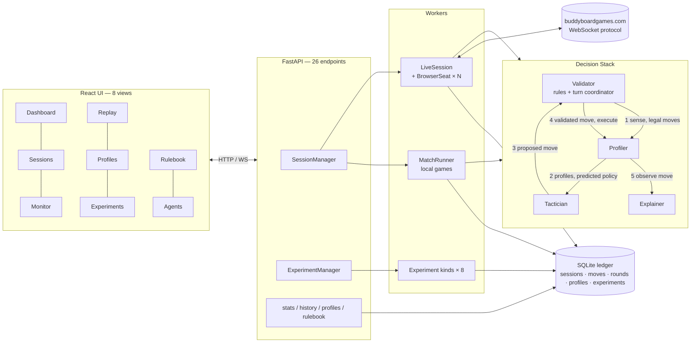
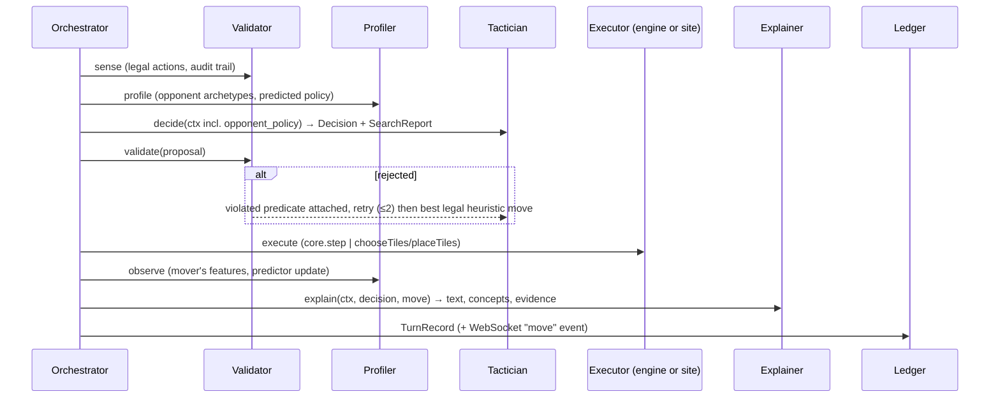

# TILES: Architecting an Explainable Multi-Agent System for Competitive Board Games

## A Case Study on Azul — Final Technical Report
---

## Abstract

Azul is a perfect-information game: every tile and board is visible. Play still depends on hidden information about the opponent, namely their strategy and risk appetite. The team terms this an *imperfect-profile* setting. TILES (Transparent Intelligence for Learning, Exploration and Simulation) is a multi-agent system that plays Azul with four agents. A **Validator** enforces the rules and coordinates each turn. A **Tactician** proposes moves (random, greedy, minimax, PUCT Monte Carlo Tree Search, and a variant that uses the opponent model). A **Profiler** models opponents online and assigns them to archetypes. An **Explainer** turns search output into a stated reason for each move. The same pipeline runs fast local simulations and real games on buddyboardgames.com through browser automation. Every decision is stored with its state, validation trace, explanation and timing in a SQLite ledger, which supports replay, profiling, a dashboard and eight registered experiments.

The rule-ingestion module recovers 19 of 19 rules, each checked against the engine. The next-move predictor reaches 87.8 % top-1 and 95.0 % top-3 accuracy, against 83.5 % and 93.5 % for a static greedy model and 17.2 % and 33.9 % for uniform guessing. Five archetypes are defined, and three behavioural families are recovered on held-out games at 71 %. Explanations cover all 873 audited moves, and the stated main reason matches the recorded score breakdown in every case. The system has played full games on the live site, including one with a human who joined through a share link. The main negative result is that profiler-conditioned search did not beat plain MCTS against opponents from the same heuristic family (98 % vs 100 % win rate at 400 simulations; 5–15 head-to-head over 20 games at 300 simulations). The experiment platform is ready to test the idea on human opponents, which is left for future work.

---

## 1. Introduction

### 1.1 Azul in brief

This section gives the minimum needed to read the rest of the paper. Azul (Plan B Games, 2017) won the Spiel des Jahres in 2018 (Spiel des Jahres, 2018). Two to four players compete to build a mosaic of coloured tiles.

**Components.** There are 100 tiles, 20 in each of five colours, kept in a bag. Each player has a *wall* (a 5×5 grid, empty at the start), five *pattern lines* of lengths 1 to 5 to the left of the wall, and a *floor line* of seven slots. Each round, *factory displays* (5, 7 or 9 for 2, 3 or 4 players) are filled with four random tiles each from the bag. A shared *centre* area starts empty.

**A round has three phases.**

1. *Drafting.* Players alternate. On a turn, a player picks one factory (or the centre) and one colour, and takes every tile of that colour there. If a factory was chosen, its remaining tiles move to the centre. The player places the taken tiles on one pattern line, or on the floor. A line holds a single colour, and it cannot take a colour already on the matching row of the wall. Tiles that do not fit go to the floor. The first player to take from the centre in a round also takes the *first-player token*, which fills a floor slot but gives first pick next round. Drafting ends when all factories and the centre are empty.
2. *Wall tiling.* Each full pattern line moves one tile onto the wall row of the same number. The other tiles of that line are discarded.
3. *Scoring.* A tile placed on the wall scores 1 point if it touches no other tile. Otherwise it scores 1 point for each tile in its connected horizontal run plus 1 for each tile in its connected vertical run (counting itself in each run that has at least two tiles). Floor tiles then cost 1, 1, 2, 2, 2, 3 and 3 points in order. The score cannot go below zero.

**End of game.** The game ends after the round in which some player completes a horizontal wall row. Bonuses follow: 2 points per complete row, 7 per complete column, 10 per colour with all five tiles on the wall. The highest score wins.

**Why it is hard.** A turn is a choice of source, colour and destination. Combining sources (5, 7 or 9), colours (up to 4 on a factory) and destinations (5 lines) gives 100, 140 or 180 raw combinations for 2, 3 and 4 players. Most are illegal. In 30 random self-play games per player count, the project's rules engine found a mean of 23.5, 32.4 and 42.6 legal moves per turn for 2, 3 and 4 players (maximum 186). This is close to the 35–38 moves per position quoted for chess (Chessprogramming Wiki, 2026). The difficulty therefore comes less from raw branching than from three other properties. Moves have long-term effects through wall adjacency and bonuses. Each round ends with a random redeal, so search cannot look across rounds exactly. And the best move depends on what the opponents are collecting and blocking.

### 1.2 Why Azul was chosen

1. **Perfect information, so the open question is the opponent.** Nothing is hidden on the board, so opponent modelling can be studied without also solving hidden-information inference, as in poker.
2. **A rule set small enough to implement exactly, rich enough to need search.** The core engine is under 1,000 lines. Greedy play beats random play and MCTS beats greedy play (§11.4), so there is a measurable range of skill.
3. **Rules in natural language.** The rulebook is short and structured, which makes it a workable source for the rule-extraction deliverable, and extracted rules can be checked against the engine.
4. **Visible interaction.** Blocking, floor sacrifices and bonus setups are observable choices, so move traces carry the signal a profiler needs.
5. **A public online implementation.** buddyboardgames.com allows the agents to be tested on a platform the team did not write, and against people.
6. **A gap in prior work.** An open-source MCTS agent for Azul exists (Yau, 2020). It does not model opponents or explain its moves, which is what this project adds.

### 1.3 The imperfect-profile framing

Chess engines now exceed the strongest human players (Zhang et al., 2025), and AlphaGo defeated a world champion at Go (Silver et al., 2016). In both, the standard approach is to search against a strong opponent. In Azul the best reply also depends on the particular opponent's tendencies. The team defines an *imperfect-profile* environment as one where the opponent's profile (strategy, risk tolerance, tactical preferences) changes the best play, even though the game state is fully visible. An agent must infer the profile from observed moves and adapt.

### 1.4 Problem statement

Agent tooling (tool calling, agent harnesses, multi-agent protocols) is moving foundation-model systems from answering questions toward acting on goals. The project applies this to a scored, turn-based competitive game. The agents should be competitive, explainable, modular and adaptive. They must extract rules from text, predict and profile opponents, search under a time limit, and give an auditable reason for each decision.

### 1.5 Scope and deliverables

| Area | Commitment |
|---|---|
| AI / ML / DL | Rule extraction, opponent modelling, profiling; exploration of transformer, RL and probabilistic approaches |
| NLP | Automated rulebook understanding via Retrieval-Augmented Generation; unstructured text to structured rules |
| Explainable AI | Transparent profiling, interpretable decision pathways, human-centred evaluation |
| Data science | Feature engineering from gameplay data; clustering and classification into archetypes |
| Systems engineering | Modular agent-of-agents architecture with specialised agents |

Deliverables: a functional prototype; a rule extraction and ingestion module with an accuracy benchmark; an opponent modelling module with predictive accuracy and baseline comparisons; an opponent profiling module identifying 3–5 archetypes; an explainability dashboard; and final deliverables of a documented repository, a technical report and a demo.

### 1.6 Contributions

1. **Engine inversion.** An early prototype used the live website as the game engine. TILES instead keeps a deterministic local engine as the single source of truth and treats the website as an adapter. This removed fragile round-transition and game-over detection, and made simulation, search and experiments possible.
2. **One pipeline, two executors.** `TurnPipeline.propose()` and `conclude()` are shared by the local match runner and the live session, so the UI and ledger see no difference between them.
3. **A measured opponent model and data-calibrated archetypes**, with an experiments platform that reproduces each number in this report with one command.
4. **Explanations derived from search output**, audited automatically for coverage and faithfulness.
5. **Live play on a changed platform.** The site moved from Socket.IO to a plain WebSocket between April and October 2026. The adapter was ported and games were played, including against a human.
6. **A negative result** on the adaptive-play hypothesis against synthetic opponents, with a diagnosis and a plan for testing it on humans.

---

## 2. Deliverables

| Deliverable | Status | Evidence (section) |
|---|---|---|
| Functional prototype — independent agents that integrate seamlessly | **Done** | §3, §12 (145 tests, Docker) |
| Rule extraction: accuracy benchmark, tooling, ingestion into Tactician/Validator | **Done** | §5, §11.5 (19/19 verified) |
| Opponent modelling: next-move predictive accuracy; comparison with baselines | **Done** | §7.3, §11.2 (87.8 % top-1 vs 83.5 % / 17.2 %) |
| Opponent profiling: 3–5 distinct archetypes | **Done (lower bound)** | §7.2, §11.3 (5 archetypes; 3 families recovered at 71 %) |
| Explainability dashboard: why a move was chosen, how a profile was derived | **Done** | §8, §11.6 (coverage 100 %, faithfulness 100 %) |
| End-to-end autonomous gameplay on the live website | **Done** | §9 |
| Deterministic, auditable decision pipeline with replay | **Done** | §3.3, §10 |
| Adaptive intelligence via profiling | **Implemented; no gain against synthetic opponents** | §6.4, §11.1 |
| Visualisation and monitoring | **Done** | §3.5, §10 |
| Tactician (search: MCTS / minimax with profiler conditioning) | **Done** | §6 |
| Profiler (learned: online opponent policy, archetype clustering) | **Done** | §7 |
| Experiment tracking (MLflow) | **Done** | §10.3 |
| Source repository with documentation; technical report | **Done** | this document, `README.md`, `docs/` (ARCHITECTURE, API, EVALUATION) |

---

## 3. System architecture

### 3.1 Overview



TILES has six main parts. The **React frontend** (session configuration, live monitor, replay, profile analyser, experiments, rulebook, agents) talks to a **FastAPI** (Ramírez, n.d.) **orchestrator** that owns session and experiment lifecycles and broadcasts events over WebSocket. The orchestrator drives two kinds of game worker — a local **MatchRunner** and a **LiveSession** that manages one Chromium browser per bot seat — plus an **ExperimentManager** that runs registered experiments in the background. All workers run the same **Decision Stack** through one `TurnPipeline` and write to the same **SQLite ledger**. The live platform is reached through the site's WebSocket protocol from inside the browser pages.

### 3.2 Design principles

1. **The local rules engine is the single source of truth.** `tiles/core/` owns legality, scoring and state transitions. The live platform mirrors state in and takes actions out; it is never asked whether a move is legal.
2. **Agents are interfaces, not classes.** Each Decision Stack role is an abstract base class (`tiles/agents/base.py`) with a registry and a human-readable catalogue (`catalog.py`, served as `GET /api/agents`), so a trained RL Tactician or a transformer Profiler can be dropped in without touching the orchestrator, server or UI.
3. **Explainability is data-first.** Tacticians must return a `SearchReport` — candidates with Q-values, visit counts, priors, principal variations and per-component heuristic breakdowns. Explanations are derived from these artefacts, never invented after the fact, and an automated audit checks that they are (§11.6).
4. **Everything is replayable and measurable.** Every turn yields a `TurnRecord` (state before/after, action, validation trace, explanation, profiles, timing) persisted to the ledger. Experiments are first-class jobs whose results live in the same ledger.

### 3.3 The per-turn pipeline



`propose()` runs sense → profile → decide → validate and returns a validated proposal; `conclude()` runs observe → explain and builds the record. The local runner wraps them around `core.step`; the live session wraps them around a WebSocket emit and a wait for the platform's authoritative state. The Validator coordinates every turn: no agent acts on its own initiative, and an illegal move cannot reach the board.

### 3.4 What is per player and what is shared

A *player* is one Tactician instance bound to a seat (a local seat, a Chromium browser, or a human). Everything else — Validator, Profiler, Explainer, orchestrator, ledger — is one session-level instance that every player's turn runs through. A 2–4 player session therefore has 2–4 Tactician/seat pairs but one Profiler that observes all of them.

### 3.5 User interface

| View | Purpose |
|---|---|
| Dashboard | Ledger-wide statistics: sessions, moves, experiments, win rate per Tactician, decision-latency percentiles, archetype counts, recent games |
| Sessions | Configure 2–4 seats (any Tactician with parameters, or a *human* seat in live mode), Profiler, Explainer, seed, pacing; list, start, stop, delete |
| Monitor | Live board, round-grouped move log with timings, round summaries, system log, lobby strip with room name and join link (live mode), and the **XAI panel** |
| Replay | Scrub or auto-play any recorded game with the same board and XAI components; export JSON |
| Profiles | The Profile Analyzer: replay a session through any Profiler; archetype and confidence, nine traits, colour/source/row distributions, score trajectory, archetype timeline |
| Experiments | Launch any of the eight experiments with parameters, watch progress, read summary/metrics/tables/charts, export JSON |
| Rulebook | Browse the rulebook, run retrieval queries, inspect extracted rules and their verification status |
| Agents | Decision Stack diagram and the registry of Tacticians, Profilers and Explainers with parameter schemas |

Charts are dependency-free inline SVG; the frontend is coded against the contract in `docs/API.md`.

---

## 4. Game engine and Validator

### 4.1 State representation

`GameState` / `PlayerBoard` (`tiles/core/state.py`) use a dual representation. For search, walls are 25-bit integers and tile pools are five-element count vectors, so cloning a state for MCTS is cheap. For humans and persistence, `to_dict()` / `from_dict()` give a semantic JSON view (factories, centre, pattern lines, wall, floor, scores, bag, lid, first-player token) that the ledger, Explainer and frontend consume. Constants follow the rulebook: 20 tiles per colour (100 tiles), floor penalties (−1, −1, −2, −2, −2, −3, −3), 5/7/9 factories for 2/3/4 players.

### 4.2 Action space

`Action` has a stable 300-slot `action_id` (10 sources × 5 colours × 6 destinations: five pattern lines or the floor). This gives reinforcement-learning code a fixed action mask (`legal_action_mask`). The mean number of legal moves is 23–43 (§1.1), so the mask is sparse.

### 4.3 Rules as named predicates

Legality is a sequence of named predicates — `phase_is_drafting`, `color_exists`, `source_exists`, `source_has_color`, `dest_exists`, `wall_slot_open`, `line_color_matches`, `line_has_space` — each returning a machine-readable `RuleViolation`. The same predicate names are the targets of rule extraction (§5) and the content of the Validator's audit trail. `apply_action`, `resolve_round` (wall tiling, adjacency scoring, floor penalties with the zero floor, first-player token hand-over, bag refill from the lid) and `end_game_bonuses` (2 per row, 7 per column, 10 per colour) complete the engine; `step()` is the single transition function.

### 4.4 Validator

`tiles/agents/validator.py` wraps `check_action` and records every check. In the orchestrator a rejected proposal is bounced back to the Tactician with the violated predicate attached; after two rejections the best legal heuristic move is taken. The persistent-rejection path is also exercised in live play: three consecutive site rejections fail the session rather than loop.

### 4.5 Verification

The engine is tested property-style: random full games for 2, 3 and 4 players terminate and **conserve the 100 physical tiles** across every transition; scoring, tiling, floor penalties, bonuses and game-over detection have targeted tests (16 engine tests in `tests/test_rules.py`; 145 tests overall).

---

## 5. Rule ingestion: the RAG-to-Logic pipeline

The pipeline turns the rulebook into structured rules, scores the extraction against the engine, and feeds the rules to the Tactician and Validator. It lives in `tiles/rulebook/` and has three stages:

1. **Ingest** (`ingest.py`). The English rulebook (`rulebook.md`, 14 sections) is split into section-level and three-sentence sliding-window chunks and indexed with a pure-Python TF-IDF retriever (Salton & Buckley, 1988) using cosine similarity. This is the retrieval step of Retrieval-Augmented Generation (Lewis et al., 2020), without the generation step on the default path. Exposed as `GET /api/rulebook/search`.
2. **Extract** (`extract.py`). Each known rule *topic* has a retrieval query and a parser that mines the retrieved chunk for parameters (penalty tables, bonus values, factory counts, tile supply) or confirms that the constraint's source sentence is present, producing a structured `RuleSpec` (`id`, `section`, `text`, `kind` ∈ {constraint, scoring, flow}, `predicate`, `parameters`). An optional LLM extractor (Claude) produces the same JSON and falls back to the deterministic path on any failure, so the pipeline never depends on network access.
3. **Verify** (`verify.py`). Every spec is checked **against the engine as ground truth**: scoring and flow rules by comparing extracted parameters with engine constants and behaviour (e.g. simulated floor penalties, bonuses, factory fill, bag refill, tie-break); constraint rules by behavioural probes — minimal game states in which the engine must raise exactly the predicate the spec names.

Nineteen rules are extracted and verified: four scoring rules (floor penalties, end-game bonuses, placement scoring, score floor at zero), eight flow rules (factory counts, tile supply, factory fill, first-player token, game-end trigger, bag refill, tie-break, next-round preparation) and seven constraints (one per engine predicate, e.g. `draft_take_all → source_has_color`, `wall_duplicate → wall_slot_open`). **Accuracy: 19/19 (100 %)** (§11.5). Because the engine predicates are exactly the rules the Validator enforces and the heuristic the Tactician scores with, extraction is ingested into both roles by construction, and the generative component stays out of the real-time move path.

---

## 6. Tacticians: strategic search

All Tacticians implement `decide(ctx) → Decision(action, SearchReport)`; `ctx` carries the state, the legal actions, a per-decision RNG seed and, when the orchestrator injects it, the Profiler's predicted opponent policy.

### 6.1 Shared heuristic (`heuristics.py`)

A single decomposed evaluation serves as the greedy policy, the minimax leaf value, the MCTS prior and rollout policy, the Profiler's feature basis and the Explainer's vocabulary. `score_action` rates a drafting action with seven named components: immediate placement points (weight 3.0), line progress (1.0), near-completion (0.8), floor penalty (1.2, negative), first-player value (0.7), end-game bonus potential (0.6, scaled so a completing tile is worth the full bonus) and **denial** (0.4) — taking tiles an opponent's pattern lines visibly need. The decomposition doubles as explainability evidence (§8).

### 6.2 Baselines

`random` and `greedy` are the baselines; `minimax` is a depth-limited (3) paranoid alpha–beta search within the current round with a 12-move beam at non-root nodes. Drafting is deterministic between redeals, so the within-round tree is exact; the paranoid reduction (all opponents minimise the root's value) is exact for two players and sound for three and four.

### 6.3 PUCT Monte Carlo Tree Search (`mcts.py`)

Monte Carlo Tree Search (Browne et al., 2012; Fu et al., 2024) builds a search tree from repeated simulated games. Each root decision runs *N* simulations (default 300) of PUCT selection (Rosin, 2011; `c_puct` = 1.5) with priors from a temperature-2 softmax over the heuristic scores. Values are kept from the root player's perspective in [−1, 1]; opponents select by the negated value (paranoid). The redeal between rounds is stochastic, so the tree never grows past a round boundary: a child whose creation resolves the round is a *chance leaf* and every visit determinises its own deal. Rollouts are ε-greedy (ε = 0.2) over a six-action heuristic sample for at most two further round resolutions, then bootstrapped with `tanh(evaluate_state / 20)`. The report exposes the top eight candidates with Q, visits, prior, principal variation and the heuristic decomposition of each candidate.

### 6.4 Profiler-conditioned search (`mcts_profiled`)

At opponent decision nodes the prior becomes `0.7 · predicted + 0.3 · heuristic`, where `predicted` is the Profiler's next-move distribution for that opponent (§7.3). Search effort is thereby concentrated on futures the *actual* opponent is likely to create — the progress report's core idea of adaptive play. Whether this helps is the subject of the ablation in §11.1.

---

## 7. Opponent modelling and profiling

### 7.1 Features and traits (`profiler/features.py`)

Every observed move yields a feature vector computed against the pre-move state: colour indicator, from-centre, to-floor, overflow count, completed line, took first-player token, the heuristic components (immediate points, denial, floor penalty, bonus potential), the number of legal moves and decision time. A per-player accumulator folds these into nine normalised traits — `color_bias`, `center_rate`, `floor_rate`, `completion_rate`, `denial_avg`, `risk_avg`, `bonus_focus`, `fpt_rate`, `immediate_avg` — plus `tempo_ms`, which is reported but excluded from classification.

### 7.2 Archetypes (`profiler/archetypes.py`)

Five archetypes are defined — **aggressive_blocker**, **cautious_optimizer**, **set_collector**, **greedy_scorer**, **risk_taker** — each with a description and a nine-trait signature. Classification is nearest-signature with a softmax confidence over negative distances, so it works from the first observed move and sharpens as evidence accumulates.

Two methodological choices matter. First, signatures are **data-calibrated**: each is the centroid of the trait vectors realised by a reference greedy preset designed to evoke that archetype (20 games per preset, calibration seed 11). Hand-written caricatures proved unreachable — a greedy player cannot take the first-player token in more than about one move in six, so a signature with `fpt_rate` = 0.30 is never the nearest. Second, distances are **standardised** by each trait's pooled standard deviation over the calibration population, so a low-variance but discriminative trait such as `denial_avg` (σ ≈ 0.11) counts as much as a noisy one such as `center_rate` (σ ≈ 0.06 on a wider range). Offline discovery uses a pure-Python k-means with k-means++ seeding (Arthur & Vassilvitskii, 2007) and ten restarts over z-scored traits.

### 7.3 Next-move prediction (`profiler/predictor.py`)

Each opponent is modelled as a softmax policy over the shared heuristic components with a per-player weight vector. Cold start uses the population prior ("people mostly play sound Azul", i.e. the default weights). Each observed move applies a structured-perceptron update (Collins, 2002) with multiplicative weights (Arora et al., 2012): when the model would have predicted a different action, the weights of components where the chosen action beats the predicted one rise and the others fall (range-normalised gradient, learning rate 0.8), then the vector is rescaled to the prior's norm. When the model already ranks the chosen move first there is no update, so weights move only to fix ranking mistakes. The predicted distribution is the temperature-2 softmax blended with uniform by `α = (n + 3) / (n + 3 + 6)`, which grows with the number of observed moves *n*: the Bayesian prior-to-posterior transition described in the progress report, deterministic and dependency-free. `top_k` serves the evaluation; the full distribution serves the search (§6.4).

### 7.4 Post-hoc Profile Analyzer (`profiler/analysis.py`)

Any recorded session can be replayed through any registered Profiler (`POST /api/profiles/{id}/analyze`), returning each player's final profile, descriptive statistics (colour, source and row distributions, score trajectory) and the move-by-move archetype timeline that the Profiles view renders. The same code profiles human moves inferred from live games (§9.5).

---

## 8. Explainability

### 8.1 Template Explainer (`explainer/templates.py`)

An explanation is composed from the `SearchReport`:

- a **primary-driver sentence** — the largest weighted component of the chosen move ("it completes a line for 4 points", "it denies the blue tiles Bruno needs");
- a **margin sentence** against the runner-up — heuristic gap, or for search Tacticians the visit share, Q-gap and the expected line (principal variation) over *N* simulations;
- a **profiler sentence** when the opponent model biased the search ("expecting Bruno (aggressive_blocker, 14 moves observed) to contest the shared supply");
- **concept tags** — `COMPLETES_LINE`, `BLOCKS_OPPONENT`, `BONUS_SETUP`, `FLOOR_SACRIFICE`, `TAKES_FIRST_PLAYER`, `FORCED`, `ENDGAME`;
- structured **evidence** — components, simulations, score gap, runner-up, principal variation.

Forced moves are stated as such. The MCTS report attaches the heuristic decomposition of each candidate (it is what the prior was computed from), so search decisions also carry a stated driver.

### 8.2 LLM refinement (`explainer/llm.py`)

With an `ANTHROPIC_API_KEY`, the `llm` Explainer asks Claude to rewrite the template explanation as commentary; the template text is kept as evidence and any failure falls back silently. The LLM is never in the decision path.

### 8.3 XAI panel

The Monitor and Replay views show, per move: the rationale, concept tags, the candidate table (score / visits / prior), the expected line, decide / validate / explain timings, and the opponent profile card (archetype, confidence, trait bars, moves observed). The Profiles view shows how a profile was derived (traits, distributions, timeline) — the "how a profile was derived" half of the dashboard deliverable.

### 8.4 Automated audit

The `xai_coverage` experiment measures **coverage** (share of recorded moves with an explanation), **concept frequencies**, and **faithfulness** — whether the primary driver stated in each explanation equals the argmax of the Tactician's own weighted component breakdown recorded with the move. Results are in §11.6. Human-centred ratings of clarity and usefulness are outside the automated audit and are discussed in §13.

---

## 9. Live platform play

### 9.1 Integration

Each bot seat is a Playwright-driven (Microsoft, n.d.) Chromium page on buddyboardgames.com/azul. An init script wraps `window.WebSocket` so the page's own socket is reachable; every server frame is intercepted and parsed (`engine/protocol.py`), and turns are sent as the page would send them, with an acknowledgement wait keyed by turn type and player so concurrent acknowledgements are never confused. The site is the dealer; the local engine is the referee.

Between April and October 2026 the platform **changed its protocol** from Socket.IO (`42[...]` frames) to a plain WebSocket (`wss://…/do-ws?game=azul&room=…`, `{"type", "payload"}` JSON frames) with a new game-object shape (`playerOrder`, `playerTurnIndex`, `centerTiles`, `wall.rows`, `floorLines.lines`) and base64-encoded `?room=` / `?name=` share links. Site-specific code is confined to the `engine/` package (`protocol.py`, `browser_seat.py`, `dom_snapshot.py`, `state_translator.py`, `live_session.py`), so the port did not change the decision stack, and the legacy framing still parses.

### 9.2 Lifecycle

```mermaid
stateDiagram-v2
  [*] --> connecting: launch N Chromium seats
  connecting --> lobby: host joinRoom → createRoom (retry under a fresh name on collision)
  lobby --> lobby: other bots join; humans open the share link, enter a name, press Play
  lobby --> starting: all configured seats present (or 300 s timeout)
  starting --> playing: startGameResponse (seat order) → opening deal (site auto-deal | host dealTiles | DOM fallback)
  playing --> playing: bot turn — propose → chooseTiles/placeTiles → ack → newer state → conclude → ledger
  playing --> playing: human turn — wait for the next authoritative state; infer the move; Profiler observes
  playing --> playing: round boundary — grace for the site's auto-deal, else current bot deals
  playing --> completed: game over (roundInProgress false + completed row | win screen)
  playing --> failed: 3 consecutive site rejections | error
  playing --> stalled: no new state within the turn timeout
  playing --> aborted: stop button
```



### 9.3 Human seats

A `human` seat produces a share link with the room pre-filled. The host waits until every configured seat is in the lobby, then presses *Start*. Human moves are not sent by TILES; they are **inferred** by diffing consecutive authoritative states (`infer_action`), then fed to the Profiler like any other observation, so a human opponent is profiled and predicted exactly as a bot would be.

### 9.4 Failure handling

Room-name collisions (the site keeps a room alive after a game) are retried up to three times under a fresh name; the status strip and join link update. Opening-deal timeouts fall back to an explicit `dealTiles` and then to a DOM scrape. Acknowledgement mismatches, stale actor state and late client deals were each observed in real games and are handled (freshest state wins; grace period before dealing). The loop is tested offline against a fake site that uses the real rules engine (`tests/test_live_session.py`: full game with host deal, auto-deal, human seat inference, stop, persistent rejection, room collision retry).

### 9.5 Results on the real site (10 October 2026)

| Game | Seats | Outcome | Notes |
|---|---|---|---|
| CLI, bot vs bot | Athena = greedy, Bob = greedy | 49 moves, 5 rounds, 59–74 | median execute (emit → ack) 650 ms per move; decide 0.1 ms |
| Web UI, bot vs bot | Athena = mcts_profiled (300 sims), Bob = greedy | 52 moves, 5 rounds, Athena 55–44 | Athena decide p50 141 ms, execute p50 431 ms, total p50 577 ms |
| Web UI, bot host + human via share link | Athena = mcts_profiled, human | 26 moves recorded | Profiler observed all 26 human moves; archetype set_collector (confidence 0.37) |

Earlier attempts the same day failed for the reasons documented above (protocol change, invalid plain-text room links, reused room names); each led to a fix and a regression test.


---

## 10. Ledger, telemetry and the experiments platform

### 10.1 Ledger (`ledger/store.py`)

SQLite in WAL mode with five tables: `sessions` (config, status, result), `moves` (one `TurnRecord` JSON per step: state before/after, action, validation trace, explanation, profiles, timing), `rounds`, `profiles` and `experiments` (params, progress, result). The application only inserts moves and never updates them, and a duplicate step number is rejected. This is a convention in the store code, not a database constraint: there are no triggers, and deleting a session also deletes its moves. The ledger is therefore an insert-only log in practice, not a tamper-proof one. Export (`GET /api/history/{id}/export`) returns `{session, rounds, moves, profiles}`.

### 10.2 Telemetry

Every move carries `decide_ms`, `validate_ms`, `execute_ms` (live: emit-to-acknowledgement), `explain_ms` and `total_ms`. Sessions stream `status`, `state`, `move`, `round`, `game_over` and `log` events over WebSocket; experiments stream progress. The Dashboard aggregates the ledger (`GET /api/stats`).

### 10.3 Experiments (`experiments/`)

Eight experiment *kinds* are registered with parameter schemas (`profiler_ablation`, `prediction_accuracy`, `archetype_discovery`, `tournament`, `search_budget_sweep`, `rule_extraction`, `latency_profile`, `xai_coverage`). Each produces one uniform result (`summary`, `metrics`, `tables`, `series` as bar/line/matrix, `raw`), so the Experiments view renders any of them without special-casing. Runs execute in the background with live progress, can be stopped early, persist in the ledger, and are reproducible from the CLI (`tiles experiment run <kind> --param k=v --output file.json`). A tracker abstraction logs to MLflow (MLflow, n.d.) when available (`docker compose --profile telemetry up`) and to JSONL otherwise.

---

## 11. Evaluation

All numbers below were produced by the experiments platform with the commands listed in Appendix A. Seeds are fixed, and seats alternate to cancel first-player advantage. Decision times depend on the hardware used.

### 11.1 A1 — Profiler ablation (headline)

Three conditions play a fixed denial-heavy greedy "blocker": `greedy` (no search, no profiling), `mcts` (PUCT with heuristic priors), `mcts_profiled` (PUCT with the Profiler's predicted opponent policy in the priors).

| Condition | Games | Wins | Win rate | Avg margin (pts) | Avg decision (ms) |
|---|---|---|---|---|---|
| greedy | 50 | 25 | 50 % | −2.1 | 0.0 |
| mcts (400 sims) | 50 | 50 | **100 %** | +17.7 | 146.7 |
| mcts_profiled (400 sims) | 50 | 49 | 98 % | +18.2 | 150.2 |

Profiling costs **3.5 ms per decision** (2.4 %). At a low budget (20 games, 50 simulations), where priors matter more, the picture is the same: greedy 25 %, mcts 85 % (+9.0), mcts_profiled 75 % (+6.8). Head-to-head at 300 simulations over 20 games (seed 21), `mcts_profiled` lost to `mcts` **5–15**. In the five-way tournament (seed 11), `mcts` beat `mcts_profiled` 7–1 with 2 ties.

**Interpretation.** Search dominates the heuristic opponent at every budget, leaving no headroom (a ceiling effect), and where there is headroom the profiled variant is no better than plain MCTS. In the head-to-head it is somewhat worse (5–15), and the size of any penalty is uncertain with 20 games. The diagnosis is in §11.2: against opponents from the same heuristic family, the learned opponent policy agrees with the static heuristic prior on 83 % of moves already, so blending it into the prior adds little information while reducing exploration at opponent nodes. The hypothesis that opponent modelling helps is therefore **not supported for synthetic opponents** and **untested for humans**, whose policies deviate far more from the prior. The live engine records every human move in exactly the format this experiment needs; running A1 on human games is the first item of future work (§13).

### 11.2 A2 — Opponent-model prediction accuracy

50 games (1,360 predictions) against opponents with distinct weight presets (blocker / collector alternating).

| Model | Top-1 | Top-3 |
|---|---|---|
| **Profiler predictor** (online, prior → posterior) | **87.8 %** | **95.0 %** |
| Static greedy (population prior, never adapts) | 83.5 % | 93.5 % |
| Uniform over legal moves (exact expectation) | 17.2 % | 33.9 % |

| Phase | Predictions | Predictor top-1 | Static greedy top-1 |
|---|---|---|---|
| Early (rounds 1–2) | 551 | 87.8 % | 85.7 % |
| Mid (rounds 3–4) | 544 | 86.2 % | 81.3 % |
| Late (round 5+) | 265 | **90.9 %** | 83.4 % |

The predictor beats the static model by 4.3 points overall and by 7.5 points late in the game, and the gap widens with evidence — the intended cold-start transition. Random and greedy are the two baseline predictors; minimax appears as a strength baseline in §11.4 (as a *predictor* it would equal the greedy prior at the leaves of a within-round search and was not separately evaluated).

### 11.3 A4 — Archetype discovery

Five greedy presets (blocker, collector, risk_taker, cautious, vanilla), 20 games each, profiled by a fresh Profiler per game. Signatures were calibrated on seed 11 and evaluated on held-out seed 12.

| | Calibration seed 11 | **Held-out seed 12** | Chance |
|---|---|---|---|
| 5-way rule-based agreement (preset → intended archetype) | 52 % | **46 %** | 20 % |
| k-means (k = 5, z-scored, 10 restarts) cluster purity | 50 % | 41 % | — |
| 3-family agreement ({blocker, risk_taker} / {cautious} / {collector, vanilla}) | — | **71 %** | 33 % |

Held-out confusion (rows = preset, columns = classified archetype):

| preset → | aggressive_blocker | cautious_optimizer | set_collector | greedy_scorer | risk_taker |
|---|---|---|---|---|---|
| blocker | **14** | 0 | 1 | 0 | 5 |
| collector | 2 | 7 | **6** | 4 | 1 |
| risk_taker | 9 | 0 | 0 | 1 | **10** |
| cautious | 1 | **13** | 3 | 3 | 0 |
| vanilla | 2 | 7 | 7 | **3** | 1 |

Three behaviours are recovered reliably — the blocker (high denial, floor and risk), the cautious optimiser (low denial, almost never takes the first-player token) and the tempo-seeking risk taker — while *collector* and *vanilla* play are statistically indistinguishable from each other and from cautious play in this population: competent greedy play clusters tightly (completion ≈ 0.63, centre ≈ 0.52) and the presets differ only on a few traits with small realised ranges. The deliverable of 3–5 distinct archetypes is met at its lower bound for synthetic players. Human games (§9.5) show wider trait ranges and are where the five-way classification is expected to be meaningful; the Profile Analyzer already handles them.

### 11.4 A3 — Tactician strength and search budget

Round-robin, 10 games per pairing, 300 simulations, Elo ratings (Elo, 1978) from 1200 with K = 32:

| Tactician | Elo | W–L–T | Win rate | Avg score |
|---|---|---|---|---|
| mcts | **1462** | 35–3–2 | 87.5 % | 56.0 |
| mcts_profiled | 1347 | 30–8–2 | 75 % | 55.2 |
| minimax (depth 3) | 1204 | 18–21–1 | 45 % | 40.8 |
| greedy | 1088 | 14–25–1 | 35 % | 46.6 |
| random | 899 | 0–40–0 | 0 % | 0.3 |

Head-to-head (10 games each): both MCTS variants beat random 10–0 and greedy 10–0; `mcts` beat minimax 8–2 and `mcts_profiled` beat minimax 9–1; minimax vs greedy 5–4–1. The within-round paranoid minimax adds only a modest gain over greedy because it shares greedy's leaf evaluation and cannot see past the redeal; MCTS, which determinises redeals and rolls out two rounds ahead, is the clear step up (Stage 1's greedy-beats-random 43–3 is reproduced as 10–0).

Search budget (MCTS vs greedy, 10 games per budget):

| Simulations | 25 | 50 | 100 | 200 | 400 | 800 |
|---|---|---|---|---|---|---|
| Win rate | 60 % | 100 % | 100 % | 100 % | 100 % | 100 % |
| Avg margin | +2.3 | +12.8 | +14.2 | +15.1 | +10.4 | +24.2 |
| Avg decision (ms) | 9.5 | 19.2 | 36.9 | 74.6 | 150.8 | 291.6 |

The knee is at 50–100 simulations (≤ 40 ms); 300 is the live-play default, well inside the platform's turn pacing.

### 11.5 A5 — Rule extraction benchmark

Deterministic extraction: **19 rules extracted, 19/19 verified against the engine (100 %), 0 skipped** — 4 scoring, 8 flow, 7 constraint rules, each tied to a rulebook section and (for constraints) an engine predicate. The LLM extractor runs the same benchmark when a key is configured; its output goes through the same verifier as the symbolic path.

### 11.6 A6 — Explainability audit

Over 873 recorded moves in 16 sessions (five Tacticians, 2–4 players):

| Metric | Value |
|---|---|
| Coverage (moves with an explanation) | **100 %** (873/873) |
| Faithfulness (stated primary driver = argmax of the recorded component breakdown) | **100 %** of 734 explanations with a stated driver |
| Explanations without a driver | 97 random-Tactician moves (no search report) and 42 moves from other Tacticians, mostly forced moves |
| Concept tags | COMPLETES_LINE 535 · BONUS_SETUP 502 · FLOOR_SACRIFICE 204 · ENDGAME 180 · TAKES_FIRST_PLAYER 80 · BLOCKS_OPPONENT 75 · FORCED 43 |
| Stated drivers | immediate_points 488 · line_progress 138 · near_completion 42 · floor_penalty 25 · denial 23 · bonus_potential 14 · first_player 4 |

Faithfulness is 100 % by construction: explanations are generated from the same records the audit checks, so a match is expected. The audit is a regression guard. It would flag an explanation, for example one rewritten by the LLM Explainer, whose stated driver differed from the recorded breakdown. It does not show that readers find the explanations clear or useful; that needs the human study in §13.

### 11.7 A7 — Latency profile

Per-move latency from the ledger (873 moves), milliseconds:

| Tactician | Moves | decide p50 | decide p90 | decide max | validate p50 | explain p50 | total p50 |
|---|---|---|---|---|---|---|---|
| random | 97 | 0.00 | 0.00 | 0.01 | 0.00 | 0.01 | 0.18 |
| greedy | 279 | 0.04 | 0.14 | 0.37 | 0.00 | 0.02 | 0.19 |
| minimax | 195 | 6.2 | 32.9 | 118.9 | 0.00 | 0.02 | 6.3 |
| mcts (300) | 130 | 135.1 | 240.5 | 316.7 | 0.01 | 0.03 | 148.0 |
| mcts_profiled (300) | 172 | 155.2 | 260.8 | 606.8 | 0.01 | 0.04 | 162.7 |

Validation and explanation are negligible (< 0.05 ms); decision time is the budget. In live play the dominant cost is the platform round-trip (emit → acknowledgement ≈ 430–650 ms, §9.5), so a 300-simulation search adds about 25 % to a live turn. Every stage is timed, and the only expensive one, the search, has a tunable budget.

### 11.8 Summary of evidence

| Claim | Evidence |
|---|---|
| Rules are understood and enforced | 19/19 extracted rules verified; 100-tile conservation across random games; zero illegal moves possible |
| Opponents are predicted | 87.8 % top-1 vs 83.5 % static and 17.2 % uniform; gap widens late-game |
| Opponents are profiled | 5 archetypes; 3 families at 71 % held-out; human games profiled live |
| Search is strong | Elo ladder mcts 1462 > mcts_profiled 1347 > minimax 1204 > greedy 1088 > random 899 |
| Decisions are explained and auditable | 100 % coverage, 100 % faithfulness, replay with full state |
| Plays on the live website | Three validated games on 10 Oct 2026 incl. a human via share link |
| Adaptive play helps | **Not shown** vs synthetic opponents (98 % vs 100 %; 5–15 head-to-head); human opponents are future work |

---

## 12. Engineering

| Aspect | State |
|---|---|
| Backend | Python, about 11.7 k lines in `backend/tiles/` across 11 packages (`core`, `agents`, `orchestration`, `ledger`, `rulebook`, `engine`, `sim`, `experiments`, `telemetry`, `rl`, `server`) plus the `cli.py` module. The Docker image uses Python 3.12; the package requires 3.10 or newer |
| Frontend | React 18 + TypeScript (Vite), about 4.4 k lines of TypeScript plus 1.7 k lines of CSS, 8 views, hash router, inline-SVG charts, no chart dependency |
| Tests | **145** pytest tests (about 3.0 k lines): engine properties, tacticians, profiler, explainer, rulebook, ledger round-trip and duplicate-step rejection, orchestration, API (FastAPI test client), live loop against a fake site, experiments, RL env. `npm run build` type-checks the UI. There are no frontend unit tests |
| Packaging | `Dockerfile`, `Dockerfile.live` (bundled Chromium), `docker-compose.yml` with `live`, `telemetry` (MLflow) and `dev` profiles; `start.sh` for local development (macOS / Linux; on Windows use WSL or Docker) |
| Interfaces | 26 REST/WebSocket endpoints documented in `docs/API.md`; CLI `tiles play`, `live`, `analyze`, `tournament`, `ablate`, `predict-eval`, `verify-rules`, `experiment`, `serve` |
| RL readiness | `rl/azul_env.py`: PettingZoo AEC environment (Terry et al., 2021) with action masks over the 300-slot action space |

---

## 13. Limitations and future work

1. **Adaptive play on human opponents.** The live human seats, move inference, ledger and the A1 experiment are in place, but evaluating adaptive play on human games needs a sizeable set of recorded games (30–50 would be a reasonable target) and willing participants. If the gain stays absent on humans, the blend ratio (0.7) and the predictor temperature are the first parameters to tune, and a learned opponent policy is the next model to try.
2. **Archetype resolution.** Five archetypes are defined, and three families are recoverable from synthetic play. A sequence model over move features (for example a transformer) and larger human datasets would help separate the remaining two.
3. **Human-centred evaluation.** The automated audit covers coverage and faithfulness. Clarity and usefulness ratings from 5–10 participants, using the Replay view as the stimulus, would complete the evaluation of the explanations.
4. **Live-site fragility.** The platform changed protocol once during the project. Site-specific code is confined to the `engine/` package and the loop is tested offline, but another change would require re-checking the adapter.
5. **Reinforcement-learning Tactician.** The action-masked environment is tested. A policy-gradient agent (for example PPO) could plug into the Tactician registry. Genetic-algorithm tuning of the heuristic weights is another extension.

---

## 14. Conclusion

TILES delivers each planned component with measured results. The local engine made the system testable and fast. The shared pipeline gives local and live games the same decision path, ledger record and UI. The registry design lets agents be swapped, and the experiments platform reproduces each number in this report from one command. Rules are extracted and verified at 100 %. Opponents are predicted at 87.8 % top-1. Three archetype families are recovered on held-out games. Every audited move has an explanation that matches its score breakdown. The system has played full games on the live website, including one against a human. One hypothesis was not confirmed: profiler-conditioned search did not beat plain search against synthetic opponents. Testing it on human opponents, and the other extensions, are described in §13.

---

## 15. Individual accomplishments

The work was split by component so that each member owned at least one concept-heavy part of the system (search, learning, language processing, agents and integration, or systems and evaluation). Everyone also took part in the shared tasks listed after the table.

The table below states each member's area, the concepts applied and where the work can be found.

| Member | Component owned | Concepts applied | Main evidence |
|---|---|---|---|
| **Chan Jing Rong** | Tactician search: shared heuristic, minimax (alpha–beta), PUCT MCTS and profiler-conditioned MCTS; tournament and Elo; search-budget sweep; profiler ablation (A1, A3) | Adversarial search, Monte Carlo methods under chance, exploration vs exploitation, experiment design | `agents/tacticians/`, `sim/`, experiments `tournament`, `search_budget_sweep`, `profiler_ablation`; §6, §11.1, §11.4 |
| **Velu** | Opponent modelling and profiling: move features and traits, archetype signatures, k-means discovery, online next-move predictor, Profile Analyzer and Profiles view (A2, A4) | Feature engineering, clustering, supervised and online learning, model evaluation against baselines | `agents/profiler/`, `sim/prediction_eval.py`, experiments `prediction_accuracy`, `archetype_discovery`; §7, §11.2, §11.3 |
| **Johann Oh Hock Seng** | Language and explanation: rulebook ingestion (chunking, TF-IDF retrieval, rule extraction, optional LLM extractor, engine-based verification), template and LLM Explainers, XAI audit, Rulebook view and XAI panel (A5, A6) | Information retrieval, RAG, turning text into logic, explainable AI, evaluating explanations | `rulebook/`, `agents/explainer/`, experiments `rule_extraction`, `xai_coverage`; §5, §8, §11.5, §11.6 |
| **Brian Zheng** | Live play and agents in the real world: Playwright seats, WebSocket protocol port, human-seat move inference, room lifecycle and failure handling, Sessions and Monitor views; initial prototype and first architecture diagram | Software agents acting in an unmodelled environment, protocol reverse-engineering, state estimation from observations, fault handling | `engine/`, `tests/test_live_session.py`, `tests/test_state_translator.py`; §9 |
| **Weiqiao Li** | Systems core: rules engine and Validator, `TurnPipeline`, SQLite ledger, FastAPI server, experiments platform, MLflow / JSONL tracking, Docker packaging, integration of the components | Symbolic rule systems, deterministic state machines, agent coordination, reproducibility and experiment tracking | `core/`, `agents/validator.py`, `orchestration/`, `ledger/`, `server/`, `experiments/`, `telemetry/`; §3, §4, §10 |

**Shared by all five.** Writing and running tests for one's own component and reviewing another's; requirements analysis against the capstone brief; the reports; and the demo and presentation.

**Balance.** Each member owns one backend area, at least one experiment and the matching report sections. The systems core is the widest in code volume; the search, profiling and language components are narrower and carry more of the evaluation work.

---

## 16. Alignment with the capstone requirements

The ISS capstone brief asks for an intelligent system that applies at least one problem-solving technique from the programme, with good documentation, presentations and, in Phase 2, a technical paper, an individual report and a demo. Its guide for application projects lists complexity, innovation, verification and validation, customer feedback and overall functionality.

| Requirement | How TILES meets it |
|---|---|
| Design and develop an intelligent system | Four-agent decision stack with search, a learned opponent model and an explainer (§3, §6–§8) |
| Use at least one problem-solving technique from the programme | Reasoning systems: rule engine, validator and search. Pattern recognition: clustering and next-move prediction. Software agents: coordinated agents acting on a live website. Language processing: rule extraction and explanation text |
| Complexity of problem | Stochastic, multi-player game with a live online platform and an opponent model in the decision loop |
| Innovation | Opponent-aware search, explanations derived from search output, engine-verified rule extraction |
| Verification and validation | 145 automated tests, property tests on the engine, rule verification against the engine, explanation audit, reproducible experiments (§11) |
| Overall functionality | Local and live play, replay, dashboard, rulebook browser and eight experiments (§3.5, §10) |
| Documentation | README, architecture and API documents, evaluation summary and this report |

---

## 17. Learning reflections

**Lessons about the problem.**

1. *Visible information does not make opponents predictable.* Predicting a heuristic opponent's move was easy (88 % top-1), but modelling intent well enough to change the agent's own play was not. A model that only matches the prior adds nothing to search. This is why the A1 ablation shows no gain, and it led the team to treat the evaluation design (who the opponents are) as part of the method.
2. *A negative result is still a result.* The team first expected profiler-conditioned search to win. The ceiling effect at 400 simulations and the 83 % agreement between the learned policy and the prior explained why it did not. Reporting this was more useful than tuning until a number looked good.
3. *Branching factor alone is a poor measure of difficulty.* The proposal estimated 100–180 move combinations; measuring legal moves gave 23–43 on average. The framing was corrected: stochastic redeals, long-term scoring and hidden intent are the real difficulty.

**Lessons about building agent systems.**

4. *Make one component the authority.* Moving to a local rules engine as the single source of truth removed a class of live-site bugs and made search, testing and experiments possible.
5. *Treat the outside world as unreliable.* The platform changed protocol between April and October. Confining site code to one package kept the port small, and an offline fake site kept it testable.
6. *Explanations need a record to check against.* Producing explanations from search artefacts allowed them to be audited automatically. That audit shows consistency, not usefulness, which only people can judge.
7. *Reproducibility is a design goal.* Fixed seeds, one command per experiment and a ledger meant that any experiment could be re-run from a single command and compared with its stored result.

**Links to the programme's courses.**

| Course area | Applied in the project | Main difficulty |
|---|---|---|
| Intelligent reasoning systems | Rules as named predicates; deterministic validator; minimax and MCTS | Handling chance between rounds in a search tree |
| Pattern recognition systems | Trait features, nearest-signature classification, k-means, calibration on held-out seeds | Realistic opponents: synthetic presets overlap, so archetypes blur |
| Intelligent software agents | Four cooperating agents, a coordinator, bots acting through a browser | Keeping behaviour correct when the site changes |
| Practical language processing | Chunking, TF-IDF retrieval, rule extraction, template and LLM explanations | Deciding how to check extracted rules; the engine served as ground truth |

**What the team would change.** Automated checks on every commit and a plan for human evaluation should be set up from the first week. Human games should be collected earlier, because the central hypothesis depends on them.

---

## Statement of compliance with the policy for use of AI in teaching and learning

In preparing this project and report the team used AI tools (including Claude Code, Claude, Gemini and ChatGPT) for brainstorming architectural options, clarifying technical concepts, accelerating implementation and refactoring of code under the team's direction, drafting text and tables for documentation, and proofreading. Generated code was reviewed and tested (145 automated tests) against the deterministic rules engine and, for live play, against the platform. Reported numbers come from the team's own experiment runs on the dates stated. Cited sources were checked against the original publications or pages. The design decisions, interpretation of results and conclusions are the team's own.

---

## References

1. Zhang, Y., Jacob, A. P., Lai, V., Fried, D., & Ippolito, D. (2025). Human-aligned chess with a bit of search. *International Conference on Learning Representations (ICLR 2025)*. arXiv:2410.03893.
2. Silver, D., Huang, A., Maddison, C. J., et al. (2016). Mastering the game of Go with deep neural networks and tree search. *Nature*, 529, 484–489.
3. Browne, C. B., Powley, E., Whitehouse, D., et al. (2012). A survey of Monte Carlo tree search methods. *IEEE Transactions on Computational Intelligence and AI in Games*, 4(1), 1–43.
4. Rosin, C. D. (2011). Multi-armed bandits with episode context. *Annals of Mathematics and Artificial Intelligence*, 61(3), 203–230.
5. Fu, M. C., Qiu, D., & Xu, J. (2024). A tutorial for Monte Carlo tree search in AI. In *Proceedings of the 2024 Winter Simulation Conference* (pp. 16–30). IEEE.
6. Lewis, P., Perez, E., Piktus, A., et al. (2020). Retrieval-augmented generation for knowledge-intensive NLP tasks. *Advances in Neural Information Processing Systems 33*.
7. Salton, G., & Buckley, C. (1988). Term-weighting approaches in automatic text retrieval. *Information Processing & Management*, 24(5), 513–523.
8. Collins, M. (2002). Discriminative training methods for hidden Markov models: theory and experiments with perceptron algorithms. In *Proceedings of EMNLP 2002*.
9. Arora, S., Hazan, E., & Kale, S. (2012). The multiplicative weights update method: a meta-algorithm and applications. *Theory of Computing*, 8, 121–164.
10. Arthur, D., & Vassilvitskii, S. (2007). k-means++: the advantages of careful seeding. In *Proceedings of SODA 2007*.
11. Elo, A. E. (1978). *The Rating of Chessplayers, Past and Present*. Arco.
12. Terry, J. K., Black, B., Grammel, N., et al. (2021). PettingZoo: Gym for multi-agent reinforcement learning. *Advances in Neural Information Processing Systems 34*.
13. Plan B Games. (2017). *Azul rulebook*. (Game by Michael Kiesling.)
14. Spiel des Jahres. (2018). Azul, Spiel des Jahres 2018. https://www.spiel-des-jahres.de/en/games/azul/
15. Chessprogramming Wiki. Branching factor. https://www.chessprogramming.org/Branching_Factor
16. Yau, A. (2020). *Azul-MCTS-AI* [Source code]. GitHub. https://github.com/mgsweet/Azul-MCTS-AI
17. Microsoft. Playwright documentation. https://playwright.dev
18. Ramírez, S. FastAPI documentation. https://fastapi.tiangolo.com
19. MLflow. MLflow documentation. https://mlflow.org

## Appendix A — Reproducing the results

```bash
cd backend && source .venv/bin/activate          # ./start.sh creates the venv
tiles experiment run rule_extraction
tiles experiment run prediction_accuracy  --param games=50 --param seed=11
tiles experiment run archetype_discovery  --param games_per_preset=20 --param seed=12   # held-out
tiles experiment run profiler_ablation    --param games=50 --param simulations=400 --param seed=11
tiles experiment run profiler_ablation    --param games=20 --param simulations=50  --param seed=21
tiles experiment run tournament           --param games_per_pair=10 --param simulations=300 --param seed=11
tiles experiment run tournament           --param entrants=mcts,mcts_profiled --param games_per_pair=20 --param seed=21
tiles experiment run search_budget_sweep  --param budgets=25,50,100,200,400,800 --param games_per_budget=10 --param seed=11
# ledger-based audits (play some games first, e.g. tiles play ... --db db/tiles.db)
tiles experiment run latency_profile --db db/tiles.db
tiles experiment run xai_coverage    --db db/tiles.db
# live play
tiles live --room tiles-demo --player Athena=mcts_profiled --player You=human --headed --db db/tiles.db
```

Every run is also available from the Experiments view, persists in the ledger and exports as JSON. Total wall-clock for the set above is about 25 minutes on a laptop.

## Appendix B — API summary

`GET /api/health` · `GET /api/agents` · `POST/GET /api/sessions`, `GET/DELETE /api/sessions/{id}`, `POST …/start|stop`, `WS /api/sessions/{id}/ws` · `GET /api/history/{id}`, `GET /api/history/{id}/export` · `GET /api/profiles/archetypes`, `GET /api/profiles/{id}`, `POST /api/profiles/{id}/analyze` · `GET /api/experiments/types`, `POST/GET /api/experiments`, `GET/DELETE /api/experiments/{id}`, `POST …/stop`, `WS /api/experiments/{id}/ws` · `GET /api/rulebook`, `GET /api/rulebook/search`, `GET /api/rulebook/rules` · `GET /api/stats`. Full schemas: `docs/API.md`.

## Appendix C — Repository layout

```
backend/tiles/
├── core/            pure Azul engine: state, actions, rules, simulator, encodings
├── agents/          base interfaces · catalog · validator · tacticians/ · profiler/ · explainer/
├── orchestration/   TurnPipeline: propose() / conclude() / run_turn()
├── ledger/          SQLite: sessions, moves, rounds, profiles, experiments
├── rulebook/        RAG-to-Logic: rulebook.md → RuleSpecs → engine verification
├── engine/          live-play adapter: protocol, browser seat, live session, translator, DOM fallback
├── sim/             match runner, tournaments, ablation, prediction evaluation
├── experiments/     registry, background runner, eight experiment kinds, CLI
├── telemetry/       MLflow / JSONL tracking
├── rl/              PettingZoo AEC environment
├── server/          FastAPI app, session manager, stats, routers/
└── cli.py
frontend/src/        views/ (8) · components/ (board, move log, XAI panel, charts) · api/ · types.ts
docs/                ARCHITECTURE · API · EVALUATION · FINAL_REPORT
```
