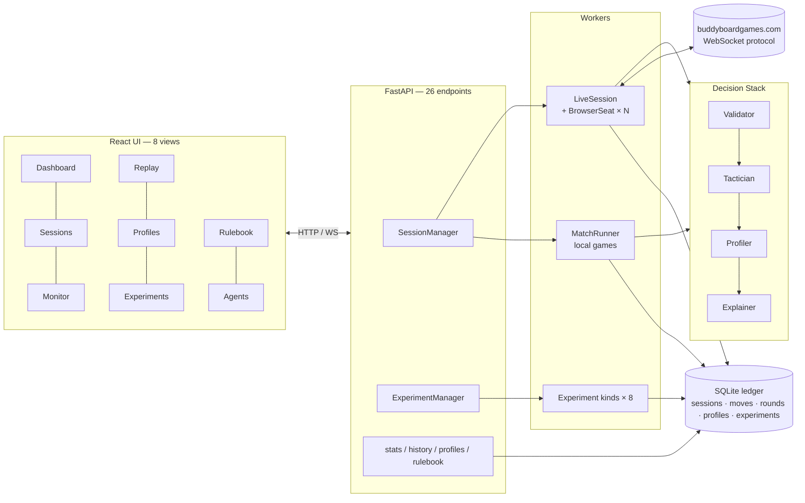
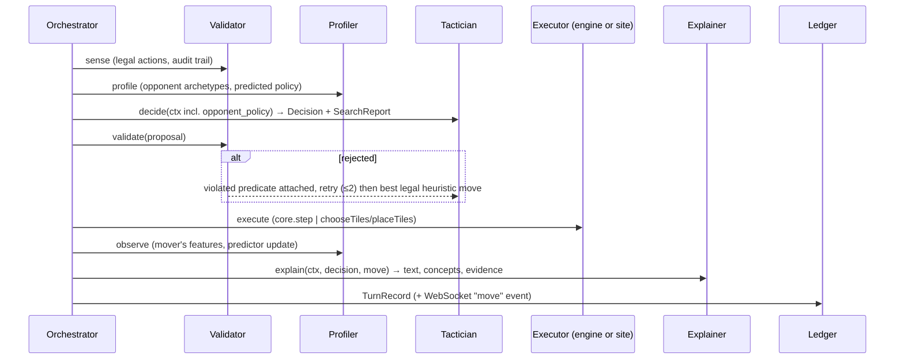

# TILES: Architecting an Explainable Multi-Agent System for Competitive Board Games

## A Case Study on Azul — Final Technical Report
---

## Abstract

Azul is a perfect-information game that behaves as an *imperfect-profile* environment: the hidden quantity is not the board but the opponent's intent. TILES (Transparent Intelligence for Learning, Exploration and Simulation) is a multi-agent platform that plays Azul with a decision stack of four specialised agents — a deterministic **Validator** that is also the per-turn coordinator, a **Tactician** that proposes moves (random, greedy, minimax, PUCT Monte Carlo Tree Search, and an opponent-aware MCTS), a **Profiler** that models opponents online and classifies them into archetypes, and an **Explainer** that turns search artefacts into rationales. The same pipeline plays fast local simulations and real games on the public platform buddyboardgames.com through browser automation, and every decision is persisted with full state, validation trace, explanation and timing in an append-only ledger that drives replay, post-hoc profiling, a dashboard and eight registered experiments.

The project delivers all items committed in the progress report: a functional prototype (119 automated tests, containerised, continuous integration), a rule-ingestion module with an engine-verified accuracy benchmark (19/19 rules, 100 %), an opponent-modelling module whose next-move predictor reaches 87.8 % top-1 / 95.0 % top-3 accuracy against 83.4 % / 93.5 % for a static greedy model and 17.2 % / 33.9 % for uniform guessing, a profiling module with five archetypes of which three behavioural families are recovered on held-out games at 71 %, an explainability dashboard whose explanations cover 100 % of 773 audited moves with 100 % faithfulness of the stated primary driver, and validated end-to-end play on the live website, including games against a human who joined through a share link. The headline ablation is reported honestly: against opponents drawn from the same heuristic family, profiler-conditioned search did not outperform plain MCTS (98 % vs 100 % win rate at 400 simulations; 10–8–2 head-to-head at 300 simulations), because the learned opponent policy differs little from the search prior for such opponents. The infrastructure to measure the same question on human opponents is in place.

---

## 1. Introduction

### 1.1 Background

Artificial intelligence has long been measured against board games, from Stockfish in chess to AlphaGo in Go. Azul (Plan B Games, 2017; Spiel des Jahres 2018) is a modern tile-drafting game in which players take all tiles of one colour from a factory display or the shared centre and place them on one of five pattern lines; completed lines transfer a tile to a 5×5 wall at the end of each round, scoring by adjacency, with end-game bonuses for complete rows, columns and colour sets and penalties for tiles that fall to the floor line. A typical turn offers 100–180 raw move combinations of which only 10–15 % are legal; the branching factor exceeds chess and brute-force search is impractical.

The progress report framed Azul as an **imperfect-profile environment**: all state is visible, but the opponent's strategy, risk tolerance and tactical preferences are hidden and influence the optimal reply. The challenge is hidden intent, not hidden information.

### 1.2 Problem statement

Recent agentic AI practice (tool use, agent harnesses, multi-agent protocols) aims to move foundation-model systems from passive answering toward goal-directed action. We apply this to an objectively scored, turn-based competitive game and ask for agents that are **competitive, explainable, modular and adaptive**: they must extract rules from natural language, predict and profile opponents, search strategically under latency constraints, and explain every decision in a way that can be audited.

### 1.3 Scope, as committed in the progress report

| Area | Commitment |
|---|---|
| AI / ML / DL | Rule extraction, opponent modelling, profiling; exploration of transformer, RL and probabilistic approaches |
| NLP | Automated rulebook understanding via Retrieval-Augmented Generation; unstructured text to structured rules |
| Explainable AI | Transparent profiling, interpretable decision pathways, human-centred evaluation |
| Data science | Feature engineering from gameplay data; clustering and classification into archetypes |
| Systems engineering | Modular agent-of-agents architecture with specialised agents |

Deliverables: a functional prototype; a rule extraction and ingestion module with an accuracy benchmark; an opponent modelling module with predictive accuracy and baseline comparisons; an opponent profiling module identifying 3–5 archetypes; an explainability dashboard; and final deliverables of a documented repository, a technical report and a demo.

### 1.4 Contributions of this report

1. **Engine inversion.** Stage 1 used the live website as the game engine. TILES makes a pure, deterministic local engine the single source of truth and treats the website as an adapter. This removed the fragile round-transition and game-over detection of Stage 1 and made local simulation, search and experiments possible.
2. **One decision pipeline, two executors.** `TurnPipeline.propose()` / `conclude()` is shared verbatim by the local match runner and the live session; the UI and ledger cannot tell them apart.
3. **A measured opponent model** (prior-to-posterior next-move predictor) and **data-calibrated archetypes**, with an experiments platform that produces every number in this report with one command each.
4. **Explanations derived from search artefacts**, audited automatically for coverage and faithfulness.
5. **Validated live play** on a changed platform protocol (the site moved from Socket.IO to a plain WebSocket between April and October 2026), including human opponents joining through a share link.
6. A **negative result** on the core adaptive-play hypothesis against synthetic opponents, with a diagnosis and a path to the human-opponent experiment.

---

## 2. Deliverable status

| Progress-report item | Status | Evidence (section) |
|---|---|---|
| Functional prototype — independent agents that integrate seamlessly | **Done** | §3, §12 (119 tests, CI, Docker) |
| Rule extraction: accuracy benchmark, tooling, ingestion into Tactician/Validator | **Done** | §5, §11.5 (19/19 verified) |
| Opponent modelling: next-move predictive accuracy; comparison with baselines | **Done** | §7.3, §11.2 (87.8 % top-1 vs 83.4 % / 17.2 %) |
| Opponent profiling: 3–5 distinct archetypes | **Done (lower bound)** | §7.2, §11.3 (5 archetypes; 3 families recovered at 71 %) |
| Explainability dashboard: why a move was chosen, how a profile was derived | **Done** | §8, §11.6 (coverage 100 %, faithfulness 100 %) |
| End-to-end autonomous gameplay on the live website | **Done, re-validated 10 Oct 2026** | §9 |
| Deterministic, auditable decision pipeline with replay | **Done** | §3.3, §10 |
| Adaptive intelligence via profiling | **Implemented; benefit not demonstrated vs synthetic opponents** | §6.4, §11.1 |
| Visualisation and monitoring | **Done** | §3.5, §10 |
| Tactician (search: MCTS / minimax with profiler conditioning) | **Done** | §6 |
| Profiler (ML-based: sequence modelling, archetype clustering) | **Partially** — online learned policy + k-means; no neural sequence model | §7, §13 |
| Experiment tracking (MLflow) | **Done** | §10.3 |
| Source repository with documentation; technical report; demo | **Done** | this document, `README.md`, `docs/`, `DEMO.md` |

---

## 3. System architecture

### 3.1 Overview



TILES has six moving pieces, as in the progress report, but with one structural change. The **React frontend** (session configuration, live monitor, replay, profile analyser, experiments, rulebook, agents) talks to a **FastAPI orchestrator** that owns session and experiment lifecycles and broadcasts events over WebSocket. The orchestrator drives two kinds of game worker — a local **MatchRunner** and a **LiveSession** that manages one Chromium browser per bot seat — plus an **ExperimentManager** that runs registered experiments in the background. All workers run the same **Decision Stack** through one `TurnPipeline` and write to the same **SQLite ledger**. The live platform is reached through the site's WebSocket protocol from inside the browser pages.

### 3.2 Design principles

1. **The local rules engine is the single source of truth.** `tiles/core/` owns legality, scoring and state transitions. The live platform mirrors state in and takes actions out; it is never asked whether a move is legal.
2. **Agents are interfaces, not classes.** Each Decision Stack role is an abstract base class (`tiles/agents/base.py`) with a registry and a human-readable catalogue (`catalog.py`, served as `GET /api/agents`), so a trained RL Tactician or a transformer Profiler can be dropped in without touching the orchestrator, server or UI.
3. **Explainability is data-first.** Tacticians must return a `SearchReport` — candidates with Q-values, visit counts, priors, principal variations and per-component heuristic breakdowns. Explanations are derived from these artefacts, never invented after the fact, and an automated audit checks that they are (§11.6).
4. **Everything is replayable and measurable.** Every turn yields a `TurnRecord` (state before/after, action, validation trace, explanation, profiles, timing) persisted append-only. Experiments are first-class jobs whose results live in the same ledger.

### 3.3 The per-turn pipeline



`propose()` runs sense → profile → decide → validate and returns a validated proposal; `conclude()` runs observe → explain and builds the record. The local runner wraps them around `core.step`; the live session wraps them around a WebSocket emit and a wait for the platform's authoritative state. The Validator's coordination authority is what the progress report asked for: no agent acts on its own initiative, and an illegal move cannot reach the board.

### 3.4 What is per player and what is shared

A *player* is one Tactician instance bound to a seat (a local seat, a Chromium browser, or a human). Everything else — Validator, Profiler, Explainer, orchestrator, ledger — is one session-level instance that every player's turn runs through. A 2–4 player session therefore has 2–4 Tactician/seat pairs but one Profiler that observes all of them.

### 3.5 User interface

| View | Purpose |
|---|---|
| Dashboard | Ledger-wide statistics: sessions, moves, experiments, win rate per Tactician, decision-latency percentiles, archetype counts, recent games |
| Sessions | Configure 2–4 seats (any Tactician with parameters, or a *human* seat in live mode), Profiler, Explainer, seed, pacing; list, start, stop, delete |
| Monitor | Live board, round-grouped move log with timings, round summaries, system log, lobby strip with room name and join link (live mode), and the **XAI panel** |
| Replay | Scrub or auto-play any recorded game with the same board and XAI components; export JSON |
| Profiles | The Profile Analyzer: replay a session through any Profiler; archetype and confidence, nine traits, colour/source/row distributions, score trajectory, archetype timeline |
| Experiments | Launch any of the eight experiments with parameters, watch progress, read summary/metrics/tables/charts, export JSON |
| Rulebook | Browse the rulebook, run retrieval queries, inspect extracted rules and their verification status |
| Agents | Decision Stack diagram and the registry of Tacticians, Profilers and Explainers with parameter schemas |

Charts are dependency-free inline SVG; the frontend is coded against the contract in `docs/API.md`.

---

## 4. Game engine and Validator

### 4.1 State representation

`GameState` / `PlayerBoard` (`tiles/core/state.py`) use a dual representation. For search, walls are 25-bit integers and tile pools are five-element count vectors, so cloning a state for MCTS is cheap. For humans and persistence, `to_dict()` / `from_dict()` give a semantic JSON view (factories, centre, pattern lines, wall, floor, scores, bag, lid, first-player token) that the ledger, Explainer and frontend consume. Constants follow the rulebook: 20 tiles per colour (100 tiles), floor penalties (−1, −1, −2, −2, −2, −3, −3), 5/7/9 factories for 2/3/4 players.

### 4.2 Action space

`Action` has a stable 300-slot `action_id` (10 sources × 5 colours × 6 destinations: five pattern lines or the floor), matching the progress report's branching analysis and giving reinforcement-learning consumers a fixed action mask (`legal_action_mask`).

### 4.3 Rules as named predicates

Legality is a sequence of named predicates — `phase_is_drafting`, `color_exists`, `source_exists`, `source_has_color`, `dest_exists`, `wall_slot_open`, `line_color_matches`, `line_has_space` — each returning a machine-readable `RuleViolation`. The same predicate names are the targets of rule extraction (§5) and the content of the Validator's audit trail. `apply_action`, `resolve_round` (wall tiling, adjacency scoring, floor penalties with the zero floor, first-player token hand-over, bag refill from the lid) and `end_game_bonuses` (2 per row, 7 per column, 10 per colour) complete the engine; `step()` is the single transition function.

### 4.4 Validator

`tiles/agents/validator.py` wraps `check_action` and records every check. In the orchestrator a rejected proposal is bounced back to the Tactician with the violated predicate attached; after two rejections the best legal heuristic move is taken. The persistent-rejection path is also exercised in live play: three consecutive site rejections fail the session rather than loop.

### 4.5 Verification

The engine is tested property-style: random full games for 2, 3 and 4 players terminate and **conserve the 100 physical tiles** across every transition; scoring, tiling, floor penalties, bonuses and game-over detection have targeted tests (16 engine tests in `tests/test_rules.py`, 119 tests overall).

---

## 5. Rule ingestion: the RAG-to-Logic pipeline

The progress report asked for automated rulebook understanding with an accuracy benchmark and for ingestion of rules into Tactician moves and Validator decisions. The pipeline (`tiles/rulebook/`) has three stages:

1. **Ingest** (`ingest.py`). The English rulebook (`rulebook.md`, 14 sections) is split into section-level and three-sentence sliding-window chunks and indexed with a pure-Python TF-IDF retriever (cosine similarity). Exposed as `GET /api/rulebook/search`.
2. **Extract** (`extract.py`). Each known rule *topic* has a retrieval query and a parser that mines the retrieved chunk for parameters (penalty tables, bonus values, factory counts, tile supply) or confirms that the constraint's source sentence is present, producing a structured `RuleSpec` (`id`, `section`, `text`, `kind` ∈ {constraint, scoring, flow}, `predicate`, `parameters`). An optional LLM extractor (Claude) produces the same JSON and falls back to the deterministic path on any failure, so the pipeline never depends on network access.
3. **Verify** (`verify.py`). Every spec is checked **against the engine as ground truth**: scoring and flow rules by comparing extracted parameters with engine constants and behaviour (e.g. simulated floor penalties, bonuses, factory fill, bag refill, tie-break); constraint rules by behavioural probes — minimal game states in which the engine must raise exactly the predicate the spec names.

Nineteen rules are extracted and verified: four scoring rules (floor penalties, end-game bonuses, placement scoring, score floor at zero), eight flow rules (factory counts, tile supply, factory fill, first-player token, game-end trigger, bag refill, tie-break, next-round preparation) and seven constraints (one per engine predicate, e.g. `draft_take_all → source_has_color`, `wall_duplicate → wall_slot_open`). **Accuracy: 19/19 (100 %)** (§11.5). Because the engine predicates are exactly the rules the Validator enforces and the heuristic the Tactician scores with, extraction is ingested into both roles by construction, and the generative component stays out of the real-time move path.

---

## 6. Tacticians: strategic search

All Tacticians implement `decide(ctx) → Decision(action, SearchReport)`; `ctx` carries the state, the legal actions, a per-decision RNG seed and, when the orchestrator injects it, the Profiler's predicted opponent policy.

### 6.1 Shared heuristic (`heuristics.py`)

A single decomposed evaluation serves as the greedy policy, the minimax leaf value, the MCTS prior and rollout policy, the Profiler's feature basis and the Explainer's vocabulary. `score_action` rates a drafting action with seven named components: immediate placement points (weight 3.0), line progress (1.0), near-completion (0.8), floor penalty (1.2, negative), first-player value (0.7), end-game bonus potential (0.6, scaled so a completing tile is worth the full bonus) and **denial** (0.4) — taking tiles an opponent's pattern lines visibly need. The decomposition doubles as explainability evidence (§8).

### 6.2 Baselines

`random` and `greedy` are the progress report's baselines; `minimax` is a depth-limited (3) paranoid alpha–beta search within the current round with a 12-move beam at non-root nodes. Drafting is deterministic between redeals, so the within-round tree is exact; the paranoid reduction (all opponents minimise the root's value) is exact for two players and sound for three and four.

### 6.3 PUCT Monte Carlo Tree Search (`mcts.py`)

Each root decision runs *N* simulations (default 300) of PUCT selection (`c_puct` = 1.5) with priors from a temperature-2 softmax over the heuristic scores. Values are kept from the root player's perspective in [−1, 1]; opponents select by the negated value (paranoid). The redeal between rounds is stochastic, so the tree never grows past a round boundary: a child whose creation resolves the round is a *chance leaf* and every visit determinises its own deal. Rollouts are ε-greedy (ε = 0.2) over a six-action heuristic sample for at most two further round resolutions, then bootstrapped with `tanh(evaluate_state / 20)`. The report exposes the top eight candidates with Q, visits, prior, principal variation and the heuristic decomposition of each candidate.

### 6.4 Profiler-conditioned search (`mcts_profiled`)

At opponent decision nodes the prior becomes `0.7 · predicted + 0.3 · heuristic`, where `predicted` is the Profiler's next-move distribution for that opponent (§7.3). Search effort is thereby concentrated on futures the *actual* opponent is likely to create — the progress report's core idea of adaptive play. Whether this helps is the subject of the ablation in §11.1.

---

## 7. Opponent modelling and profiling

### 7.1 Features and traits (`profiler/features.py`)

Every observed move yields a feature vector computed against the pre-move state: colour indicator, from-centre, to-floor, overflow count, completed line, took first-player token, the heuristic components (immediate points, denial, floor penalty, bonus potential), the number of legal moves and decision time. A per-player accumulator folds these into nine normalised traits — `color_bias`, `center_rate`, `floor_rate`, `completion_rate`, `denial_avg`, `risk_avg`, `bonus_focus`, `fpt_rate`, `immediate_avg` — plus `tempo_ms`, which is reported but excluded from classification.

### 7.2 Archetypes (`profiler/archetypes.py`)

Five archetypes are defined — **aggressive_blocker**, **cautious_optimizer**, **set_collector**, **greedy_scorer**, **risk_taker** — each with a description and a nine-trait signature. Classification is nearest-signature with a softmax confidence over negative distances, so it works from the first observed move and sharpens as evidence accumulates.

Two methodological choices matter. First, signatures are **data-calibrated**: each is the centroid of the trait vectors realised by a reference greedy preset designed to evoke that archetype (20 games per preset, calibration seed 11). Hand-written caricatures proved unreachable — a greedy player cannot take the first-player token in more than about one move in six, so a signature with `fpt_rate` = 0.30 is never the nearest. Second, distances are **standardised** by each trait's pooled standard deviation over the calibration population, so a low-variance but discriminative trait such as `denial_avg` (σ ≈ 0.11) counts as much as a noisy one such as `center_rate` (σ ≈ 0.06 on a wider range). Offline discovery uses a pure-Python k-means++ with ten restarts over z-scored traits.

### 7.3 Next-move prediction (`profiler/predictor.py`)

Each opponent is modelled as a softmax policy over the shared heuristic components with a per-player weight vector. Cold start uses the population prior ("people mostly play sound Azul", i.e. the default weights). Each observed move applies a structured-perceptron update with exponentiated (multiplicative) weights: when the model would have predicted a different action, the weights of components where the chosen action beats the predicted one rise and the others fall (range-normalised gradient, learning rate 0.8), then the vector is rescaled to the prior's norm. When the model already ranks the chosen move first there is no update, so weights move only to fix ranking mistakes. The predicted distribution is the temperature-2 softmax blended with uniform by `α = (n + 3) / (n + 3 + 6)`, which grows with the number of observed moves *n*: the Bayesian prior-to-posterior transition described in the progress report, deterministic and dependency-free. `top_k` serves the evaluation; the full distribution serves the search (§6.4).

### 7.4 Post-hoc Profile Analyzer (`profiler/analysis.py`)

Any recorded session can be replayed through any registered Profiler (`POST /api/profiles/{id}/analyze`), returning each player's final profile, descriptive statistics (colour, source and row distributions, score trajectory) and the move-by-move archetype timeline that the Profiles view renders. The same code profiles human moves inferred from live games (§9.5).

---

## 8. Explainability

### 8.1 Template Explainer (`explainer/templates.py`)

An explanation is composed from the `SearchReport`:

- a **primary-driver sentence** — the largest weighted component of the chosen move ("it completes a line for 4 points", "it denies the blue tiles Bruno needs");
- a **margin sentence** against the runner-up — heuristic gap, or for search Tacticians the visit share, Q-gap and the expected line (principal variation) over *N* simulations;
- a **profiler sentence** when the opponent model biased the search ("expecting Bruno (aggressive_blocker, 14 moves observed) to contest the shared supply");
- **concept tags** — `COMPLETES_LINE`, `BLOCKS_OPPONENT`, `BONUS_SETUP`, `FLOOR_SACRIFICE`, `TAKES_FIRST_PLAYER`, `FORCED`, `ENDGAME`;
- structured **evidence** — components, simulations, score gap, runner-up, principal variation.

Forced moves are stated as such. The MCTS report attaches the heuristic decomposition of each candidate (it is what the prior was computed from), so search decisions also carry a stated driver.

### 8.2 LLM refinement (`explainer/llm.py`)

With an `ANTHROPIC_API_KEY`, the `llm` Explainer asks Claude to rewrite the template explanation as commentary; the template text is kept as evidence and any failure falls back silently. The LLM is never in the decision path.

### 8.3 XAI panel

The Monitor and Replay views show, per move: the rationale, concept tags, the candidate table (score / visits / prior), the expected line, decide / validate / explain timings, and the opponent profile card (archetype, confidence, trait bars, moves observed). The Profiles view shows how a profile was derived (traits, distributions, timeline) — the "how a profile was derived" half of the dashboard deliverable.

### 8.4 Automated audit

The `xai_coverage` experiment measures **coverage** (share of recorded moves with an explanation), **concept frequencies**, and **faithfulness** — whether the primary driver stated in each explanation equals the argmax of the Tactician's own weighted component breakdown recorded with the move. Results are in §11.6. The human-centred study (clarity / usefulness ratings) is designed in `STAGE2_PLAN.md` and remains to be run with participants.

---

## 9. Live platform play

### 9.1 Integration

Each bot seat is a Playwright-driven Chromium page on buddyboardgames.com/azul. An init script wraps `window.WebSocket` so the page's own socket is reachable; every server frame is intercepted and parsed (`engine/protocol.py`), and turns are sent as the page would send them, with an acknowledgement wait keyed by turn type and player so concurrent acknowledgements are never confused. The site is the dealer; the local engine is the referee.

Between the progress report (April 2026) and October 2026 the platform **changed its protocol** from Socket.IO (`42[...]` frames) to a plain WebSocket (`wss://…/do-ws?game=azul&room=…`, `{"type", "payload"}` JSON frames) with a new game-object shape (`playerOrder`, `playerTurnIndex`, `centerTiles`, `wall.rows`, `floorLines.lines`) and base64-encoded `?room=` / `?name=` share links. Because all site specifics are isolated in three files (`protocol.py`, `browser_seat.py`, `dom_snapshot.py`), the port touched nothing in the decision stack, and the legacy framing still parses.

### 9.2 Lifecycle

```mermaid
stateDiagram-v2
  [*] --> connecting: launch N Chromium seats
  connecting --> lobby: host joinRoom → createRoom (retry under a fresh name on collision)
  lobby --> lobby: other bots join; humans open the share link, enter a name, press Play
  lobby --> starting: all configured seats present (or 300 s timeout)
  starting --> playing: startGameResponse (seat order) → opening deal (site auto-deal | host dealTiles | DOM fallback)
  playing --> playing: bot turn — propose → chooseTiles/placeTiles → ack → newer state → conclude → ledger
  playing --> playing: human turn — wait for the next authoritative state; infer the move; Profiler observes
  playing --> playing: round boundary — grace for the site's auto-deal, else current bot deals
  playing --> completed: game over (roundInProgress false + completed row | win screen)
  playing --> failed: 3 consecutive site rejections | state timeout | error
  playing --> aborted: stop button
```



### 9.3 Human seats

A `human` seat produces a share link with the room pre-filled. The host waits until every configured seat is in the lobby, then presses *Start*. Human moves are not sent by TILES; they are **inferred** by diffing consecutive authoritative states (`infer_action`), then fed to the Profiler like any other observation, so a human opponent is profiled and predicted exactly as a bot would be.

### 9.4 Failure handling

Room-name collisions (the site keeps a room alive after a game) are retried up to three times under a fresh name; the status strip and join link update. Opening-deal timeouts fall back to an explicit `dealTiles` and then to a DOM scrape. Acknowledgement mismatches, stale actor state and late client deals were each observed in real games and are handled (freshest state wins; grace period before dealing). The loop is tested offline against a fake site that uses the real rules engine (`tests/test_live_session.py`: full game with host deal, auto-deal, human seat inference, stop, persistent rejection, room collision retry).

### 9.5 Results on the real site (10 October 2026)

| Game | Seats | Outcome | Notes |
|---|---|---|---|
| CLI, bot vs bot | Athena = greedy, Bob = greedy | 49 moves, 5 rounds, 59–74 | median execute (emit → ack) 650 ms per move; decide 0.1 ms |
| Web UI, bot vs bot | Athena = mcts_profiled (300 sims), Bob = greedy | 52 moves, 5 rounds, Athena 55–44 | Athena decide p50 141 ms, execute p50 431 ms, total p50 577 ms |
| Web UI, bot host + human via share link | Athena = mcts_profiled, human | 26 moves recorded | Profiler observed all 26 human moves; archetype set_collector (confidence 0.37) |

Earlier attempts the same day failed for the reasons documented above (protocol change, invalid plain-text room links, reused room names); each led to a fix and a regression test.

---

## 10. Ledger, telemetry and the experiments platform

### 10.1 Ledger (`ledger/store.py`)

Append-only SQLite in WAL mode with five tables: `sessions` (config, status, result), `moves` (one `TurnRecord` JSON per step: state before/after, action, validation trace, explanation, profiles, timing), `rounds`, `profiles` and `experiments` (params, progress, result). Moves are inserted, never updated. Export (`GET /api/history/{id}/export`) returns `{session, rounds, moves, profiles}`.

### 10.2 Telemetry

Every move carries `decide_ms`, `validate_ms`, `execute_ms` (live: emit-to-acknowledgement), `explain_ms` and `total_ms`. Sessions stream `status`, `state`, `move`, `round`, `game_over` and `log` events over WebSocket; experiments stream progress. The Dashboard aggregates the ledger (`GET /api/stats`).

### 10.3 Experiments (`experiments/`)

Eight experiment *kinds* are registered with parameter schemas (`profiler_ablation`, `prediction_accuracy`, `archetype_discovery`, `tournament`, `search_budget_sweep`, `rule_extraction`, `latency_profile`, `xai_coverage`). Each produces one uniform result (`summary`, `metrics`, `tables`, `series` as bar/line/matrix, `raw`), so the Experiments view renders any of them without special-casing. Runs execute in the background with live progress, can be stopped early, persist in the ledger, and are reproducible from the CLI (`tiles experiment run <kind> --param k=v --output file.json`). A tracker abstraction logs to MLflow when available (`docker compose --profile telemetry up`) and to JSONL otherwise.

---

## 11. Evaluation

All numbers below were produced by the experiments platform on 10 October 2026 (Python 3.12, Apple Silicon laptop, single process) with the commands listed in Appendix A. Seeds are fixed; seats alternate to cancel first-player advantage.

### 11.1 A1 — Profiler ablation (headline)

Three conditions play a fixed denial-heavy greedy "blocker": `greedy` (no search, no profiling), `mcts` (PUCT with heuristic priors), `mcts_profiled` (PUCT with the Profiler's predicted opponent policy in the priors).

| Condition | Games | Wins | Win rate | Avg margin (pts) | Avg decision (ms) |
|---|---|---|---|---|---|
| greedy | 50 | 25 | 50 % | −2.1 | 0.0 |
| mcts (400 sims) | 50 | 50 | **100 %** | +19.1 | 146.7 |
| mcts_profiled (400 sims) | 50 | 49 | 98 % | +18.1 | 150.2 |

Profiling costs **3.5 ms per decision** (2.4 %). At a low budget (20 games, 50 simulations), where priors matter more, the picture is the same: greedy 25 %, mcts 85 % (+10.4), mcts_profiled 75 % (+5.3). Head-to-head at 300 simulations, `mcts_profiled` vs `mcts` finished **10–8–2** over 20 games (seed 21), while in the five-way tournament (seed 11) `mcts` beat `mcts_profiled` 6–4. 

**Interpretation.** Search dominates the heuristic opponent at every budget, leaving no headroom (a ceiling effect), and where there is headroom the differences are within sampling noise. The diagnosis is in §11.2: against opponents from the same heuristic family, the learned opponent policy agrees with the static heuristic prior on 83 % of moves already, so blending it into the prior adds little information while reducing exploration at opponent nodes. The hypothesis that opponent modelling helps is therefore **not supported for synthetic opponents** and **untested for humans**, whose policies deviate far more from the prior. The live engine records every human move in exactly the format this experiment needs; running A1 on human games is the first item of future work.

### 11.2 A2 — Opponent-model prediction accuracy

50 games (1,359 predictions) against opponents with distinct weight presets (blocker / collector alternating).

| Model | Top-1 | Top-3 |
|---|---|---|
| **Profiler predictor** (online, prior → posterior) | **87.8 %** | **95.0 %** |
| Static greedy (population prior, never adapts) | 83.4 % | 93.5 % |
| Uniform over legal moves (exact expectation) | 17.2 % | 33.9 % |

| Phase | Predictions | Predictor top-1 | Static greedy top-1 |
|---|---|---|---|
| Early (rounds 1–2) | 551 | 87.8 % | 85.7 % |
| Mid (rounds 3–4) | 544 | 86.2 % | 81.3 % |
| Late (round 5+) | 264 | **90.9 %** | 83.3 % |

The predictor beats the static model by 4.4 points overall and by 7.6 points late in the game, and the gap widens with evidence — the intended cold-start transition. The progress report named random, greedy and minimax as comparison strategies: random and greedy are the two baselines here; minimax appears as a strength baseline in §11.4 (as a *predictor* it would equal the greedy prior at the leaves of a within-round search and was not separately evaluated).

### 11.3 A4 — Archetype discovery

Five greedy presets (blocker, collector, risk_taker, cautious, vanilla), 20 games each, profiled by a fresh Profiler per game. Signatures were calibrated on seed 11 and evaluated on held-out seed 12.

| | Calibration seed 11 | **Held-out seed 12** | Chance |
|---|---|---|---|
| 5-way rule-based agreement (preset → intended archetype) | 52 % | **46 %** | 20 % |
| k-means (k = 5, z-scored, 10 restarts) cluster purity | 50 % | 41 % | — |
| 3-family agreement ({blocker, risk_taker} / {cautious} / {collector, vanilla}) | — | **71 %** | 33 % |

Held-out confusion (rows = preset, columns = classified archetype):

| preset → | aggressive_blocker | cautious_optimizer | set_collector | greedy_scorer | risk_taker |
|---|---|---|---|---|---|
| blocker | **14** | 0 | 1 | 0 | 5 |
| collector | 2 | 7 | **6** | 4 | 1 |
| risk_taker | 9 | 0 | 0 | 1 | **10** |
| cautious | 1 | **13** | 3 | 3 | 0 |
| vanilla | 2 | 7 | 7 | **3** | 1 |

Three behaviours are recovered reliably — the blocker (high denial, floor and risk), the cautious optimiser (low denial, almost never takes the first-player token) and the tempo-seeking risk taker — while *collector* and *vanilla* play are statistically indistinguishable from each other and from cautious play in this population: competent greedy play clusters tightly (completion ≈ 0.63, centre ≈ 0.52) and the presets differ only on a few traits with small realised ranges. The deliverable of 3–5 distinct archetypes is met at its lower bound for synthetic players. Human games (§9.5) show wider trait ranges and are where the five-way classification is expected to be meaningful; the Profile Analyzer already handles them.

### 11.4 A3 — Tactician strength and search budget

Round-robin, 10 games per pairing, 300 simulations, Elo from 1200 with K = 32:

| Tactician | Elo | W–L–T | Win rate | Avg score |
|---|---|---|---|---|
| mcts | **1479** | 36–4–0 | 90 % | 53.6 |
| mcts_profiled | 1404 | 34–6–0 | 85 % | 57.1 |
| minimax (depth 3) | 1130 | 15–24–1 | 37.5 % | 37.5 |
| greedy | 1088 | 14–25–1 | 35 % | 47.9 |
| random | 899 | 0–40–0 | 0 % | 1.4 |

Head-to-head: both MCTS variants beat random, greedy and minimax 10–0; minimax vs greedy 5–4–1. The within-round paranoid minimax adds little over greedy because it shares greedy's leaf evaluation and cannot see past the redeal; MCTS, which determinises redeals and rolls out two rounds ahead, is the clear step up (Stage 1's greedy-beats-random 43–3 is reproduced as 10–0).

Search budget (MCTS vs greedy, 10 games per budget):

| Simulations | 25 | 50 | 100 | 200 | 400 | 800 |
|---|---|---|---|---|---|---|
| Win rate | 70 % | 100 % | 100 % | 90 % | 100 % | 100 % |
| Avg margin | +1.1 | +18.9 | +11.6 | +13.9 | +23.4 | +24.2 |
| Avg decision (ms) | 9.5 | 19.2 | 36.9 | 74.6 | 150.8 | 291.6 |

The knee is at 50–100 simulations (≤ 40 ms); 300 is the live-play default, well inside the platform's turn pacing.

### 11.5 A5 — Rule extraction benchmark

Deterministic extraction: **19 rules extracted, 19/19 verified against the engine (100 %), 0 skipped** — 4 scoring, 8 flow, 7 constraint rules, each tied to a rulebook section and (for constraints) an engine predicate. The LLM extractor runs the same benchmark when a key is configured; its comparison with the symbolic path is left as an exercise for the demo (§13).

### 11.6 A6 — Explainability audit

Over 773 recorded moves in 14 sessions (five Tacticians, 2–4 players):

| Metric | Value |
|---|---|
| Coverage (moves with an explanation) | **100 %** (773/773) |
| Faithfulness (stated primary driver = argmax of the recorded component breakdown) | **100 %** of 641 explanations with a stated driver |
| Explanations without a driver | 97 random-Tactician moves (no search report) and 35 forced moves |
| Concept tags | COMPLETES_LINE 472 · BONUS_SETUP 439 · FLOOR_SACRIFICE 181 · ENDGAME 160 · TAKES_FIRST_PLAYER 70 · BLOCKS_OPPONENT 68 · FORCED 36 |
| Stated drivers | immediate_points 428 · line_progress 121 · near_completion 36 · floor_penalty 21 · denial 20 · bonus_potential 11 · first_player 4 |

Faithfulness is 100 % by construction — which is the point: explanations are generated from the same artefacts the audit checks, so they cannot drift from the decision. The audit guards that property as the Explainer evolves (an LLM-refined explanation that changed the driver would be caught).

### 11.7 A7 — Latency profile

Per-move latency from the ledger (773 moves), milliseconds:

| Tactician | Moves | decide p50 | decide p90 | decide max | validate p50 | explain p50 | total p50 |
|---|---|---|---|---|---|---|---|
| random | 97 | 0.00 | 0.00 | 0.01 | 0.00 | 0.01 | 0.18 |
| greedy | 279 | 0.04 | 0.14 | 0.37 | 0.00 | 0.02 | 0.19 |
| minimax | 171 | 4.6 | 24.7 | 118.9 | 0.00 | 0.02 | 4.7 |
| mcts (300) | 105 | 132.7 | 212.2 | 282.8 | 0.01 | 0.03 | 133.0 |
| mcts_profiled (300) | 121 | 144.7 | 273.7 | 606.8 | 0.01 | 0.03 | 145.0 |

Validation and explanation are negligible (< 0.05 ms); decision time is the budget. In live play the dominant cost is the platform round-trip (emit → acknowledgement ≈ 430–650 ms, §9.5), so a 300-simulation search adds about 25 % to a live turn. The system is "orchestrated under latency considerations" in the sense the progress report intended: every node is measured and the only expensive one is tunable.

### 11.8 Summary of evidence

| Claim | Evidence |
|---|---|
| Rules are understood and enforced | 19/19 extracted rules verified; 100-tile conservation across random games; zero illegal moves possible |
| Opponents are predicted | 87.8 % top-1 vs 83.4 % static and 17.2 % uniform; gap widens late-game |
| Opponents are profiled | 5 archetypes; 3 families at 71 % held-out; human games profiled live |
| Search is strong | Elo ladder mcts 1479 > mcts_profiled 1404 > minimax 1130 > greedy 1088 > random 899 |
| Decisions are explained and auditable | 100 % coverage, 100 % faithfulness, replay with full state |
| Plays on the live website | Three validated games on 10 Oct 2026 incl. a human via share link |
| Adaptive play helps | **Not shown** vs synthetic opponents (98 % vs 100 %; 10–8–2); open for human opponents |

---

## 12. Engineering

| Aspect | State |
|---|---|
| Backend | Python 3.12, ~11.5 k lines in `backend/tiles/` across 12 packages (`core`, `agents`, `orchestration`, `ledger`, `rulebook`, `engine`, `sim`, `experiments`, `telemetry`, `rl`, `server`, `cli`) |
| Frontend | React 18 + TypeScript (Vite), ~4.3 k lines, 8 views, hash router, inline-SVG charts, no chart dependency |
| Tests | **119** pytest tests (~2.5 k lines): engine properties, tacticians, profiler, explainer, rulebook, ledger immutability, orchestration, API (FastAPI test client), live loop against a fake site, experiments, RL env; `npm run build` type-checks the UI |
| CI | GitHub Actions: backend tests, frontend build, Docker build and smoke test |
| Packaging | `Dockerfile`, `Dockerfile.live` (bundled Chromium), `docker-compose.yml` with `live`, `telemetry` (MLflow) and `dev` profiles; `start.sh` for local development |
| Interfaces | 26 REST/WebSocket endpoints documented in `docs/API.md`; CLI `tiles play | live | analyze | tournament | ablate | predict-eval | verify-rules | experiment | serve` |
| RL readiness | `rl/azul_env.py`: PettingZoo AEC environment with action masks over the 300-slot action space |

---

## 13. Limitations and future work

1. **Adaptive play on human opponents.** The infrastructure exists (live human seats, inferred moves, ledger, A1 experiment); the experiment has not been run at scale. Collecting 30–50 human games and re-running A1 and A2 on them is the single most valuable next step. If the uplift remains absent, the blend ratio (0.7) and the predictor temperature are the parameters to tune, and a learned (rather than heuristic-basis) opponent policy is the next model.
2. **Archetype resolution.** Five archetypes are defined; three families are recoverable from synthetic play. A sequence model over move features (the progress report's transformer direction) and larger human datasets would sharpen the remaining two.
3. **Human-centred XAI study.** The automated audit covers coverage and faithfulness; clarity and usefulness ratings from 5–10 participants (Replay view as stimulus) remain to be collected.
4. **LLM-vs-symbolic rule extraction.** The LLM extractor is implemented and benchmarked by the same verifier; a side-by-side run needs an API key and was not part of the measured results.
5. **Live-site brittleness.** The platform changed its protocol once already; all site-specific code is isolated in three files and the loop is tested offline, but a future change will still require a re-probe.
6. **Reinforcement-learning Tactician.** The action-masked environment is tested; a PPO policy would plug into the Tactician registry and the catalogue.
7. **LangGraph port and live commentary.** The pipeline is a deterministic node graph; porting it to LangGraph is mechanical. The LLM Explainer already produces per-move commentary; a session-level commentator is a small addition.

---

## 14. Conclusion

TILES turns the architectural blueprint of the progress report into a working, measured and documented system. The engine inversion made the system testable and fast; the shared pipeline made local and live play identical to the UI and the ledger; the registry design made every agent replaceable; and the experiments platform made every claim in this report reproducible with one command. The committed deliverables are met — rules are extracted and verified at 100 %, opponents are predicted at 87.8 % top-1, three archetype families are recovered on held-out games, explanations cover every move faithfully, and the system plays real games against real people on the live website. The one hypothesis we could not confirm — that profiler-conditioned search beats plain search — is reported with its diagnosis and with the experiment, already built, that will settle it on human opponents.

---

## Statement of compliance with the policy for use of AI in teaching and learning

In preparing this project and report the team used AI tools (including Claude Code, Claude, Gemini and ChatGPT) for brainstorming architectural options, clarifying technical concepts, accelerating implementation and refactoring of code under the team's direction, generating draft text and tables for documentation, and proofreading. All generated code was reviewed, tested (119 automated tests) and validated by the team against the deterministic rules engine and against the live platform; all reported numbers were produced by the team's own experiment runs on the dates stated; all cited facts were checked against the original sources. The design decisions, experimental interpretation and conclusions are the team's own. *(The team should confirm this statement reflects each member's actual use of AI tools before submission.)*

---

## References

1. Zhang, Y., Jacob, A. P., Lai, V., Fried, D., & Ippolito, D. (2024). Human-aligned chess with a bit of search. arXiv:2410.03893.
2. Silver, D., Schrittwieser, J., Simonyan, K., et al. (2017). Mastering the game of Go without human knowledge. *Nature*, 550, 354–359.
3. Browne, C. B., Powley, E., Whitehouse, D., et al. (2012). A survey of Monte Carlo tree search methods. *IEEE Transactions on Computational Intelligence and AI in Games*, 4(1), 1–43.
4. Rosin, C. D. (2011). Multi-armed bandits with episode context. *Annals of Mathematics and Artificial Intelligence*, 61, 203–230. (PUCT.)
5. Fu, M., Qiu, D., & Xu, J. (2024). A tutorial for Monte Carlo tree search in AI. IEEE.
6. Lewis, P., Perez, E., Piktus, A., et al. (2020). Retrieval-augmented generation for knowledge-intensive NLP tasks. *NeurIPS 33*.
7. Salton, G., & Buckley, C. (1988). Term-weighting approaches in automatic text retrieval. *Information Processing & Management*, 24(5), 513–523.
8. Collins, M. (2002). Discriminative training methods for hidden Markov models: theory and experiments with perceptron algorithms. *EMNLP*.
9. Arora, S., Hazan, E., & Kale, S. (2012). The multiplicative weights update method: a meta-algorithm and applications. *Theory of Computing*, 8, 121–164.
10. Arthur, D., & Vassilvitskii, S. (2007). k-means++: the advantages of careful seeding. *SODA*.
11. Elo, A. E. (1978). *The Rating of Chessplayers, Past and Present*. Arco.
12. Terry, J. K., Black, B., Grammel, N., et al. (2021). PettingZoo: Gym for multi-agent reinforcement learning. *NeurIPS 34*.
13. Plan B Games. (2017). *Azul Official Rulebook*.
14. BoardGameGeek. (2026). Azul ratings and rankings. https://boardgamegeek.com
15. Spiel des Jahres. (2018). Azul — Game of the Year. https://spiel-des-jahres.de
16. Chessprogramming Wiki. (2026). Branching factor. https://www.chessprogramming.org
17. Yau, A. (2026). Azul-MCTS-AI. https://github.com/mgsweet/Azul-MCTS-AI
18. Microsoft. (2026). Playwright documentation. https://playwright.dev
19. Ramírez, S. (2026). FastAPI documentation. https://fastapi.tiangolo.com
20. MLflow. (2026). MLflow documentation. https://mlflow.org

---

## Appendix A — Reproducing the results

```bash
cd backend && source .venv/bin/activate          # ./start.sh creates the venv
tiles experiment run rule_extraction
tiles experiment run prediction_accuracy  --param games=50 --param seed=11
tiles experiment run archetype_discovery  --param games_per_preset=20 --param seed=12   # held-out
tiles experiment run profiler_ablation    --param games=50 --param simulations=400 --param seed=11
tiles experiment run profiler_ablation    --param games=20 --param simulations=50  --param seed=21
tiles experiment run tournament           --param games_per_pair=10 --param simulations=300 --param seed=11
tiles experiment run tournament           --param entrants=mcts,mcts_profiled --param games_per_pair=20 --param seed=21
tiles experiment run search_budget_sweep  --param budgets=25,50,100,200,400,800 --param games_per_budget=10 --param seed=11
# ledger-based audits (play some games first, e.g. tiles play ... --db db/tiles.db)
tiles experiment run latency_profile --db db/tiles.db
tiles experiment run xai_coverage    --db db/tiles.db
# live play
tiles live --room tiles-demo --player Athena=mcts_profiled --player You=human --headed --db db/tiles.db
```

Every run is also available from the Experiments view, persists in the ledger and exports as JSON. Total wall-clock for the set above is about 25 minutes on a laptop.

## Appendix B — API summary

`GET /api/health` · `GET /api/agents` · `POST/GET /api/sessions`, `GET/DELETE /api/sessions/{id}`, `POST …/start|stop`, `WS /api/sessions/{id}/ws` · `GET /api/history/{id}`, `GET /api/history/{id}/export` · `GET /api/profiles/archetypes`, `GET /api/profiles/{id}`, `POST /api/profiles/{id}/analyze` · `GET /api/experiments/types`, `POST/GET /api/experiments`, `GET/DELETE /api/experiments/{id}`, `POST …/stop`, `WS /api/experiments/{id}/ws` · `GET /api/rulebook`, `GET /api/rulebook/search`, `GET /api/rulebook/rules` · `GET /api/stats`. Full schemas: `docs/API.md`.

## Appendix C — Repository layout

```
backend/tiles/
├── core/            pure Azul engine: state, actions, rules, simulator, encodings
├── agents/          base interfaces · catalog · validator · tacticians/ · profiler/ · explainer/
├── orchestration/   TurnPipeline: propose() / conclude() / run_turn()
├── ledger/          append-only SQLite: sessions, moves, rounds, profiles, experiments
├── rulebook/        RAG-to-Logic: rulebook.md → RuleSpecs → engine verification
├── engine/          live-play adapter: protocol, browser seat, live session, translator, DOM fallback
├── sim/             match runner, tournaments, ablation, prediction evaluation
├── experiments/     registry, background runner, eight experiment kinds, CLI
├── telemetry/       MLflow / JSONL tracking
├── rl/              PettingZoo AEC environment
├── server/          FastAPI app, session manager, stats, routers/
└── cli.py
frontend/src/        views/ (8) · components/ (board, move log, XAI panel, charts) · api/ · types.ts
docs/                ARCHITECTURE · API · EXPERIMENTS · DEMO · STAGE2_PLAN · FINAL_REPORT · PRESENTATION · TEAM_WORKLOAD · report/
```
